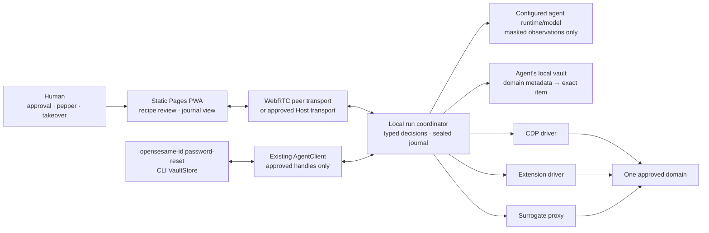

# CUA password reset

Implementation design for [ADR 0213](../adr/0213-cua-password-reset-recipes.md).
It extends the [forgot-password ceremony](forgot-password-ceremony.md). The
implementation is split across the pure grant model, the CUA engine and its
local mock-site suites, and the existing client CLI/PWA approval surfaces.

## 1. Components and trust boundaries

The PWA needs no Identity API, Host, daemon or loopback default. It prepares and
reviews runs offline. A remote coordinator is reached only through an approved
route. ADR 0186's `PeerTransport` carries sealed bounded frames; Host transport
is an alternative adapter, not a credential store. The agent's own local vault
is accessed through existing `AgentClient` and CLI `VaultStore` seams, never by
handing it the PWA vault key. `AgentClient` authorizes closed run operations;
only the trusted CLI adapter opens the agent-dedicated state directory.

Research informs optional adapters and evaluation, not bundled trust:
[trycua/cua](https://github.com/trycua/cua),
[ZJU-REAL/CUA-JEV](https://github.com/ZJU-REAL/CUA-JEV),
[vercel-labs/agent-browser](https://github.com/vercel-labs/agent-browser),
[AI SDK WorkflowAgent](https://ai-sdk.dev/docs/agents/workflow-agent), and
[Vercel Workflow Worlds](https://workflow-sdk.dev/worlds).

## 2. Configuration-time proof

A descriptor contains runtime/model ids, adapter and schema versions, endpoint,
transport custody, observation ceilings and supported decisions. Provider
secrets remain connection references. Executables follow ADR 0006's trusted-exec
and minimal-environment rules. Saving settings runs local fixtures that:

1. send masked structural observations with canaries in every sensitive place;
2. require responses to parse under `additionalProperties: false` into the
   closed decision union;
3. reject script, arbitrary network, secret text, unknown decisions and excess
   string/array/step limits;
4. verify the declared endpoint and model are the ones actually called; and
5. fail if a canary appears in output, screenshots, logs or model state.

The configuration digest covers every field and schema digest. Run approval
names it. Editing runtime, model, endpoint, adapter or schemas requires a new
proof and approval. Validation proves wire shape, not third-party honesty.

## 3. Typed discovery and recipes

The driver enumerates legal candidates from the recipe and masked observation.
The model returns one decision: `act`, `wait`, `handoff`, `finish` or `refuse`.
`act` names a fresh observation id, offered candidate id and its expected-effect
id; it cannot carry script, a selector, URL, shell command or field value. A
candidate names a closed reset action, executor, opaque target and side-effect
class. The driver checks freshness, origin, frame, uniqueness, visibility,
target type, grant and budgets before acting. An independent verifier checks the
new state; a model's `finish` or an executor receipt is not success.

Closed actions include `navigate_entry`, `follow_recovery`, `fill_identifier`,
`request_reset`, `open_mail_link`, `fill_candidate`, `submit_new_password`,
`verify_login` and `close_context`. There is no `evaluate`, `type_text`,
`read_value`, arbitrary HTTP/MCP or shell decision. Page prose is untrusted.
The model cannot approve, expand a grant, change origin, promote a recipe, mark
a submit accepted or reconcile itself.

A recipe is signed, bounded and domain-scoped. It pins entry/action origins,
navigation expectations, target alternatives, form encoding/fields,
transformation proof, mail matcher, composition rules, challenges, verification
and compensation signals. It holds no identifier, account id or secret. Replay
is deterministic and calls no model. Unexpected target, origin, composition or
outcome yields `recipe_drift` before mutation; bounded discovery may then run
under its own grant. After a reset request or password submit, drift enters
reconciliation instead. A distilled candidate needs review, signing and canary
verification before unattended replay.

## 4. Grants and point-of-use custody

Every capability has a separately approved per-run grant with exact action,
exact resource, short TTL and `raw_credential_export: false`. Audience is
`opensesame:password-reset:<run-id>`.

| Capability | Action |
|---|---|
| domain metadata | `password_reset.domain_metadata.list` |
| chosen item | `password_reset.item.use` |
| mailbox | `password_reset.mailbox.read` |
| browser | `password_reset.browser.drive` |
| runtime | `password_reset.runtime.execute` |
| model | `password_reset.model.plan` |
| proxy | `password_reset.proxy.substitute` |
| password production | `password_reset.password.produce` |
| human takeover | `password_reset.human.takeover` |
| reconciliation | `password_reset.run.reconcile` |
| compensation | `password_reset.run.compensate` |

Metadata uses `password-reset:domain:<domain>:metadata`; every later grant uses
`password-reset:domain:<domain>:item:<item-id>`. The PAM response contains only
matching item ids and approved non-secret labels. Selection creates a narrower
item grant; it does not widen metadata. Runtime/model/browser grants also name
the selected item so the run cannot switch accounts. No wildcard, sibling
capability, export, cross-run audience or inactive grant is accepted. Ordinary
`Grant` activity/action/resource checks and exact `Intent` fields are composed;
journal idempotency is not authorization.

The vault facade is the only producer. The default algorithmic method persists
salt/root, rules and counter; `producePassword` returns slotted parts. At each
reset the human supplies a fresh pepper directly to the effect callsite. The
coordinator never chooses it. No pepper, assembled candidate, verifier or
generated line is persisted or logged. The method is sealed before any fill.

Transport selection and custody are fixed for an approved run:

1. **CDP:** preferred control driver; decrypt at `fill_credential(reference,
   selector)` and fill only after all pre-submit checks pass.
2. **Extension:** next control driver; use isolated fill-by-reference after its
   trusted gesture, exact-origin and focus checks, never a page overlay.
3. **Proxy:** last control driver, but preferred secret delivery when its exact
   untransformed-field proof passes. The agent gets a random synthetic value
   with only the same length/character classes. The proxy recognizes one field,
   strips synthetic and places the real candidate there.

Synthetic values are forbidden with CDP/extension. The ADR 0150 exception needs
a canary proving exact action origin/path, one urlencoded or JSON field,
identity encoding and no hash, encryption, encoding, split or second appearance.
The actual intercepted request must satisfy the same shape before egress.
Multipart, transformation and unknown form code refuse substitution. A proven
before-egress abort may use late real CDP fill; uncertain transmission is
`submit_indeterminate`. Responses are scrubbed as ADR 0150 requires.

## 5. Durable execution

The journal is local and sealed through the at-rest port. Records are
append-only, single-writer and value-blind: schema/run/step ids, decision type,
recipe/config/grant/intent digests, effect key, attempt, timestamps, typed
outcome and previous-record digest. Screenshots, raw model state, mail, codes,
links, passwords, peppers and synthetic values are excluded by type.

Each effect follows this order:

1. compare active grant, frozen intent, recipe and configuration digests;
2. append `intent` with stable key `H(run || step || effect)` and commit;
3. perform the bounded effect once;
4. append typed `outcome`, independently verify, then checkpoint and advance.

A completed duplicate returns its outcome. A retryable pre-effect/read-only
failure retries with the same key. A duplicate key with another decision or
digest is `journal_conflict`. Journal write failure stops before the effect.
Stale writers and expired grants cannot dispatch.

| Last durable record | Recovery |
|---|---|
| outcome/checkpoint | reuse it; never repeat the effect |
| intent for local/read-only step | validate and retry idempotently |
| intent for reset request or mail open | reconcile state; do not repeat by default |
| password submit intent, no outcome | `submit_indeterminate`; never blind retry |
| awaiting human | resume same lease and fresh challenge only |
| conflicting records/digests | refuse and require human inspection |

Reconciliation uses fresh login or a recipe-declared read-only account signal.
`accepted` promotes the sealed method; authoritative `not_accepted` closes the
run and requires fresh approval before another request; `unknown` keeps the
candidate and asks for human recovery. A spent link alone does not prove which
password was accepted. Reconciliation grants exclude request and submit.

Compensation is idempotent: revoke grants/surrogates, close browser/transport,
forget handles and temporary files, and restore pre-run local metadata. Remote
rollback is attempted only with a proved, separately approved path and current
password. Otherwise record `compensation_partial`; never claim the site was
restored. Accepted or unknown outcomes preserve candidate access for the human.

## 6. Human takeover

A challenge moves the single browser control lease to the person and stops model
calls. CAPTCHA is solved only by the person. Required mail code, SMS, TOTP,
passkey or other 2FA is entered by the person at the page or trusted extension
UI; the model sees only `challenge_satisfied` or `challenge_failed`. No seed or
WebAuthn credential crosses the run channel. Lease expiry parks the run. A
separately granted read-only mailbox may automate ADR 0191's link-only flow, but
does not authorize autonomous second factors.

## 7. Observation and journal hygiene

Masking occurs before screenshot encoding and model-state persistence. Sensitive
rectangles include password/pepper fields, identifier, mail and reset link/code
regions; pixels are replaced, not CSS-hidden. DOM/AX snapshots remove values and
sensitive attributes. A layout epoch mismatch, unknown sensitive region or mask
failure masks the whole image or refuses capture. Raw screenshots stay volatile.
Persisted model state is bounded typed decisions and redacted structural
summaries, not provider-native hidden state. Journal, receipts and notices use
the shared scrubber and sealed storage.

## 8. Sandbox providers

The bundled CLI runtime allocates its browser through
`@opensesame/agent-sandboxes`, selected with `runtime.provider` in the
reset config (or `--provider` at configure time). The default is `local`:
an ephemeral agent-browser session on the user's device with no account
to provision. `cloudflare` allocates a Browser Run session over REST and
drives it over CDP. `boat` allocates a Boat cloud sandbox — registering
the agent through Boat's auth.md flow when no API key is configured — and
drives a relay agent inside it. `wasm-relay` drives the DOM-level driver
whose network is virtualized through a user-controlled relay
(`OPENSESAME_VNET_RELAY_URL` / `OPENSESAME_VNET_RELAY_TOKEN`), for hosts
with no direct network. Provider API keys are supplied through the environment.
Boat agent claim state is stored as plaintext in a private `0600` file beside
the config, including claim link material and identity assertions; it is not
encrypted. The directory must be owned by the current user and not writable by
other users. Every ancestor must be owned by root or the current user;
ancestors writable by others must also have the sticky bit. Boat state
persistence currently requires POSIX file protections and may be unavailable
in user namespaces that hide root ownership. An interrupted process may leave `.boat-agent-state.lock`; after confirming no
Boat allocation is running, remove that lock to retry. A rotated provider
assertion can be lost if the provider response succeeds but persistence fails
and the process exits. A lost registration or rotation response can also leave
an orphaned registration or prevent recovery; the local lock cannot make the
remote operation atomic.
When allocation itself needs a person (Boat claim, billing checkout), the
provider raises `SandboxClaimRequiredError` and the CLI prints the link
and code instead of inventing a second human channel — the same error
the PWA surfaces through its notifications queue.

## 9. Static PWA and run transport

The static PWA works with no backend. A remote person/driver pair uses the
existing live transport port and WebRTC adapter with sealed pairing, disclosed
routes, consent and ADR 0186 greeting/retry semantics. An optional configured
Host may carry the same closed value-blind messages, never becoming driver,
vault, proxy or screenshot store. ADR 0196's seat lessons apply: empty vault
catalog, seat-bound approval, strict frames, per-call grant recheck and revocation
on seat/session end. Reconnect fetches fresh status; it never replays an effect.

## 10. Implementation and test sequence

1. **Contracts:** replay `spec/conformance/cua-password-reset.json` in Rust and
   TypeScript; registry parity/mirrors; strict decision schemas.
2. **Discovery/replay:** fixtures, prompt injection, bounded decisions,
   deterministic replay, drift fallback and reviewed promotion.
3. **Transports:** CDP/extension/proxy suites, exact-form canaries,
   synthetic-shape tests, point-of-use decryption and last-moment fill.
4. **Durability:** crash at every journal/dispatch boundary, duplicate workers,
   stale writers, idempotent retry, submit-indeterminate matrix, fresh approval
   after `not_accepted`, compensation and journal conflict.
5. **Vault and human:** metadata-only PAM, per-capability/cross-run refusals,
   facade-only production, fresh pepper each reset and no persistence, every
   takeover challenge and lease expiry.
6. **Surfaces:** `opensesame-id password-reset` and PWA reset/settings journeys,
   static offline build, WebRTC and Host walks, no backend/default loopback,
   masked screenshots/model state and secret-canary sweeps.

For WorkflowAgent adapters, bound the loop, serialize reset effects and disable
automatic side-effect retry. For CUA-JEV-style adapters, prove candidate
freshness, guarded execution and independent terminal verification. Research
benchmarks supplement, but never replace, these adversarial and crash oracles.
Security-sensitive slices require `pnpm verify`, relevant audits and the Pages
static/keyboard/mobile gates and evidence for their UI changes.
