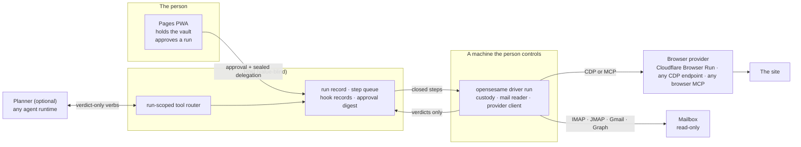

# Forgot-password ceremony

How OpenSesame resets a password the person has forgotten, in a browser it does
not own, without a model, the Host, a log or a provider's record ever being given
the password, the emailed link or the mailbox login.

Decision record: [ADR 0191](../adr/0191-forgot-password-ceremony-remote-browser.md)
(**Proposed**; nothing here is built). Builds on
[web-login rotation](web-login-rotation.md), the
[recipe schema](rotation-recipe-schema.md) and
[ADR 0190](../adr/0190-password-reset-mailboxes-are-vault-items.md), which gave a
login a mailbox. Threat model:
[web-login rotation](../security/web-login-rotation-threat-model.md), whose S1 this
design makes stronger in one case (§8).

## 1. Where it sits



Three parties are kept apart, and the design depends on it:

| Party | Is | Holds | Sees |
|---|---|---|---|
| **Driver** | `opensesame driver run`, a role of the one native binary (ADR 0138) | the identifier, the mailbox login, the candidate, the provider token — in memory, for the run | everything below, and decides what leaves |
| **Browser** | a provider's browser, ephemeral | nothing durable | the page, the reset link, the identifier and the new password as typed (class C, below) |
| **Planner** | any agent runtime, only for a site not yet known | nothing | redacted pages and verdicts |

The Host runs the same hooked runner it runs today (ADR 0159 §15); it queues
closed steps, records verb names and verdicts, and never sees a value. The
extension remains the driver for the person's own tab; this design adds a second
kind of runner, not a second protocol.

## 2. What each party can see

| | Identifier | Mailbox login | Reset link / code | New password | Page content |
|---|---|---|---|---|---|
| Vault (PWA) | yes | yes | no | after write-back | no |
| Host | no | no | no | no | redacted only, via records |
| Driver | yes | yes | yes | yes | yes |
| Planner | **no** (stripped at capture) | no | no | no | redacted |
| Provider, class B (self-hosted) | as typed | no | yes (opened) | as typed | yes |
| Provider, class C (hosted) | as typed | no | yes (opened) | as typed | yes |
| Mail server | no | yes (it is the mailbox) | yes | no | no |

The last two rows are the same on purpose: the difference between B and C is who
operates the browser, not what it sees. That is why C needs consent (ADR 0191 §9).

## 3. The run

### Ordering

`run_forgot_password` is one fixed function, as `run_change_password` is. "Hooked"
means the verb is bracketed by `pre_tool_call` / `post_tool_call` under one
`tool_call.id` (ADR 0159 §10); custody steps are Host-minted handles with
acknowledgement-only outcomes and are not hooked.

| # | Step | Hooked | Checked before it runs | On failure |
|---|---|---|---|---|
| 1 | open session | — | provider health; budget reserved; guardrails = the site's origin set; recording off | park `provider_unavailable` / `quota` |
| 2 | `navigate` recovery entry | yes | origin pinned | park `no_recovery_entry` |
| 3 | `wait_for` identifier field | yes | | park `no_recovery_entry` |
| 4 | `follow` "forgot password" (no recipe: planner names the selector) | yes | selector unique; not in a credential form | park |
| 5 | `fill_identifier` | yes | reference resolves; field is a text or email input | park |
| 6 | `submit` (the request); **T0 := now** | yes | one per site per cooldown | park `rate_limited` |
| 7 | `wait_for` the site's acknowledgement | yes | corroborating only | continue; the mail decides |
| 8 | close session (two-session shape) | — | | |
| 9 | `await_mail` | yes | after T0, in the window, sender and matcher pinned | park `mail_timeout` / `mail_ambiguous` |
| 10 | open session | — | guardrails now include any link-tracking host the recipe names | |
| 11 | `open_mail_link` | yes | https, no userinfo, origin in the allowed set | park `link_origin_refused` |
| 12 | `wait_for` the new-password field; `enter_mail_code` if the site wants a code | yes | | park |
| 13 | `generate_candidate` | **no** | only after 11 and 12 succeeded | |
| 14 | `seal_candidate` | **no** | **waits for the backup acknowledgement** | park (nothing typed yet) |
| 15 | `fill_credential` new, then confirm | yes | `candidate:<id>` only for this run and origin | park |
| 16 | `assert_present` both fields | yes | **fail closed**; the critical span starts | park |
| 17 | `submit` | yes | at most once (a marker is written before it) | indeterminate → `ReconciliationRequired` |
| 18 | `verify_login` in a fresh context | yes | the only trusted success signal | indeterminate → `ReconciliationRequired` |
| 19 | `promote_candidate` | **no** | refused until sealed | |
| 20 | close session; commit the budget; write the receipt | — | | |

Nothing interrupts 16–17. For this legacy, unjournalized runner a crash anywhere
is **never resumed** (ADR 0159 §15): whether the submit reached the site is
unknown, and the reset link is single-use, so the reaper parks the run, the
candidate is kept, and the person starts a new one. ADR 0213 amends this only for
the new CUA runner's durable intent/outcome journal: completed checkpoints may be
reused and safe steps retried, while an uncertain submit enters reconciliation
and is never blindly replayed. Because step 14 precedes step 15, the worst
outcome of a failed run is the status quo, not a lockout the run created.

### Session shape

A reset is two short interactions with a long wait between them. Billing is per
session second, so:

- **Two sessions (default).** Steps 1–7, close, wait for the mail with nothing
  open, steps 10–20 in a fresh session. A typical run is two sessions of about
  40–90 seconds each: roughly one and a half to three browser-minutes, which at
  Cloudflare's documented $0.09 an hour beyond the included hours is under half a
  cent, and fits the free plan's ten minutes a day a few times over (an estimate,
  to be measured in the Phase 0 spike).
- **One session.** For a site that binds the reset token to the browser that
  asked. The recipe says so (`session.shape: "one"`); the session is held open
  through the wait by a heartbeat, sized below the provider's idle timeout (60 s
  for Cloudflare), and the budget reservation is the whole wait.

### Park reasons

A fixed vocabulary, each with whether the site was touched. None carries a
message from the page or the mail.

`no_recovery_entry` · `challenge` · `no_such_account` · `rate_limited` ·
`mail_timeout` · `mail_ambiguous` · `link_origin_refused` · `provider_unavailable`
· `quota` · `composition_unknown` · `driver_lost` (not touched) ·
`submit_indeterminate` · `verify_indeterminate` (touched → reconcile).

## 4. The verbs

`BrowserTransport` keeps its eight. `ResetTransport` is the sibling that carries
the five a reset adds, in the way `CeremonyTransport` carries the capture verbs
(ADR 0159 §10).

| Verb | Arguments | Pinned (`Authority`) | Outcome |
|---|---|---|---|
| `fill_identifier` | `identifier_ref`, `selector` | the reference | `filled` |
| `follow` | `selector` | the origin set | `navigated{allowed}` |
| `await_mail` | `mailbox_ref`, `matcher_ref`, `deadline` | both references, the window | `arrived{handle}` · `absent` · `timeout` |
| `open_mail_link` | `handle` | the handle, the origin set | `navigated{allowed}` |
| `enter_mail_code` | `handle`, `selector` | the handle | `filled` |

No verb returns a link, a code, an address, a subject or a body. `MailHandle` is
an opaque, run-scoped name; the driver resolves it.

### What each is, in CDP

| Verb | CDP |
|---|---|
| `navigate`, `open_mail_link` | `Page.navigate`; `Page.frameNavigated` to check the origin; `Fetch.requestPaused` to refuse an off-set document where the provider does not |
| `wait_for` | `DOM.querySelector` / `Accessibility.queryAXTree`, polled; no page script |
| `fill_identifier`, `fill_credential`, `enter_mail_code` | `DOM.focus`, then `Input.insertText` (ADR 0076 §1) |
| `follow`, `submit` | `DOM.getBoxModel` and `Input.dispatchMouseEvent`, a real click, not a script's `click()` |
| `read_dom_redacted` | `Accessibility.getFullAXTree` or `DOMSnapshot.captureSnapshot`, then **the driver strips** every input's value, the identifier and any live candidate before anything leaves the driver |
| `screenshot_redacted` | `Page.captureScreenshot`, then the driver masks sensitive boxes (computed for the same layout epoch) before the image leaves the driver |
| `verify_login` | a fresh context: `Target.createBrowserContext` where available, otherwise a new session |

### What each is, over an MCP server

OpenSesame is the MCP **client**; the planner never holds the server's tools. For
Playwright MCP, whose tool list is documented:

| Verb | Tool |
|---|---|
| `navigate`, `open_mail_link` | `browser_navigate` |
| `wait_for` | `browser_wait_for` (`text`, `textGone`, at most 30 s) and `browser_snapshot` |
| `fill_*`, `enter_mail_code` | `browser_type` (`target`, `text`) |
| `follow`, `submit` | `browser_click` |
| `read_dom_redacted` | `browser_snapshot`, then the driver strips |

`browser_evaluate` and `browser_run_code_unsafe` are not on the allow-list. Two
facts about this path are stated rather than hidden: `text` is an argument, so the
password passes through the MCP server process (custody `input` at whoever runs
it); and the server's own `--allowed-origins` and `--secrets` options are
documented as not a security boundary and a convenience respectively, so the
driver relies on neither. Chrome DevTools MCP's tool names are to be taken from its tool reference
in the Phase 0 spike: Cloudflare's page documents the WebSocket flags for
connecting it (`--wsEndpoint`, `--wsHeaders`), and its own README, as read, does
not list the tools.

### Wire and code touchpoints

Each of these hard-codes the closed step set today and changes together, with a
drift test requiring every `StepRequest` variant to have a table entry:
`crates/rotation-web` (`extension.rs`, `hooks/{args,authority,verbs,transport}.rs`,
`executor.rs` for the ordering, `ActionStep` and `BlockedReason`),
`crates/gateway` (`routes/agent_runs/outcome.rs`, `web_login/control.rs`,
`spec/openapi/host-api.yaml`), the TypeScript wire
(`packages/api-client/src/agent-runs.ts`, `agent-run-wire.ts`) and the preset
(`spec/agent-hooks/presets/`). The step and record counts that tests pin (a
change run is 11 steps and 8 hooked records) are different for this run kind.

## 5. The mailbox

- **Read-only, enforced in the reader.** IMAP `EXAMINE`; JMAP with no write
  scope; the `gmail.readonly` and `Mail.Read` scopes the connector catalog lists
  for `google` and `microsoft`. The reader has no delete, move, flag or mark
  call to reach. The site's "your password was changed" notice therefore still
  reaches the person, and a stolen driver cannot clear its tracks.
- **One mailbox per delegation.** The delegation names it; the matcher names the
  senders and the link's shape. A mailbox is an `email-account` vault item
  (ADR 0190) or a `ConnectionRef` to a Gmail or Graph connection.
- **Accepted mail:** received after `T0`, within the recipe's window (default 15
  minutes), from a pinned sender domain, matching the subject hints, carrying
  exactly one link or code that fits the pinned shape. The first such message
  wins. Two candidates is `mail_ambiguous`; the run parks rather than guessing.
- **The link:** `https`, no userinfo, host in the allowed set. Mail from sites
  that track clicks carries a redirector's URL, not the site's; a recipe lists
  the redirector hosts it has reviewed (`mail.deliver.host_set`), and an unlisted
  one is `link_origin_refused`. The link is held in memory, used once, dropped.
- **A code** (some sites email six digits): matched by the recipe's pattern,
  typed by `enter_mail_code`, never returned.

## 6. The browser provider contract

A provider is `spec/browser-providers/<id>.json` plus an adapter, consumed by
both planes with a drift test in each (ADR 0139). The contract: open an
ephemeral, isolated browser; drive it with the verbs; confine it to an origin set;
report what it can enforce; meter it; close it.

```jsonc
{
  "schema_version": 1,
  "id": "cloudflare-browser-run",
  "kind": "cdp",
  "connection": { "catalog_id": "cloudflare", "operation": "browser_run.session" },
  "session": {
    "open":  { "method": "POST", "path": "/client/v4/accounts/{account_id}/browser-run/devtools/browser",
               "query": { "keep_alive": "{ttl_ms}" }, "body": { "guardrails": { "allowedDomains": "{hosts}" } } },
    "attach": "webSocketDebuggerUrl",
    "auth":  { "header": "Authorization", "scheme": "Bearer" },
    "close": { "method": "DELETE", "path": ".../devtools/browser/{session_id}" }
  },
  "confinement": "enforced",
  "limits": { "hosts_max": 50, "keep_alive_ms": { "min": 10000, "max": 600000 }, "idle_ms": 60000 },
  "recording": { "default": "off", "refuse_if_present": true },
  "custody": ["input"],
  "handoff": { "commands": ["Cloudflare.handoff"], "events": ["Cloudflare.handoffComplete"] },
  "metering": { "unit": "browser_second", "usage_api": false },
  "verified_on": "2026-10-11"
}
```

The values come from Cloudflare's documentation as read on 2026-10-11 and are
marked `verified_on`, because that documentation disagrees with itself in places
(§10).

### Cloudflare Browser Run, as documented

| | |
|---|---|
| Endpoint | `wss://api.cloudflare.com/client/v4/accounts/{id}/browser-run/devtools/browser`, or `POST` the same path for a session, then `webSocketDebuggerUrl` |
| Auth | `Authorization: Bearer`, token permission "Browser Rendering – Edit" (the REST guardrails page says Write). Not a query string. A page or an extension cannot set it on a WebSocket, so the driver is native |
| Lifetime | idle timeout 60 s; `keep_alive` extends it, up to 10 minutes on the limits page and 20 on the CDP page |
| Confinement | `guardrails.allowedDomains`, at most 50 hostnames, one `*` each, fixed for the session, set at creation; an off-list request returns 403 with `cf-mitigated: guardrails`. Page dependencies must be listed; `allowedDomainSets: ["common-cdns"]` covers the usual ones. WebSockets, redirects and DNS are not addressed |
| Recording | off unless `recording=true` at creation; cannot be turned on later; inputs masked; 30-day retention if on |
| Handoff | `Cloudflare.handoff` and `Cloudflare.handoffComplete` (July 2026); Live View for any session |
| Price | Workers Paid: 10 browser hours a month included, then $0.09 an hour; Free: 10 minutes a day; Browser Sessions also charged for concurrency (10 included on paid, 3 free) |
| Usage | per day in seconds, summed, rounded to the nearest hour; **no usage or balance API is documented**; the dashboard shows it |

### The first three providers

| Provider | Kind | Confinement | Notes |
|---|---|---|---|
| A local or self-hosted Chromium (`--remote-debugging-port`) | cdp | enforced by the driver (`Fetch`) | **class B**; the first one built, and the one recommended |
| Cloudflare Browser Run | cdp | enforced by the provider | **class C** |
| An MCP server (Chrome DevTools MCP, Playwright MCP) | mcp | attested | custody `input` at the MCP server; either class by who runs it |

### Conformance

A provider is selectable only after it passes, against a fixture site and a mail
catcher on loopback: an ephemeral context carries nothing from the last run; an
off-set request is blocked or detected; typing leaves no value in a snapshot the
driver reads; recording is off and no recording artifact is returned; a closed
session is gone; a heartbeat holds a session and its absence ends one; quota and
unavailability map to their typed errors; usage is reported. The suite cannot
prove a hosted provider's internal retention, and the consent text does not claim
it can.

## 7. The recipe

A recipe gains one closed optional member, `forgot_password`, with the same rules
as the rest of the schema: selectors and shapes, no value, identical for every
user of the site, 16 KiB bound, signed, canary-verified before an unattended run.
The identifier is a reference at run time, never in the recipe.

```jsonc
"forgot_password": {
  "entry":      { "kind": "url", "url": "https://example.com/account/forgot" },
  "identifier": { "target": { "css": "#email", "role": "textbox", "name": "Email" }, "kind": "email" },
  "request":    { "target": { "css": "button[type=submit]" },
                  "expect": [ { "kind": "text_present", "value": "If an account exists" } ] },
  "session":    { "shape": "two" },
  "mail": {
    "from_domains": ["example.com"],
    "subject_hints": ["reset", "password"],
    "deliver": { "kind": "link", "host_set": ["example.com"], "path_regex": "^/reset/[A-Za-z0-9_-]+$" },
    "window_s": 900
  },
  "reset": { "new": {}, "confirm": {}, "submit": {}, "composition": {} },
  "hosts": ["example.com", "*.example.com"],
  "cooldown_s": 900
}
```

**Distillation.** A run on an unknown site is planned (§6 of the ADR); when it
succeeds, the driver writes a candidate `forgot_password` section from what it
resolved — selectors and expectations only — and the next run on that site is
deterministic. A recipe that has not completed a real round trip is a `candidate`
and is never replayed unattended; the existing trust ladder applies unchanged.

## 8. Abuse cases

| Threat | Control | Test anchor |
|---|---|---|
| The link, a code or the candidate reaches a planner, the Host, a log or a record | no verb returns them; handles are opaque; redaction at capture | canary property test: plant strings, assert absent from records, outcomes, logs, notices, receipts and the planner transcript |
| A link to another origin (phishing, a lookalike, an unreviewed tracker) | origin-set check before navigation; tracker hosts named in the recipe | hostile-mail fixtures: lookalike host, userinfo, `http`, a redirect chain |
| Unsolicited reset mail used to start a run | a run starts only from a person's approval; the scan announces only | scan test: mail arrives, nothing is enqueued |
| Stale or replayed mail | after `T0`, window, one message wins | `mail_ambiguous` and window tests |
| The mailbox login stolen from the driver | read-only reader; per-delegation, per-origin scope; delegation TTL and revocation; sealed to the driver's key | reader has no write call (type-level); revocation test |
| The provider keeps or steals the new password | class C is off by default, consented per provider and site, receipt-recorded; class B recommended | consent receipt binding test |
| The provider records the session | recording never requested; a returned recording refuses the run | conformance |
| The provider lies (reports "present" or "logged in") | **not defended**; no integrity claim for class C (ADR 0191 §9.5) | documentation test: copy never says "attested" for class C |
| A hostile page instructs the planner | page text is `UntrustedText`; the planner's output is a selector the driver validates; `navigate` is origin-pinned | prompt-injection fixtures |
| The planner picks the wrong field | the new-password field must be a visible, unique password input beside its confirmation; presence is asserted fail-closed | executor tests |
| A candidate lost after the site accepted it | seal and backup acknowledged before anything is typed | `assert_source_order` extended |
| A placeholder submitted as the password | fail-closed presence assertion immediately before submit | executor tests |
| The submit pressed twice | a marker is written before it; a second claim answers `failed(transport)` | driver tests |
| A run loops and spends credits | per-run cap; session TTL; monthly cap; no retry on `quota`; one request per site per cooldown | budget property test (reserve, commit, release never exceed the ceiling) |
| Email bombing a person | cooldown per site, daily cap | rate tests |
| A silent move to another provider | no automatic fallback, ever | adapter selection test |
| A challenge treated as an obstacle | park, hand to the person (Live View, `Cloudflare.handoff`); no solver | ADR 0076 §3.4 |
| A crash mid-run, resumed into a spent link | never resumed; reaper parks; candidate kept | chaos test: kill the driver between 14 and 17 |
| An MCP tool runs page script | allow-list excludes evaluate-style tools | adapter test |
| An organization's account reset through a hosted browser | policy `allowed_sandbox_classes`; managed default A and B only | policy test |

**The residual that gets stronger.** ADR 0076 §7 says the sandbox holds a session
and could take the account without learning the password. In class C the
provider's operator also holds the password just typed and the link just opened.
Nothing here mitigates that; the controls are that the person chose the provider,
that their own account pays for it, that the consent said so, and that class B is
offered first.

## 9. Phases and gates

Each gate is the repository's own: tests green, `pnpm verify`, and the audits that
apply (`pnpm audit:daemon-deps` unchanged, `pnpm audit:plugin-boundary`, Clippy).

| Phase | Delivers | Exit |
|---|---|---|
| **0 — Spikes** (no acceptance needed) | **Cloudflare:** create a session over REST with guardrails, attach with the bearer header, and record which CDP domains answer (`Fetch`, `Input.insertText`, `Accessibility`, `Target.createBrowserContext`, `DOMSnapshot`), the real `keep_alive` ceiling and idle behaviour, the `Cloudflare.handoff` shape, session close reasons. **MCP:** Playwright MCP and Chrome DevTools MCP as clients; confirm tool names; prove the allow-list. **Mail:** the redirect chains in twenty real reset emails. **Sessions:** which of twenty sites bind the token to the browser | a findings page, draft provider profiles, a go or no-go on two-session as the default |
| **1 — Verbs and the spine** | `ResetTransport`, the steps, hooks, `run_forgot_password`, a fixture site and mail catcher, a local Chromium over CDP as the first provider (class B) | the canary property tests and the extended `assert_source_order` green with no third party involved |
| **2 — Mail** | the read-only reader (IMAP, JMAP, POP3; Gmail and Graph by `ConnectionRef`), the matcher, the link policy | hostile-mail fixtures green; the reader has no write call |
| **3 — The driver** | `opensesame driver run`, the delegation, the claim route for a native runner, the at-most-once marker, a sealed credential store, **and the write-back decision (Q1)** | chaos test green; the daemon's dependency budget untouched |
| **4 — Providers and consent** | the provider port, the generic CDP and Cloudflare and MCP adapters, the conformance suite, `agents.remote-browser`, the consent sheet, the budget, registry entries, the Pages panel and its tutorial, the threat-model addendum | conformance green for each provider shipped; before/after evidence; the ADR accepted for what is built |
| **5 — The planner** | the run-scoped tool router, the `forgot-password` hook preset, selector validation, distillation, teaching by handoff | a planned run leaves a recipe that replays deterministically |
| **6 — Standing approvals** | per-site unattended runs behind step-up, the passkey offer (T0), `allowed_sandbox_classes` | policy tests green |

## 10. Open questions

1. **Where the new password lands.** The shipped change ceremony ends at a
   driver-held store and a backup; it does not write the person's vault. A reset
   makes the gap matter, since the old password is gone. Options: (a) a **sealed
   inbox** the vault publishes a public key for and consumes on unlock — the
   shape secret drops already have, without a link; (b) a secret drop whose key
   reaches the person through their authenticated session; (c) leave it in the
   driver store and tell the person. (a) is recommended. It must be settled
   before Phase 3, and it is a vault-side change with its own ADR.
2. **Who plans.** The PWA tab through the model plane, the person's own agent over
   MCP, or a worker that calls a configured model endpoint over HTTPS with no SDK
   (ADR 0076 §8 keeps an LLM dependency out of every shipped binary). The tab
   needs to stay open; the others need a role or a bridge. Phases 1–4 need no
   planner.
3. **A person with no native binary.** The design says no cloud driver in v1: it
   would put the secrets with a second third party. A later option, separately
   consented.
4. **What Cloudflare's documentation leaves open:** the header or parameter that
   sets guardrails on a *CDP* acquire (the REST body is documented; the design
   uses REST then `webSocketDebuggerUrl`); the `keep_alive` ceiling (10 or 20
   minutes); whether `Target.createBrowserContext` and the `Fetch` domain are
   available; and the URL path (`browser-run` on most pages, `browser-rendering`
   on the MCP page). Each is a Phase 0 finding, not an assumption.
5. **Relying-party terms.** Automated access to a password-reset page may breach a
   site's terms (threat model S4). The position is unchanged — honour the
   well-known URL, rate-limit, never evade — and the product copy should say that
   a blocked run is a handoff, not a failure.

## References

- Cloudflare Browser Run, read 2026-10-11:
  [CDP](https://developers.cloudflare.com/browser-run/cdp/),
  [session management](https://developers.cloudflare.com/browser-run/cdp/session-management/),
  [MCP clients](https://developers.cloudflare.com/browser-run/cdp/mcp-clients/),
  [guardrails](https://developers.cloudflare.com/browser-run/features/guardrails/),
  [session recording](https://developers.cloudflare.com/browser-run/features/session-recording/),
  [limits](https://developers.cloudflare.com/browser-run/limits/),
  [pricing](https://developers.cloudflare.com/browser-run/pricing/),
  [changelog](https://developers.cloudflare.com/browser-run/changelog/).
- [Playwright MCP](https://github.com/microsoft/playwright-mcp) and
  [Chrome DevTools MCP](https://github.com/ChromeDevTools/chrome-devtools-mcp).
- In this repository: ADR 0076, 0081, 0159 (§10, §15, §16), 0190; the
  [recipe schema](rotation-recipe-schema.md); the connector catalog row
  `cloudflare` in `spec/connectors/catalog.json`.
