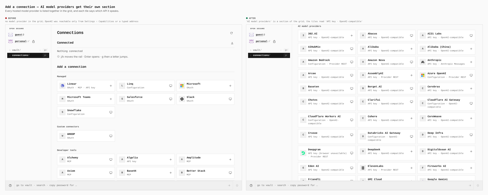
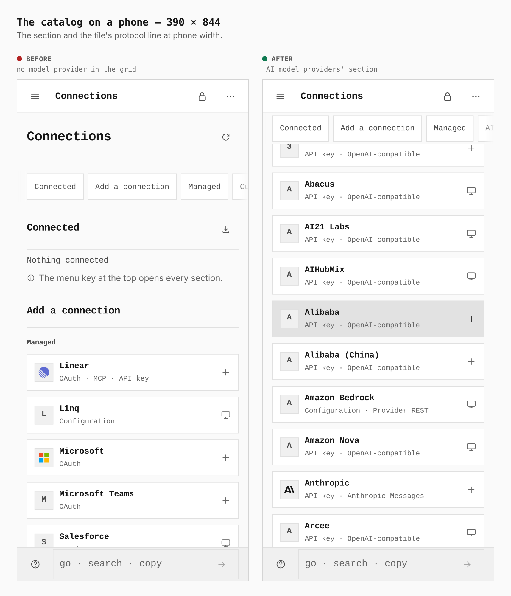
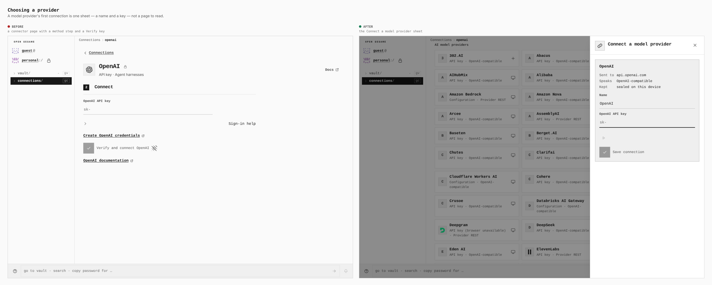
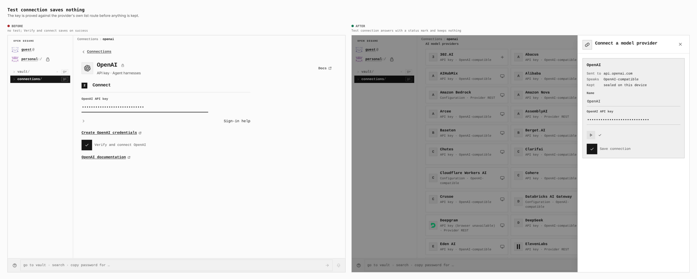
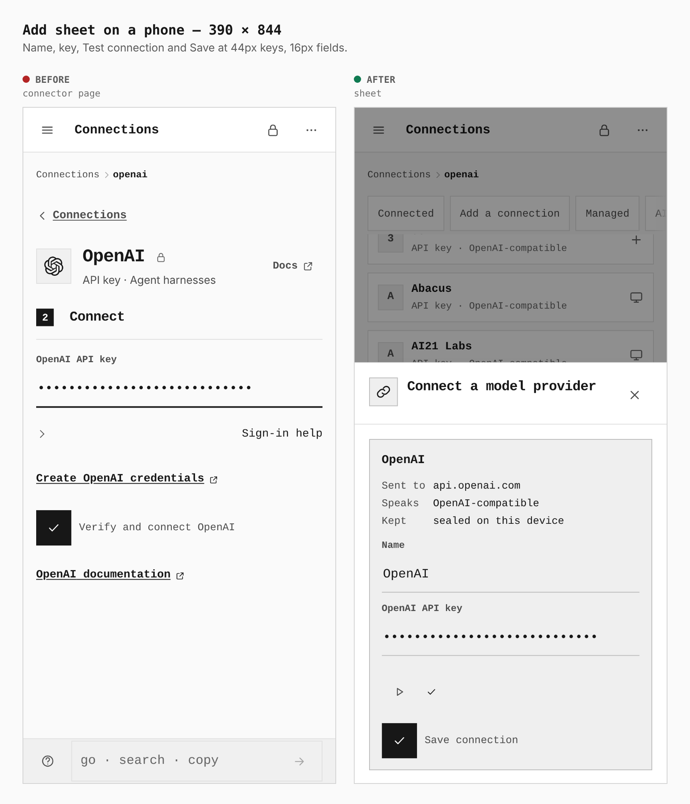
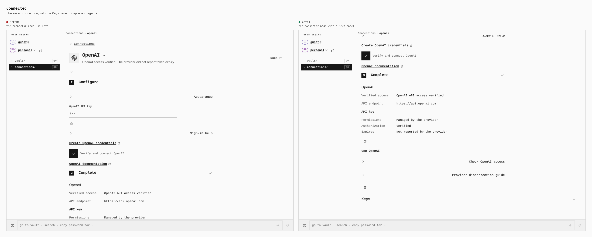
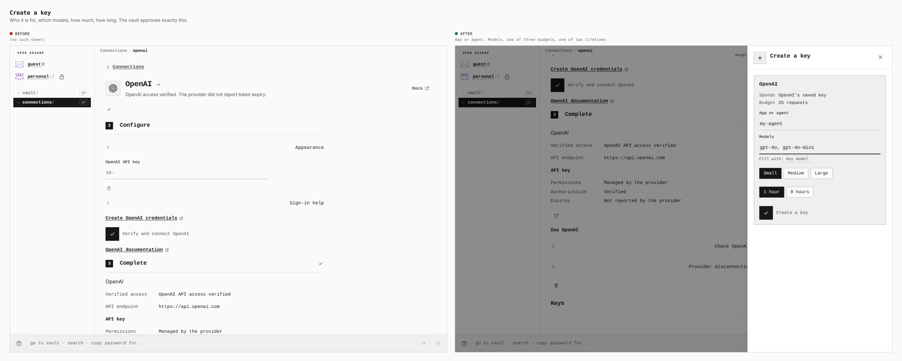
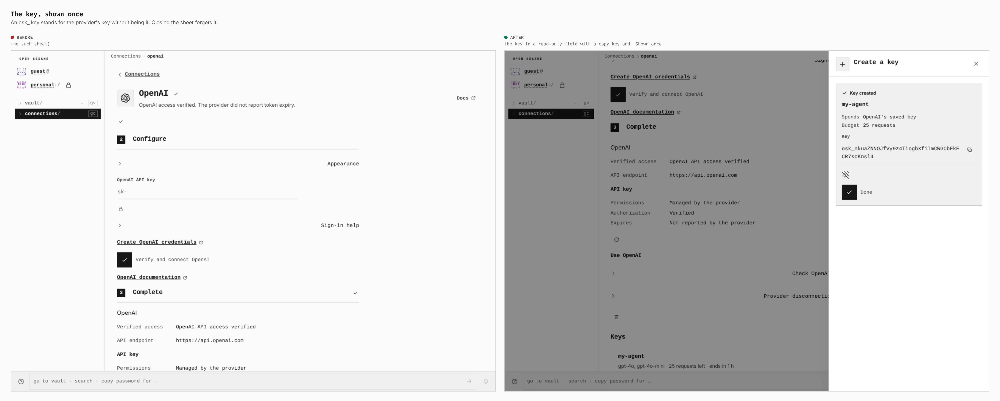
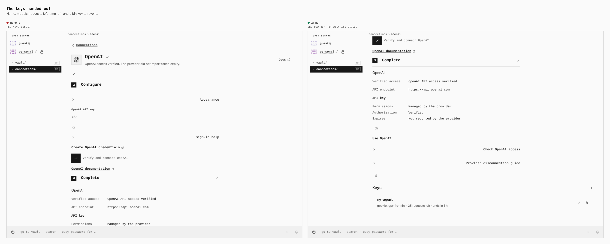
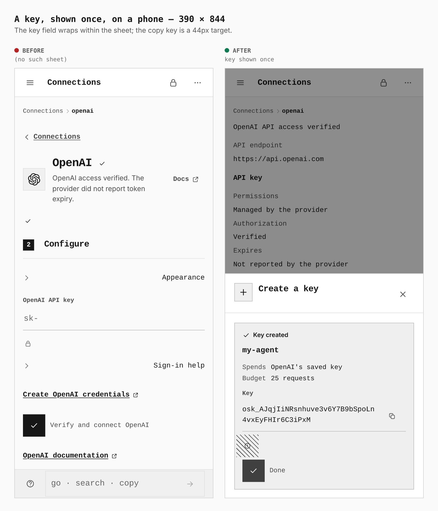

# AI model providers: their own section, a one-sheet add, and keys for apps

Before/after from two real builds: `main` and this branch, the same journey
(`journey.json`) at 1280 × 900 and 390 × 844, measured in the browser. The
before is the base build in its own worktree, never memory. The only thing
placed by the journey is the provider's answer to the one request the Add sheet
makes (`stubModelProvider`: an empty `GET /v1/models` with CORS headers, the way
the Pages tests answer it); the sheet still sends it, reads it and draws what it
makes of it. The key typed into the sheet is a placeholder, not a credential.

Decision: [ADR 0188](../../adr/0188-model-keys-and-token-exchange.md).

## The catalog

| 1280 × 900 | 390 × 844 |
|---|---|
|  |  |

The grid held 160 tiles and no model provider (OpenAI was reachable only from
Settings › Capabilities or a typed address); it holds 240, the 80 more being an
**AI model providers** section listed by name. Each tile says which API it
speaks (the OpenAI tile reads `API key · OpenAI-compatible`), and a provider a
browser cannot reach yet says so, as every other tile does.

## Adding one

| 1280 × 900 |
|---|
|  |
|  |

A connector page with a method step and a **Verify and connect** key becomes one
sheet: the host the key is sent to (`api.openai.com`), the API it speaks, where
it is kept, a name and the key. **Test connection** sends the key to the
provider's list route and keeps nothing (a status mark answers); **Save
connection** proves the key first and then seals it. On a phone:

| 390 × 844 |
|---|
|  |

## Keys for apps and agents

| 1280 × 900 |
|---|
|  |
|  |
|  |
|  |

A connected provider's page gains a **Keys** panel (the base has none, so its
"before" is the page as it was). Creating a key is a sheet: who it is for, which
models (or **Any model**), one of three budgets, one of two lifetimes. The
vault's own `manage_grants` check runs, the approval is bound to the digest of
exactly what the sheet shows, and the key is shown once. The list afterwards
reads `my-agent · gpt-4o, gpt-4o-mini · 25 requests left · ends in 1 h`, with a
bin key to revoke it.

| 390 × 844 |
|---|
|  |

Measured: the key (47 characters) is 318 × 42px on desktop and wraps to two
lines at 265px on a phone; nothing is clipped. The copy key is 24 × 24px under a
mouse and 44 × 44px on a phone.

## What is not pictured

- The keys cannot be spent from another origin yet (ADR 0188 §9); there is
  nothing to show for that. The exchange and the spend are covered by the
  conformance vectors (`spec/conformance/model-key-exchange-vectors.json`) and
  the test suites, not by a screenshot.
- 14 of the 84 model providers cannot be given keys (five `rest_json` providers
  and nine whose endpoint is the person's own); their pages carry no Keys panel.
