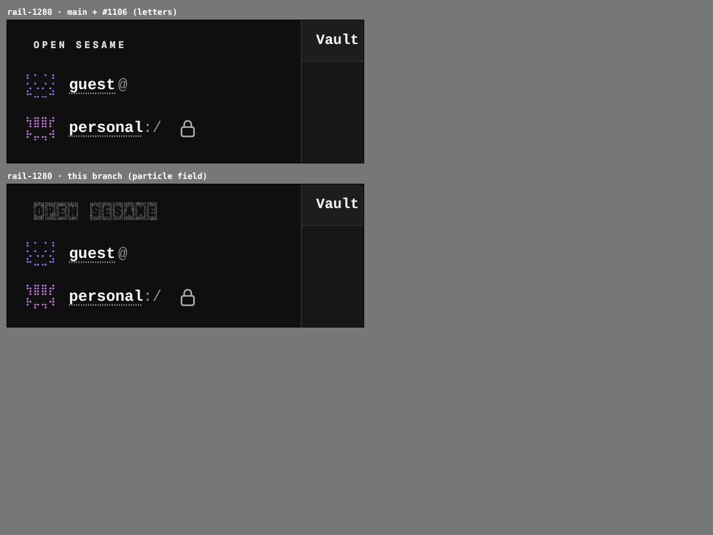
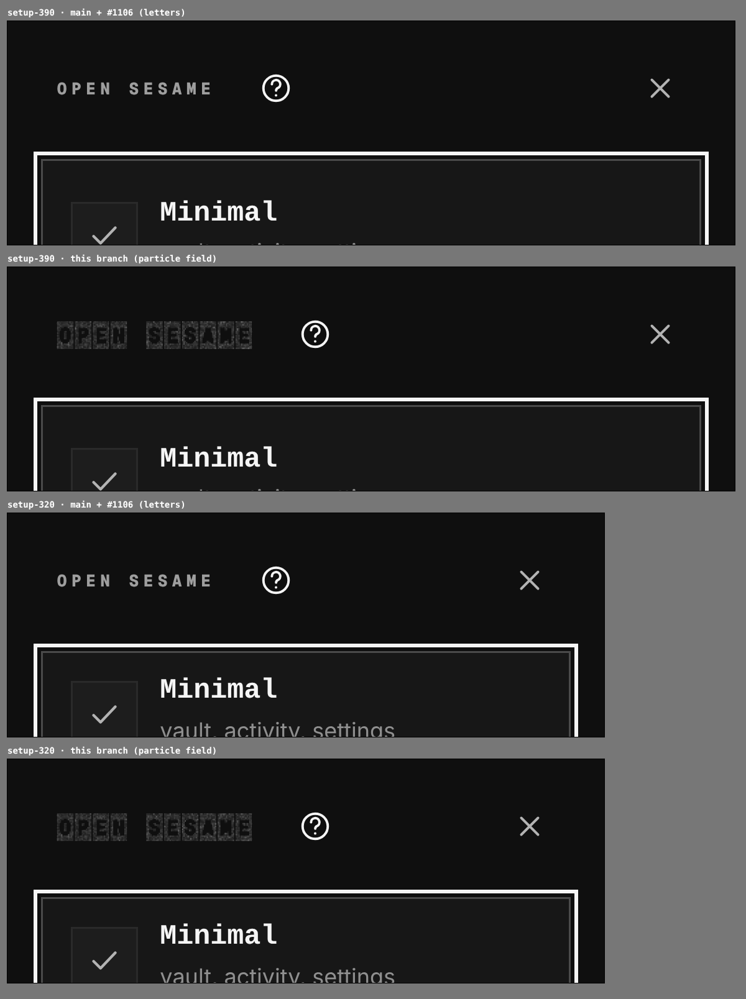
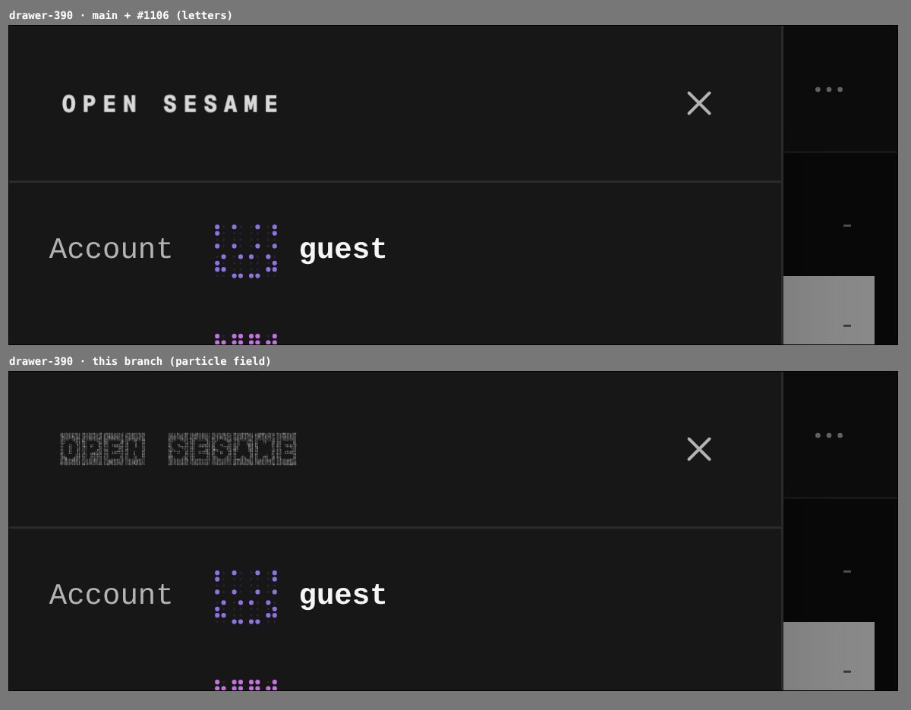

# The rail, the drawer and the setup bar draw the particle field

The chrome drew the wordmark as letters in ink with no plates: 12px in the
rail, 13px in the setup bar, 15px in the phone drawer. That rendering is
rejected. The particle field is now the wordmark's only rendering, with 16px
as its floor: under a 16px em a plate loses most of its cut-out, so a smaller em
is laid out at 16. The rail, the drawer and the setup bar draw the field at
16px. It keeps shimmering there, as on a gate's hero. A wordmark that arrives
already revealed skips the decrypt but still shimmers; only reduced motion holds
it still.

The captures come from two real builds of the same harness: `main` with
#1106 (`673c0898`) and this branch. Each surface is reached the same way, in
dark mode, five seconds after arrival, at the device's own pixel ratio (2 at
1280, 3 on a phone):

- the rail after a local-only seal;
- the setup bar after "Set up your own";
- the drawer after "Sections".

## Rail, 1280

## Setup bar, 390 and 320

## Drawer, 390

## Measured in the browser

The wordmark's computed em and canvas size. "Shimmering" means the canvas
changes between two frames 700ms apart, five seconds after arrival.
"Overflow" is how far the bar's furthest button reaches past the viewport.

| Surface | `main` + #1106 | this branch |
|---|---|---|
| Rail, 1280 | 12px em, 89×19px, still | 16px em, 116×23px, shimmering |
| Setup bar, 390 | 13px em, 96×20px, still | 16px em, 116×23px, shimmering |
| Setup bar, 320 | 13px em, 96×20px, still, overflow 0 | 16px em, 116×23px, shimmering, overflow 0 |
| Drawer, 390 | 15px em, 109×22px, still | 16px em, 116×23px, shimmering |
