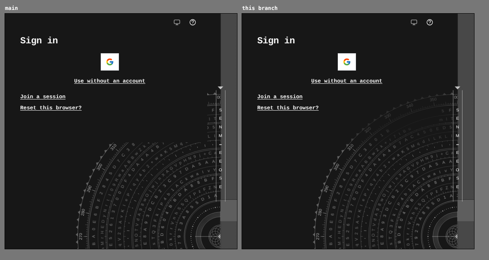
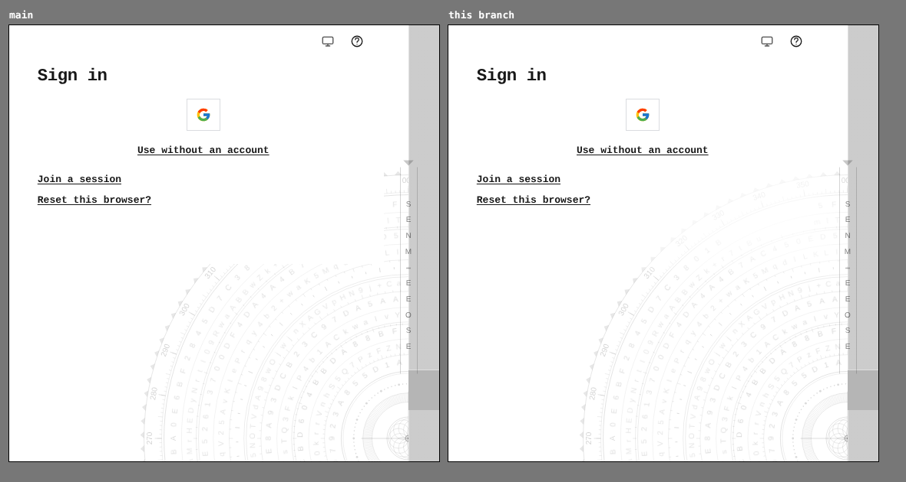
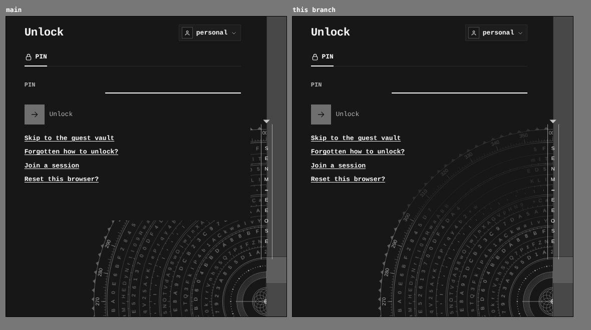
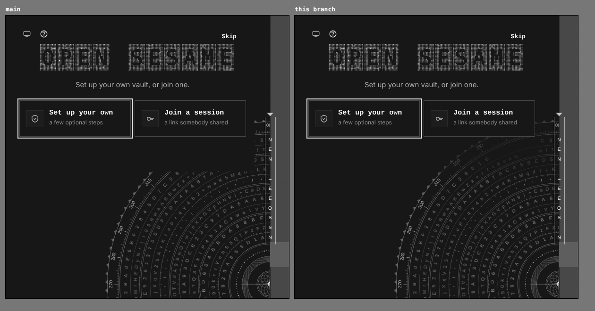
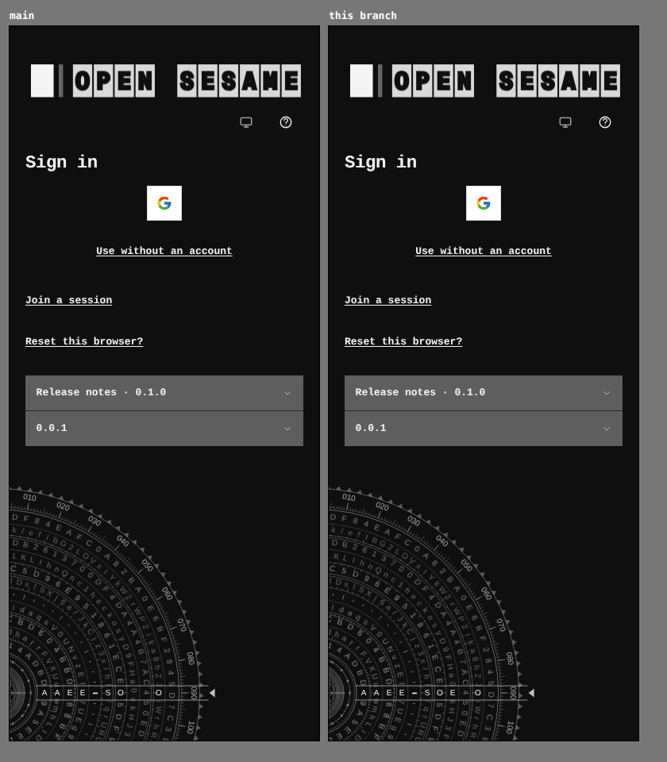

# The cipher dial carries on behind the gate's card

The cipher dial's rings were masked out under every lock-v5 card with a hard rectangle: the card's box plus 22px and 40px of padding, cleared to nothing. On the sign-in screen, where the card is short, the cut reads as a dark box sitting over the dial and slicing its rings in a straight line about 40px under the last link. The same cut was on the front door and the unlock gate.

The rings now fade under the card instead of being cut: a feathered band of 56px brings them from full strength down to 30% under the card itself (`QUIET_RING_KEEP`, `CipherDial/mask.ts`), so the dial reads as one object behind the gate and the card's text still reads over it. The cipher key's overlay keeps its hard clear on a phone, so its readout never sits under text.

Two real builds, `main` at `dcc1557a` and this branch, same harness, the same steps for each screen. Crops are at 1:1.

## Sign-in, 1280 × 900, dark

## Sign-in, 1280 × 900, light

## Unlock, 1280 × 900, dark

## Front door, 1280 × 900, dark

## Sign-in, 390 × 900, dark

On a phone the dial sits below the card, so nothing changes there.

## Measured in the browser

The ring layer's mask, read back from the page at three points on the card's centre line (1 keeps a ring pixel, 0 erases it):

| Point | `main` | This branch |
|---|---|---|
| Under the card | 0 | 0.30 |
| 20px below the card | 0 | 0.37 to 0.41 |
| 70px below the card | 1 | 1 |

The same values on sign-in, the front door and unlock, at 1280 light and dark and at 390.
