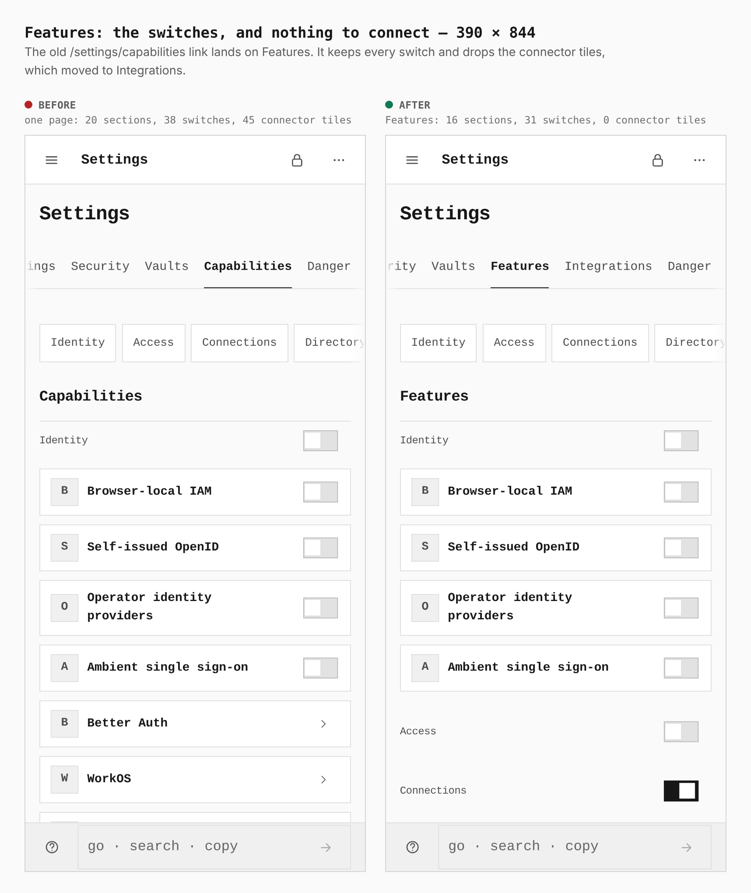
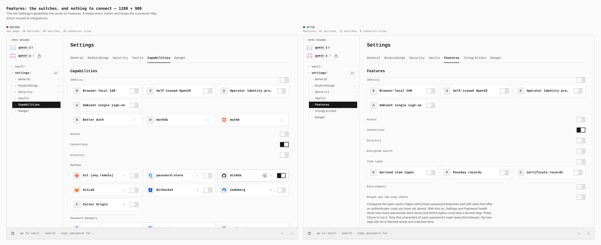
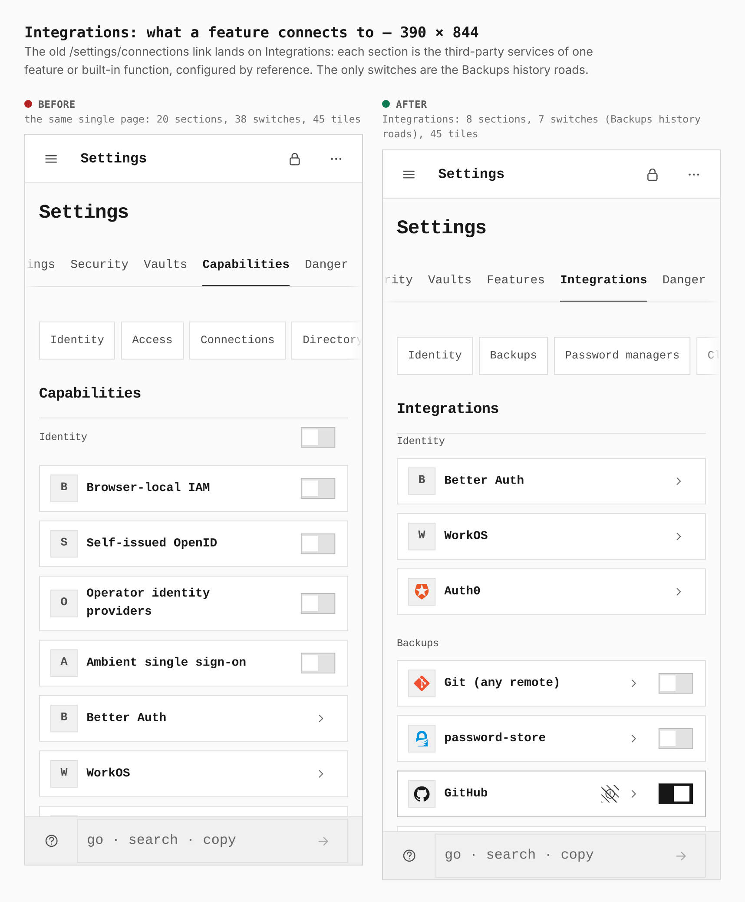
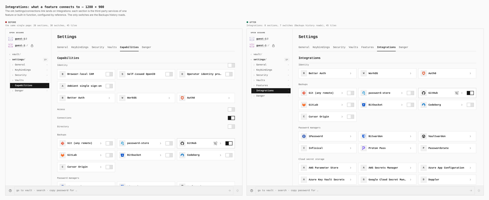
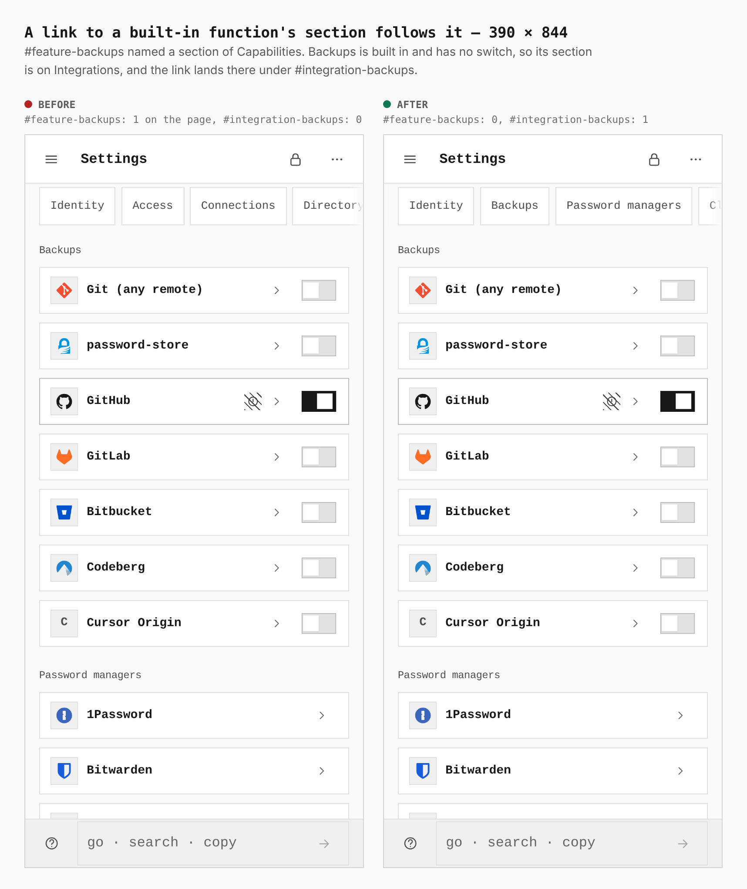
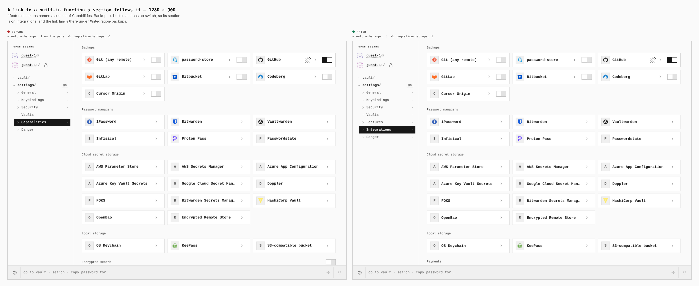
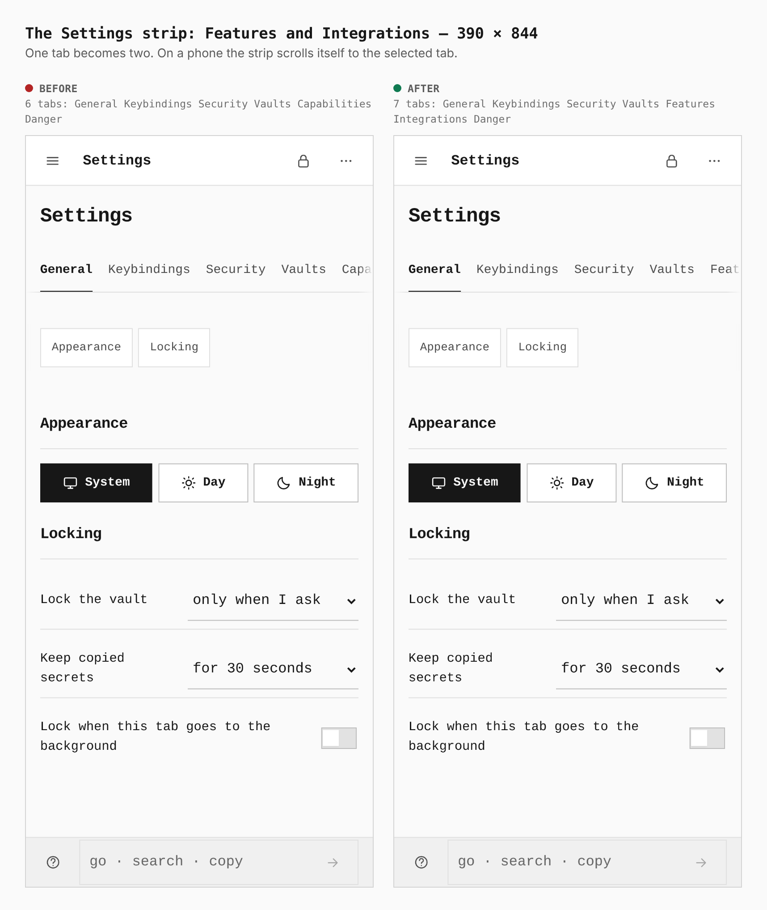
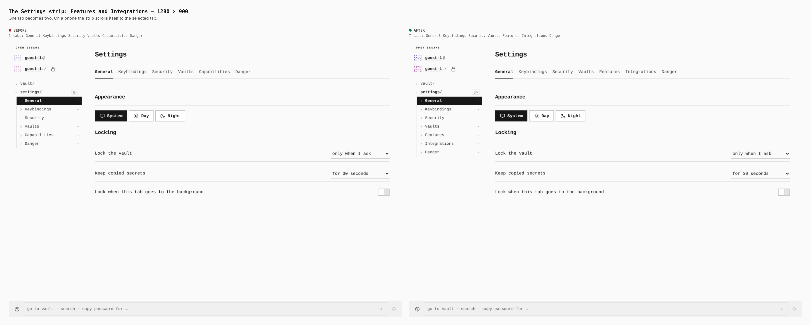

# Settings splits into Features and Integrations (ADR 0188)

Before/after from two real builds of `apps/pages`: the base (`origin/main`
`fb491073`) and this branch, walked the same way by
`apps/pages/scripts/capture-evidence.mjs` with [`journey.json`](journey.json).
Every number in a sheet's header is printed by the browser (`count` and
`report` steps), not read from the diff. Each screen is a guest on a fresh
device with Connections switched on, captured at 390 × 844 (a coarse touch
context) and 1280 × 900.

The journey visits the **retired** addresses on both builds, so the "after"
column also proves the redirects: `/settings/capabilities` lands on Features,
`/settings/connections` on Integrations, and
`/settings/capabilities#feature-backups` on `#integration-backups`.

| Sheet | 390 | 1280 | What changed |
|---|---|---|---|
| Features | [390](390-features.png) | [1280](1280-features.png) | one page of 20 sections, 38 switches and 45 connector tiles becomes Features: 16 sections, 31 switches, 0 tiles |
| Integrations | [390](390-integrations.png) | [1280](1280-integrations.png) | the 45 connector tiles are their own page: 8 sections, and 7 switches that are the Backups history roads |
| A built-in function's anchor | [390](390-backups-anchor.png) | [1280](1280-backups-anchor.png) | `#feature-backups` (1 on the page) becomes `#integration-backups` (1), because Backups has no switch |
| The Settings strip | [390](390-settings-nav.png) | [1280](1280-settings-nav.png) | 6 tabs become 7: Capabilities is Features and Integrations |

## Not captured

- **The operator's Guests and Instance policy** (Features): both need a sealed
  personal vault, and they are unchanged apart from the page that holds them.
  They are covered by `FeatureSections.test.tsx` and
  `InstanceCapabilitiesPanel.test.tsx`.
- **AI's model picks on Integrations**: they draw only while the AI feature is
  on and the on-device model's module is active. They are covered by
  `FeatureSections.status.test.tsx` ("draws AI's model picks, on Integrations,
  only while AI is on").

## Sheets

### Features

### Integrations

### A built-in function's anchor

### The Settings strip

