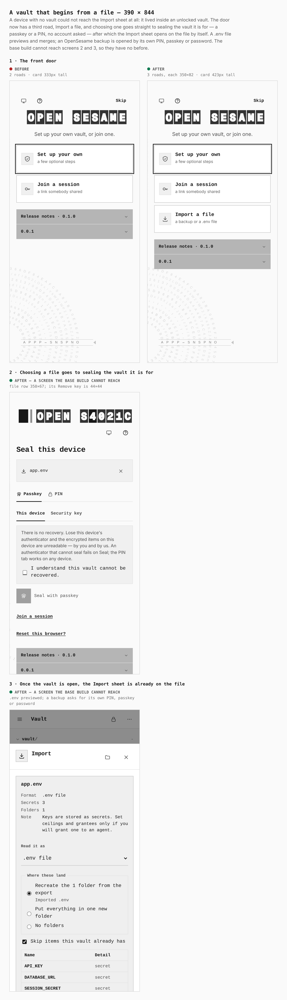
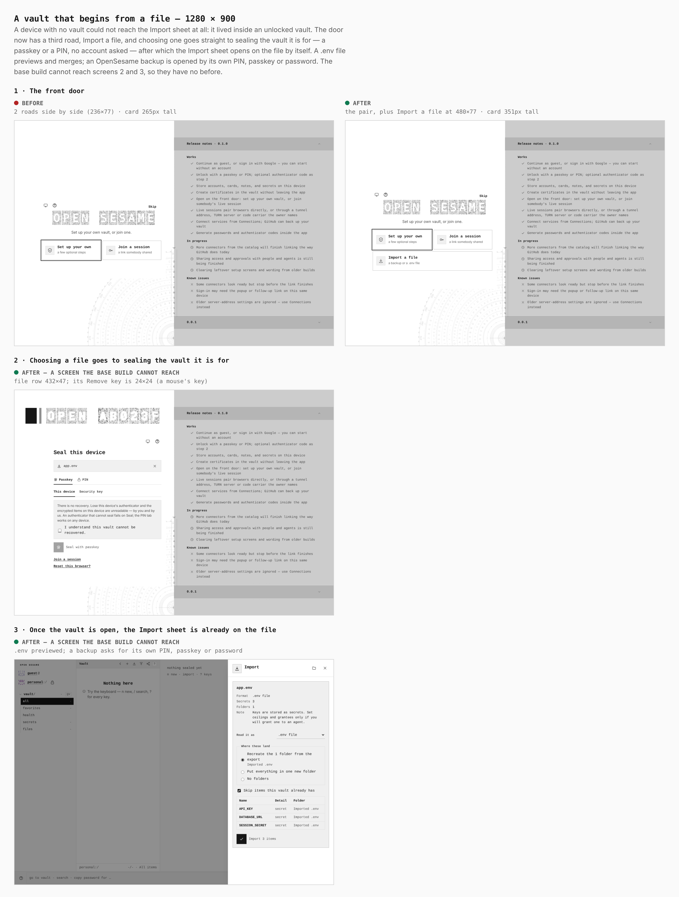

# A vault that begins from a file — before / after

[ADR 0188](../../adr/0188-a-vault-can-begin-from-a-file.md). The same screens from
two real builds — the base (`main` at `dcc1557a`) and this branch — walked the same
way by `apps/pages/scripts/capture-evidence.mjs` from [`journey.json`](journey.json),
at a phone (390 × 844, a real coarse-pointer context) and a desktop (1280 × 900)
width. Every number below is read from the browser, not from the CSS.

Screens 2 and 3 are screens the base build cannot reach — a device with no vault had
no road to the Import sheet at all — so they have no "before", and the sheets say so
rather than showing a lookalike.

## 390 × 844

| screen | before → after |
|---|---|
| The front door, `.door__roads .road` | `2 roads` → `3 roads`, each `350×82` |
| The front door, `.door__card` | `350×333` → `350×423` |
| Seal screen, `.unlock__import` (the held file) | after only: `350×67` |
| Seal screen, the file's Remove key | after only: `44×44` — a thumb's target |

## 1280 × 900

| screen | before → after |
|---|---|
| The front door, `.door__roads .road` | `236×77`, `236×77` → the same pair, plus `480×77` across both columns |
| The front door, `.door__card` | `480×265` → `480×351` |
| Seal screen, `.unlock__import` | after only: `432×47` |
| Seal screen, the file's Remove key | after only: `24×24` — the small icon key a mouse gets |

## What the pictures do not show

The restore itself — a PIN-sealed backup opened by its own PIN — is a decryption, not a
picture. `verify:static` walks it in a real browser with a real file chooser and real
WebCrypto (`apps/pages/scripts/lib/first-run-import-contract.mjs`): a backup written by
one vault is refused by a well-formed PIN that is not its own, is opened by its own in
another vault sealed under a different PIN, and nothing from it rests in the clear
afterwards (ADR 0149).
