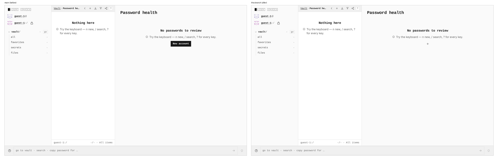
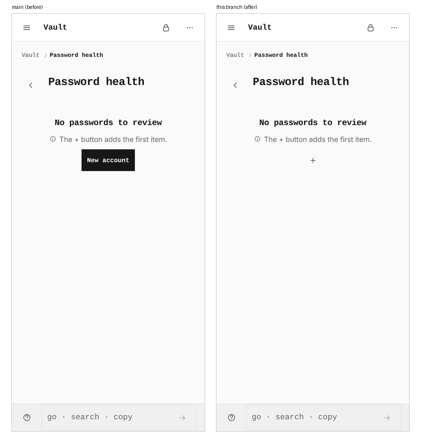
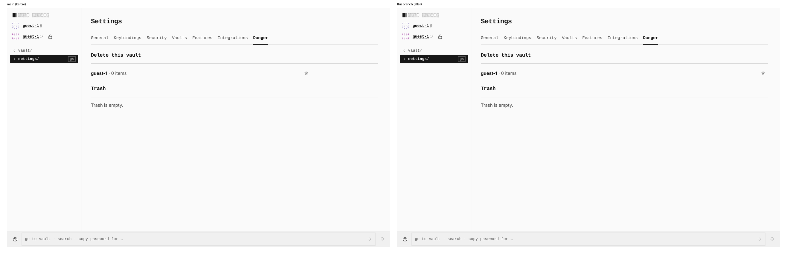
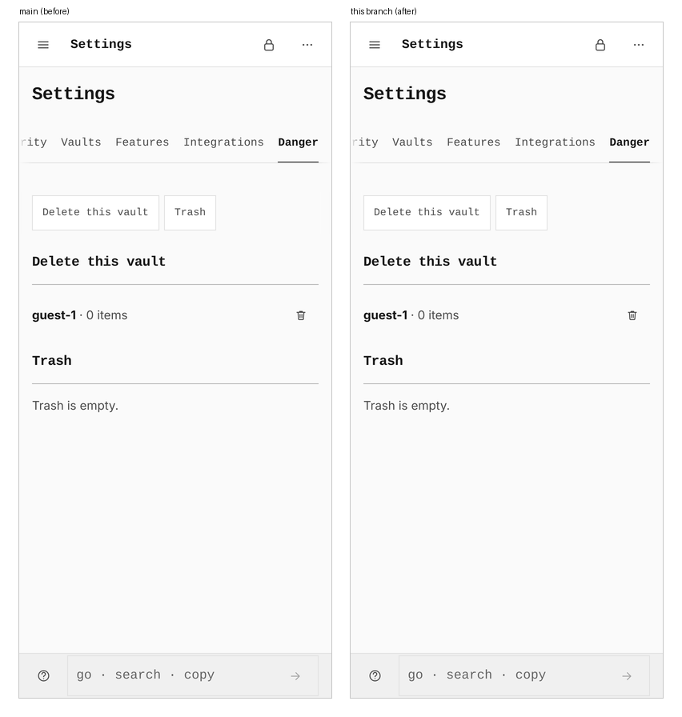

# The health report's add key, and the Danger row's bin at the row end

Two small fixes to the design contract:

- **Password health, empty.** The empty report drew "New account" as a word
  painted on a filled button. DESIGN.md § Actions are symbols rules that out
  ("never a text verb … in an empty state"). It is now the icon key every
  other "new" action uses: `icon-btn` with the plus glyph, "New account" as
  its `aria-label` and title. On a phone, the empty tip already says "The +
  button adds the first item", and the key is now that button.
- **Settings › Danger.** The open vault's row is a `keyed-row`, capped at the
  prose measure (`--text-max`, 46rem), so on a wide screen its bin stopped
  224px short of the panel's rule. The Trash rows under it already run the full
  width. The row now does too, so its bin ends where the rule ends.

Both captures come from two real builds of the same harness: `main` at
`4e8976c5` and this branch. Each is a guest vault reached through the door's
Skip, at 1280 (device pixel ratio 2) and at 390 in a touch context (ratio 3),
in light mode. The health report is `/vault/health` with nothing in the vault.
Danger is `/settings/danger`.

## Password health, 1280

## Password health, 390

## Settings › Danger, 1280

## Settings › Danger, 390

## Measured in the browser

| | `main` | this branch |
|---|---|---|
| Health action, 1280 | `btn btn--primary btn--sm`, "New account" painted, 107×30px, ink fill | `icon-btn`, no text, 32×32px, transparent |
| Health action, 390 | the same button, 107×44px | `icon-btn`, 44×44px |
| Danger bin, 1280 | right edge 1016px, rule ends at 1240px: 224px short | right edge 1240px: 0px |
| Danger bin, 390 | right edge 374px, rule 374px: 0px | unchanged, 0px |
