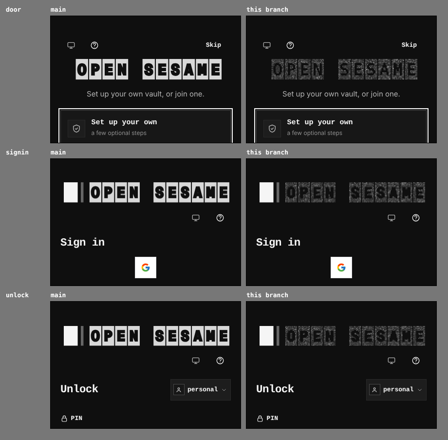
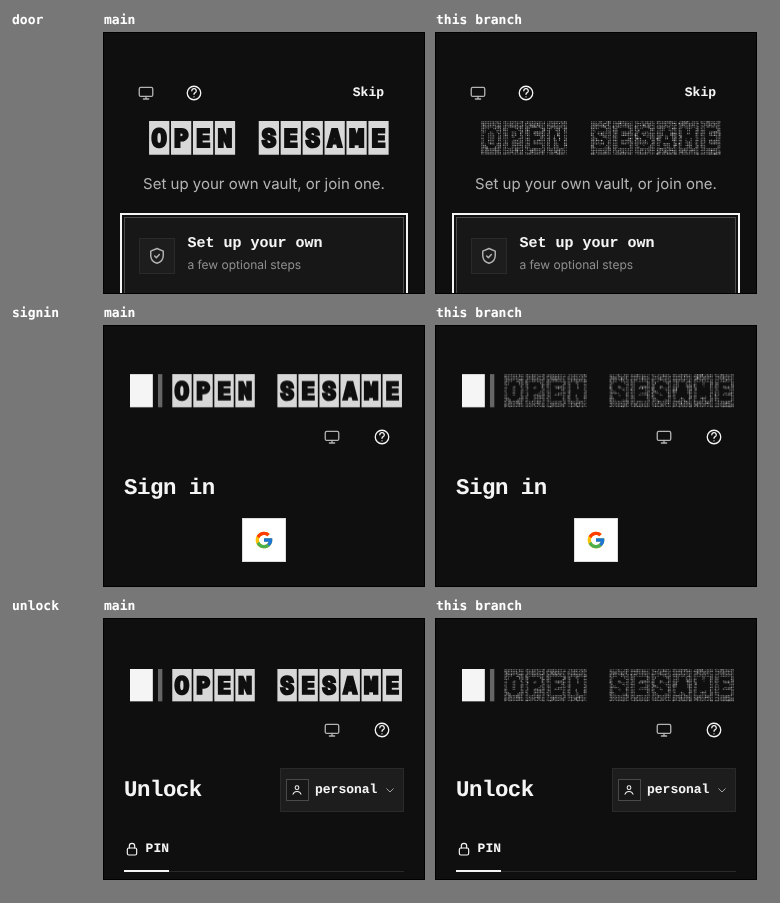

# Every gate's hero is the particle field, a phone's included

The wordmark drew three renderings by em: letters under 16px, solid ink plates from 16 to 48px, and the particle field from 48px up. On a phone every gate's hero is under 48px (the front door fits its card at about 41px at 390 and 33px at 320; the sign-in and unlock hero at about 45 and 36), so a phone got the solid plates. That rendering is rejected. The solid tier is removed: from a 16px em up the wordmark is the particle field, it decodes one slot at a time and keeps shimmering after it settles, on a phone as on a desktop. The rail and the setup bar, under 16px, are unchanged.

Two real builds, `main` at `dcc1557a` and this branch, same harness, each gate reached the same way, dark, at 1:1, five seconds after arrival (the decode has settled).

## 390 × 900

## 320 × 900

## Measured in the browser

Whether the hero's canvas changes between two frames 700ms apart, five seconds after arrival:

| Gate | 390, `main` | 390, this branch | 320, `main` | 320, this branch |
|---|---|---|---|---|
| Front door | still | moving | still | moving |
| Sign-in | still | moving | still | moving |
| Unlock | still | moving | still | moving |

The hero's width is unchanged: 320px (door) and 348px (sign-in, unlock) at 390; 258px and 280px at 320.
