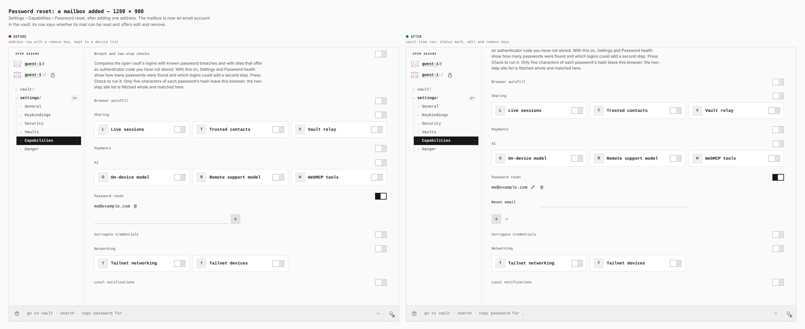
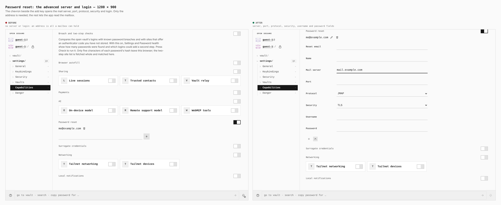
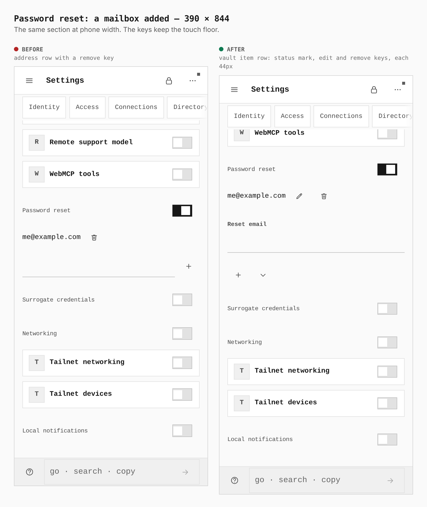
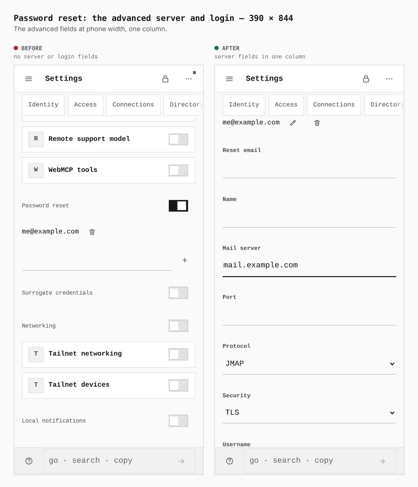

# Password reset: mailboxes as vault items

Before is the base the branch forked from (`1af7da2b`). After is this branch.
Both are real Pages builds (`VITE_BASE=/OpenSesame/`), walked the same way by
`apps/pages/scripts/capture-evidence.mjs` from `journey.json`: a guest, Settings
› Capabilities, Password reset switched on and applied, one address typed and
added. Steps marked `"only": "after"` open the server fields, which the base
does not have.

## Desktop, 1280 × 900

The mailbox is now a vault item: its row gains an edit key beside the remove
key, and the add form gains a label and a chevron that opens the server.
Measured in the browser: the add field is `442×32` before (no label) and
`480×32` after (labelled `Reset email`); the row is `480×24`.

The chevron adds a name, the mail server, port, username and password inputs
(six `480×32` inputs in all, with the address) and the protocol and security
choices. The base has nothing to show here, which is the point of the pair.

## Phone, 390 × 844

The email field is `308×44` before and `358×44` after. The row's two keys, edit
and remove, are each `44×44`, on the touch floor.

The server fields stack in one column, each `358×44`.

## What is not in the pictures

- A mailbox with a readable server shows a check; one that names a server the
  app cannot read (IMAP, POP3, no password, no TLS) shows a warning; an address
  alone shows no mark. The panel test covers the warning and the check
  (`apps/pages/src/modules/ai.password-reset/panel.test.tsx`); the journey adds
  an address alone.
- The account editor's *Reset email* choice lists the vault's mailboxes; it is
  drawn only inside an account, and `ResetEmailField.test.tsx` covers it.
- `pnpm --filter @opensesame/pages verify:tutorials` (`TUTORIALS_ONLY=feature.password-reset`)
  was run against the same build: 164 checks passed at 1280 and 390.
