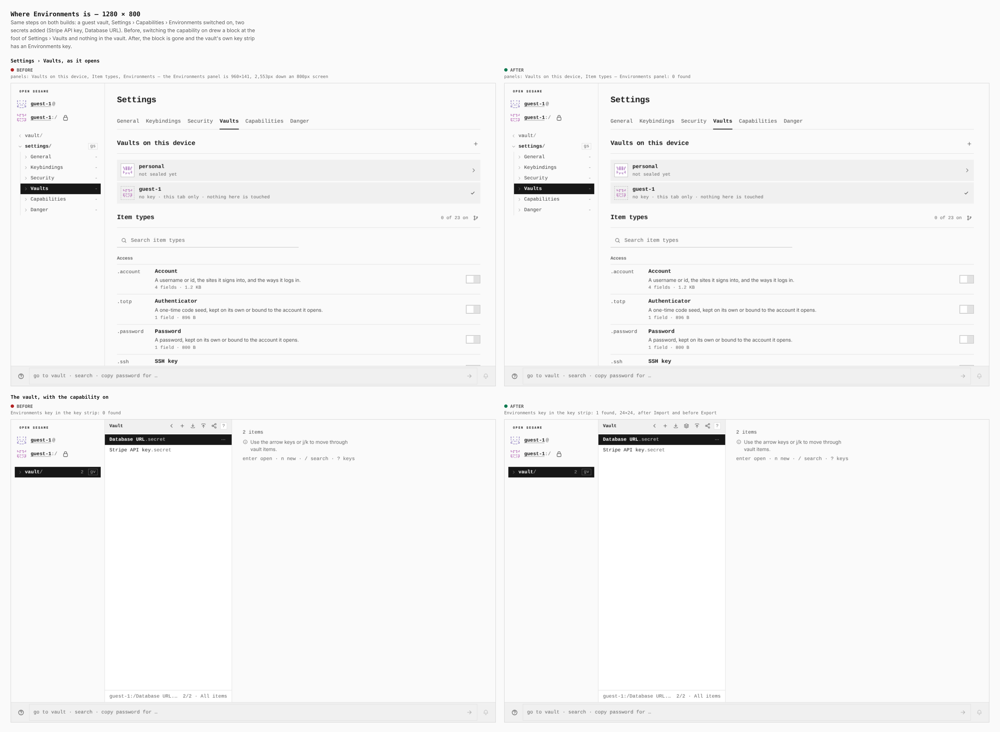
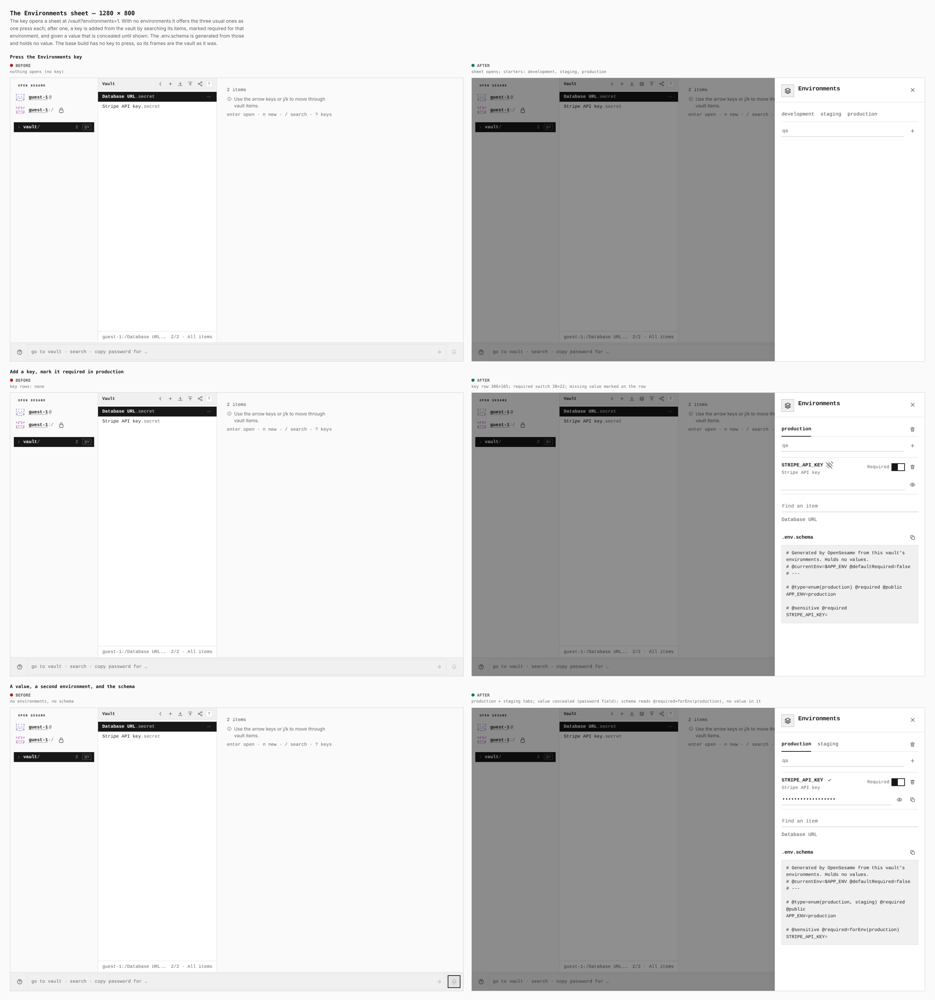
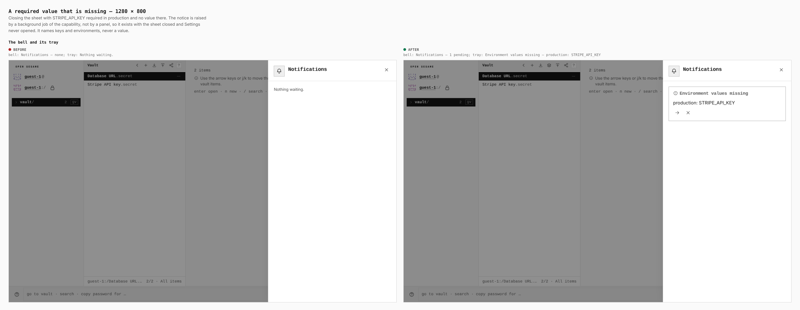
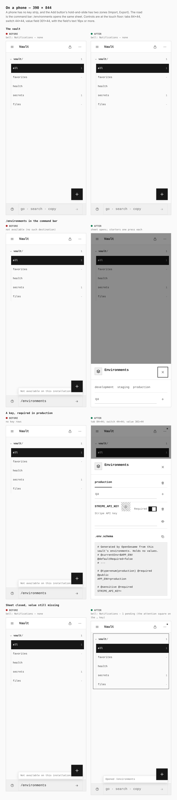

# Vault environments — before / after

Two real builds, same steps, same screens. **Before** is `main` at
`fb491073` (built in its own worktree); **after** is this branch. Every number
below was printed by the browser during the capture, not written from memory.
The journey that produced them is [`journey.json`](journey.json).

Every capture starts the same way: a guest vault, Settings › Capabilities ›
**Environments** switched on, two secrets added (*Stripe API key*,
*Database URL*). On `main` that is where it ends: the capability is on and the
vault says nothing about it.

## 1. Where Environments is

| | before | after |
|---|---|---|
| Settings › Vaults panels | Vaults on this device, Item types, **Environments** | Vaults on this device, Item types |
| `#vault-environments` | 1 found, 960×141, **2,553px down** an 800px screen | 0 found |
| Environments key in the vault's key strip | 0 found | 1 found, 24×24, after Import and before Export |

The only trace of the capability used to be a block at the foot of Settings ›
Vaults, below the 23-row item-type list. It is gone (ADR 0158: configuration
lives where its data is), and the vault's own key strip has the key.

## 2. The sheet

| step | before | after |
|---|---|---|
| Press the Environments key | nothing opens (no key) | sheet opens at `/vault?environments=1`; development, staging, production one press each |
| Add a key, mark it required in production | no key rows | key row 386×105; required switch 38×22; missing value marked on the row |
| A value, a second environment, the schema | no environments, no schema | production + staging tabs; the value is a password field; the schema reads `@required=forEnv(production)` and holds no value |

An item becomes a key when it is added from the vault by searching its items (a
vault of 500 logins is searched, never listed). Values are concealed until the
eye key is pressed and copied only by their own key.

## 3. A required value that is missing

| | before | after |
|---|---|---|
| Bell | Notifications — none | Notifications — 1 pending |
| Tray | Nothing waiting. | Environment values missing — production: STRIPE_API_KEY, with a key that opens the sheet |

Taken with the sheet closed and Settings never opened: the notice is raised by
a background job of the capability, not by a panel. It names keys and
environments, never a value.

## 4. On a phone — 390 × 844

| | before | after |
|---|---|---|
| `/environments` in the command bar | "Not available on this installation" | opens the same sheet |
| Environment tab | — | 84×44 |
| Required switch | — | 44×44 |
| Value field | — | 301×44, text 16px or more |
| Bell with a gap | Notifications — none | Notifications — 1 pending (the attention square on the … key) |

A phone has no key strip, and the Add button's hold-and-slide has two zones
(Import, Export), so the typed road is the command bar. The Add menu entry is the
road for a keyboard, a mouse or a screen reader.

## What these sheets do not show

- **Touch alone, with no environment yet.** Nothing on a phone points at the
  sheet until an environment has a gap (the notice's open key) or the
  command bar is used. A third slide zone, or a vault-rail entry a capability
  can contribute, would add a pointing road; neither is part of this change.
- **Persistence.** Environments and their values are sealed in the vault body
  and survive a lock and an unlock; that is asserted in
  `environments-store.test.ts`, not drawn here.

## Gates run on this branch

`pnpm lint`, `pnpm lint:design`, `pnpm quality` (structural ratchet, log
hygiene, package metrics, app-core and vault-core boundaries), workspace
`pnpm typecheck` (67/67), `verify:keyboard` (1280 and 390), `verify:mobile`
(390), `verify:tutorials` for `vault.environments` and `feature.environments`,
`verify:capability-graph`, and the minimal-local (hardened) and rich-explicit
profile builds. The minimal profile has `vault.environments/runtime`
physically absent.
