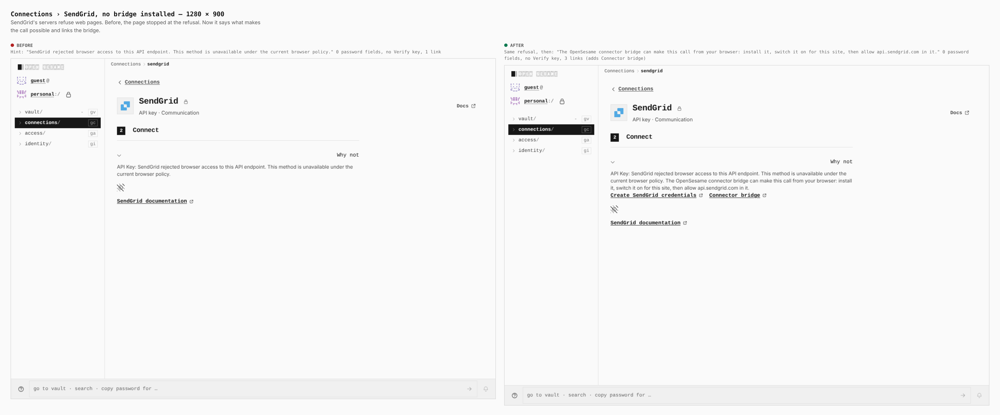
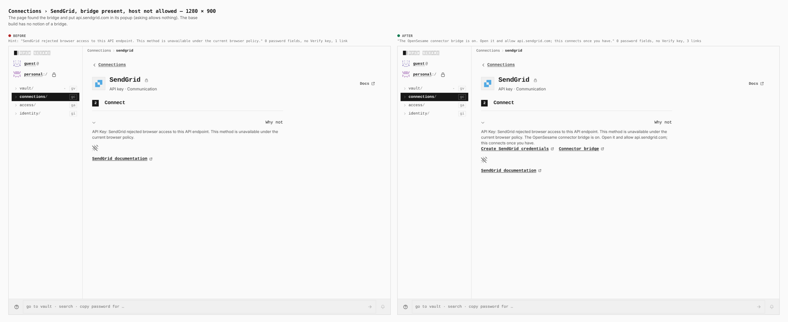
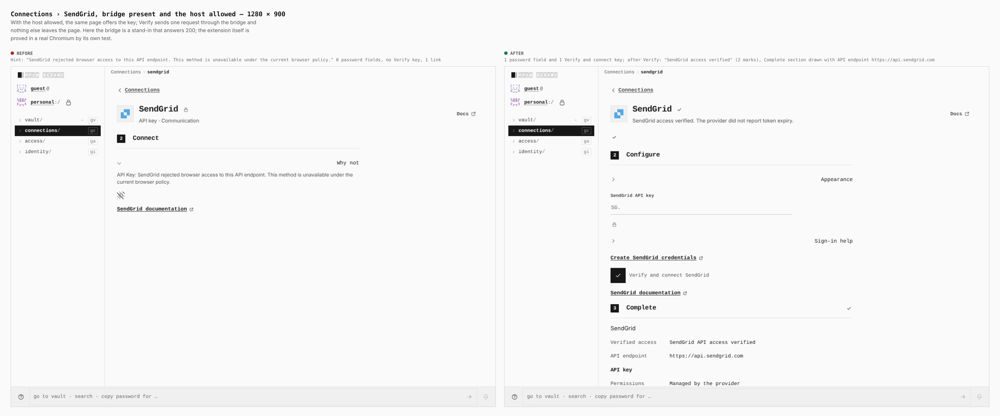
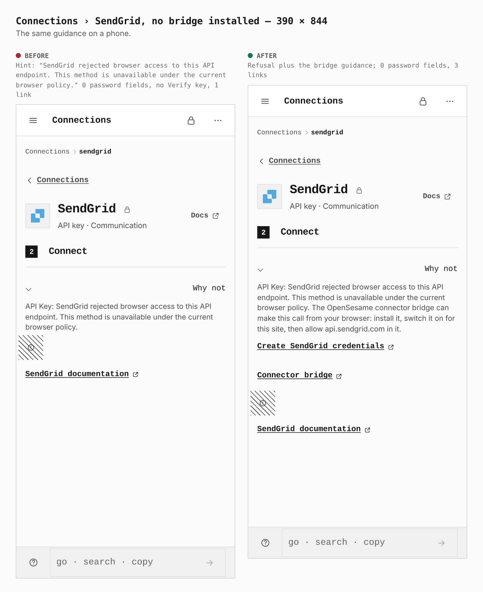
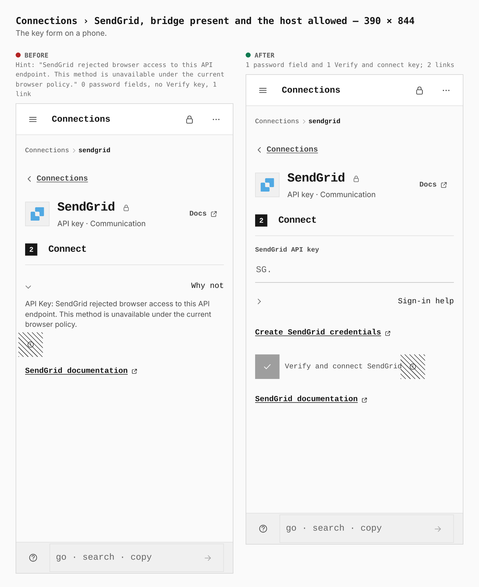
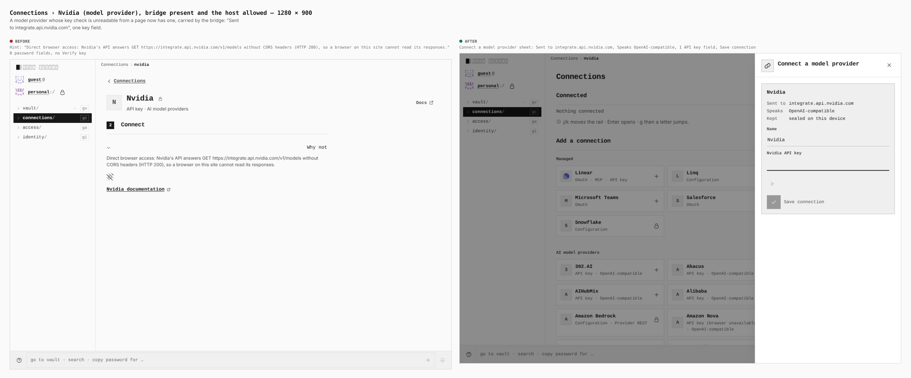

# Connections — the connector bridge

Before/after from two real Pages builds (the base, `7bfae04b`, built from the key-driven-providers branch, and this branch), walked the same way by `journey.json` in this directory: guest vault, Connections switched on, then each page. Desktop 1280×900 and phone 390×844. Every number below is read from the browser.

The extension is not in these images. Where a screen needs a bridge, the capture harness puts a stand-in for the extension's relay in the page (`apps/pages/scripts/lib/capture-bridge-steps.mjs`): it answers the three questions the real relay answers and nothing else. The extension itself, its popup and what a provider receives from it are proved in a real Chromium by `pnpm --filter @opensesame/browser-extension-bridge test:e2e`; the popup has no image here.

| Sheet | Before | After |
|---|---|---|
| `1280-sendgrid-no-bridge.png` | Hint: "SendGrid rejected browser access to this API endpoint. This method is unavailable under the current browser policy." 0 password fields, no Verify key, 1 link | Same refusal, then: "The OpenSesame connector bridge can make this call from your browser: install it, switch it on for this site, then allow api.sendgrid.com in it." 0 password fields, no Verify key, 3 links (adds Connector bridge) |
| `1280-sendgrid-needs-host.png` | Hint: "SendGrid rejected browser access to this API endpoint. This method is unavailable under the current browser policy." 0 password fields, no Verify key, 1 link | "The OpenSesame connector bridge is on. Open it and allow api.sendgrid.com; this connects once you have." 0 password fields, no Verify key, 3 links |
| `1280-sendgrid-connected.png` | Hint: "SendGrid rejected browser access to this API endpoint. This method is unavailable under the current browser policy." 0 password fields, no Verify key, 1 link | 1 password field and 1 Verify and connect key; after Verify: "SendGrid access verified" (2 marks), Complete section drawn with API endpoint https://api.sendgrid.com |
| `390-sendgrid-no-bridge.png` | Hint: "SendGrid rejected browser access to this API endpoint. This method is unavailable under the current browser policy." 0 password fields, no Verify key, 1 link | Refusal plus the bridge guidance; 0 password fields, 3 links |
| `390-sendgrid-form.png` | Hint: "SendGrid rejected browser access to this API endpoint. This method is unavailable under the current browser policy." 0 password fields, no Verify key, 1 link | 1 password field and 1 Verify and connect key; 2 links |
| `1280-nvidia-bridge.png` | Hint: "Direct browser access: Nvidia's API answers GET https://integrate.api.nvidia.com/v1/models without CORS headers (HTTP 200), so a browser on this site cannot read its responses." 0 password fields, no Verify key | Connect a model provider sheet: Sent to integrate.api.nvidia.com, Speaks OpenAI-compatible, 1 API key field, Save connection |
| `1280-inception.png` | Hint: "Direct browser access: Inception's API answers GET https://api.inceptionlabs.ai/v1/models without CORS headers (HTTP 200), so a browser on this site cannot read its responses." 0 password fields, no Verify key | Connect a model provider sheet with 1 API key field |

### Connections › SendGrid, no bridge installed — 1280 × 900

SendGrid's servers refuse web pages. Before, the page stopped at the refusal. Now it says what makes the call possible and links the bridge.

### Connections › SendGrid, bridge present, host not allowed — 1280 × 900

The page found the bridge and put api.sendgrid.com in its popup (asking allows nothing). The base build has no notion of a bridge.

### Connections › SendGrid, bridge present and the host allowed — 1280 × 900

With the host allowed, the same page offers the key; Verify sends one request through the bridge and nothing else leaves the page. Here the bridge is a stand-in that answers 200; the extension itself is proved in a real Chromium by its own test.

### Connections › SendGrid, no bridge installed — 390 × 844

The same guidance on a phone.

### Connections › SendGrid, bridge present and the host allowed — 390 × 844

The key form on a phone.

### Connections › Nvidia (model provider), bridge present and the host allowed — 1280 × 900

A model provider whose key check is unreadable from a page now has one, carried by the bridge: "Sent to integrate.api.nvidia.com", one key field.

### Connections › Inception (model provider), no bridge — 1280 × 900

Re-probing Inception's real key-check route found it admits this site, so it connects directly, with no bridge and nothing to install.

