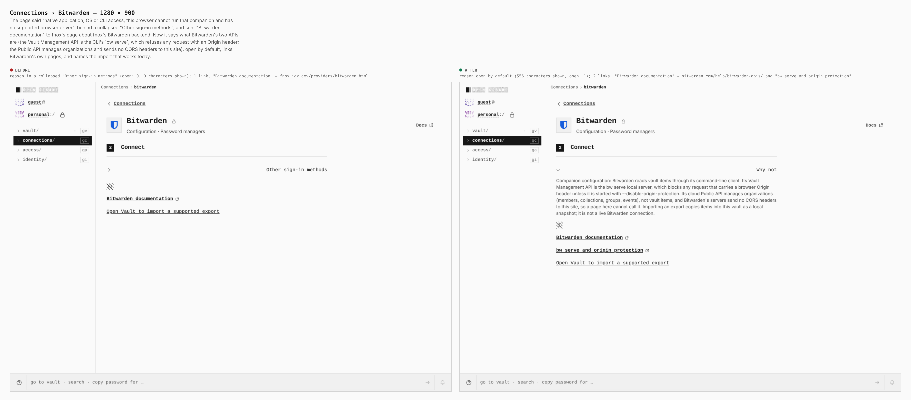
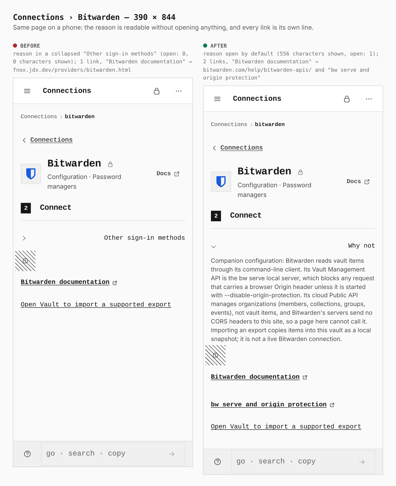
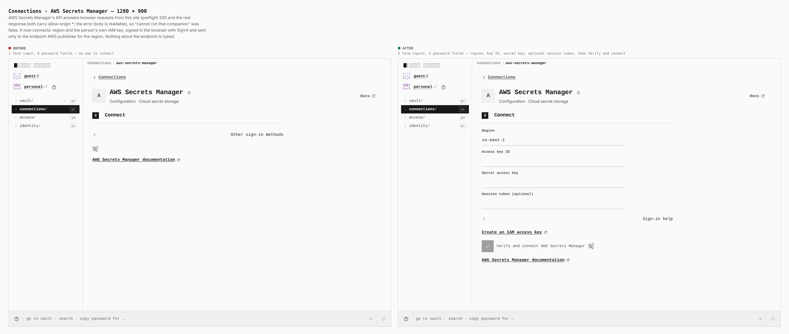
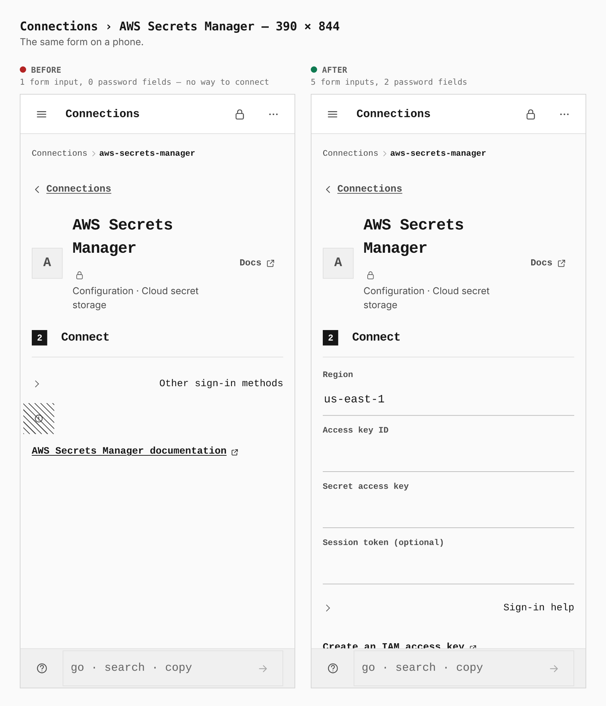
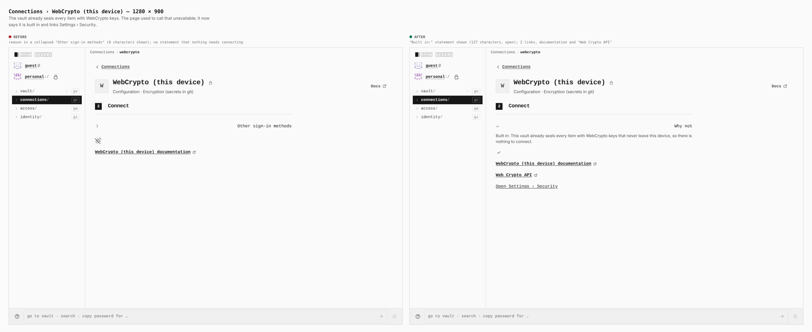
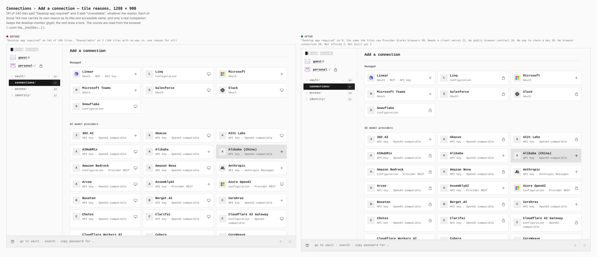
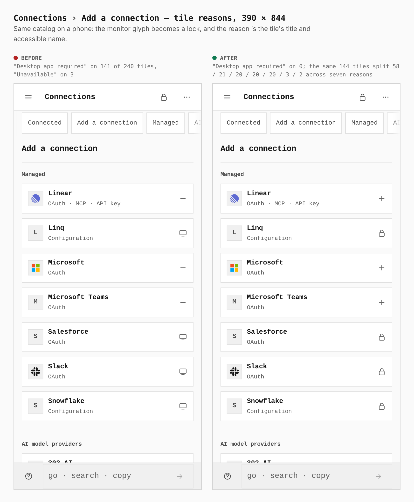

# Connections — honest reasons, real docs links, AWS in the browser

Before/after from two real Pages builds (`eeed9f36`, the base, and this branch),
walked the same way by `journey.json` in this directory: guest vault, Connections
switched on, then each page. Desktop 1280×900 and phone 390×844. Every
measurement below is read from the browser, not estimated.

| Sheet | Before | After |
|---|---|---|
| `1280-bitwarden.png`, `390-bitwarden.png` | The reason sits in a collapsed "Other sign-in methods" (0 characters shown); 1 link, "Bitwarden documentation", points at fnox's page about fnox's Bitwarden backend | The reason is open by default (556 characters): the Vault Management API is `bw serve`, which refuses an Origin header; the Public API manages organizations and sends no CORS headers here. 2 vendor links (`bitwarden.com/help/bitwarden-apis/`, the `bw serve` page) and the import that works today |
| `1280-aws.png`, `390-aws.png` | 1 form input, 0 password fields: no way to connect | 5 form inputs, 2 password fields: region, access key ID, secret key, optional session token, then Verify and connect |
| `1280-webcrypto.png` | Reason collapsed (0 characters shown), no statement that nothing needs connecting | "Built in:" statement shown (127 characters); 2 links, documentation and "Web Crypto API" |
| `1280-tiles.png`, `390-tiles.png` | "Desktop app required" on **141** of 240 tiles, "Unavailable" on 3 | "Desktop app required" on **0**; the same 144 tiles say Provider blocks browsers 58, Needs a client secret 21, No public browser contract 20, No way to check a key 20, No browser connection 20, Not offered 3, Not built yet 2 |

### Connections › Bitwarden — 1280 × 900



### Connections › Bitwarden — 390 × 844



### Connections › AWS Secrets Manager — 1280 × 900



### Connections › AWS Secrets Manager — 390 × 844



### Connections › WebCrypto (this device) — 1280 × 900



### Connections › Add a connection, tile reasons — 1280 × 900



### Connections › Add a connection, tile reasons — 390 × 844



## What this proves

- A provider page says what is true of that provider, open by default, instead
  of one sentence for every provider.
- The AWS page reached through its alias address (`aws-secrets-manager`, the id
  the app routes by) draws the real form. The alias path was broken in the first
  build of the driver and was found by this capture.
- A tile's monitor glyph is kept for a real companion only; its reason is the
  tile's title and accessible name.
- Documentation links name what they are, and point at the vendor.

## What this does not show

- The tile reason is a title and accessible name, so a still image shows the
  glyph change (monitor → lock) and the counts, not the text. The counts are the
  measurement.
- The whole flow after Verify and connect (a signed list call, then one value
  read) is covered by `AwsNative.integration.test.tsx` and `native-aws.test.ts`
  against Amazon's published SigV4 test vector, not by these images.

## How

`journey.json` in this directory. `EVIDENCE_DIST` pointed at each build's
`dist`, Chromium through `PLAYWRIGHT_CHROMIUM`:

```bash
git checkout eeed9f36 -- apps/pages/src packages/app-core/src spec/connectors
VITE_BASE=/OpenSesame/ pnpm exec turbo run build --filter=@opensesame/pages
cp -r apps/pages/dist <before-dist>
git checkout HEAD -- apps/pages/src packages/app-core/src spec/connectors
VITE_BASE=/OpenSesame/ pnpm exec turbo run build --filter=@opensesame/pages
cp -r apps/pages/dist <after-dist>
EVIDENCE_DIST=<before-dist> node apps/pages/scripts/capture-evidence.mjs capture before journey.json
EVIDENCE_DIST=<after-dist>  node apps/pages/scripts/capture-evidence.mjs capture after journey.json
node apps/pages/scripts/capture-evidence.mjs compose journey.json
```

`spec/connectors` and `packages/app-core/src` were reverted along with
`apps/pages/src` for the base capture, because the catalog and the dispositions
are read from there at build time.
