# Connections — providers that connect with the person's own key

Before/after from two real Pages builds (`516feb44`, the base, built in its own worktree, and this branch), walked the same way by `journey.json` in this directory: guest vault, Connections switched on, then each page. Desktop 1280×900 and phone 390×844. Every number below is read from the browser.

| Sheet | Before | After |
|---|---|---|
| `1280-letsencrypt.png` | "Connector not found": no tile for this provider, so the page has nothing to draw (1 input: the command bar, 0 selects, no Verify key) | 2 selects (environment, agreement), the Verify and connect key, 3 links (Subscriber Agreement, challenge types, RFC 8555); 0 password fields |
| `390-letsencrypt.png` | "Connector not found": no tile for this provider, so the page has nothing to draw (1 input: the command bar, 0 selects, no Verify key) | 2 selects, Verify and connect key, 3 links |
| `1280-aws-sts.png` | "Connector not found": no tile for this provider, so the page has nothing to draw (1 input: the command bar, 0 selects, no Verify key) | 5 inputs, 2 password fields (region, access key ID, secret, optional session token) |
| `1280-azure-ac.png` | Hint: "Azure App Configuration answers browser preflights from this site … OpenSesame has not built that connection yet." 1 input, 0 password fields, no Verify key | 4 inputs, 1 password field (store name, access key ID, access key secret) |
| `1280-gcp.png` | Hint: "… OpenSesame has no way to obtain [an access token] here yet" 1 input, 0 password fields, no Verify key | 2 inputs, 1 password field (project, service account key), Verify and connect |
| `1280-gcp-iam.png` | "Connector not found": no tile for this provider, so the page has nothing to draw (1 input: the command bar, 0 selects, no Verify key) | 1 service-account key field, Verify and connect, 2 links |
| `1280-venice.png` | Hint: "Venice AI's model list is public … listing models cannot prove a key works" 1 input, 0 password fields, no Verify key | 3 inputs, 1 password field, Verify and connect: verified with GET /api/v1/api_keys/rate_limits |
| `390-venice.png` | 1 input, 0 password fields | 3 inputs, 1 password field |
| `1280-stepfun.png` | Hint: "OpenSesame has no browser connection for StepFun … defines no key check … and no probe of that service from this site has been recorded." | Hint: "StepFun's gateway authenticates before it routes, so even the CORS preflight is refused (HTTP 401 with no Access-Control-Allow-Origin)" (open: 1, 1 doc link) |
| `1280-tiles.png` | Provider blocks browsers 58, No way to check a key 20, Not built yet 2, No browser connection 20 (of 240 tiles) | Provider blocks browsers 67, No way to check a key 0, Not built yet 0, No browser connection 10 (of 240 tiles) |
| `390-tiles.png` | Provider blocks browsers 58, No way to check a key 20, Not built yet 2, No browser connection 20 | Provider blocks browsers 67, No way to check a key 0, Not built yet 0, No browser connection 10 |

### Connections › Let's Encrypt — 1280 × 900

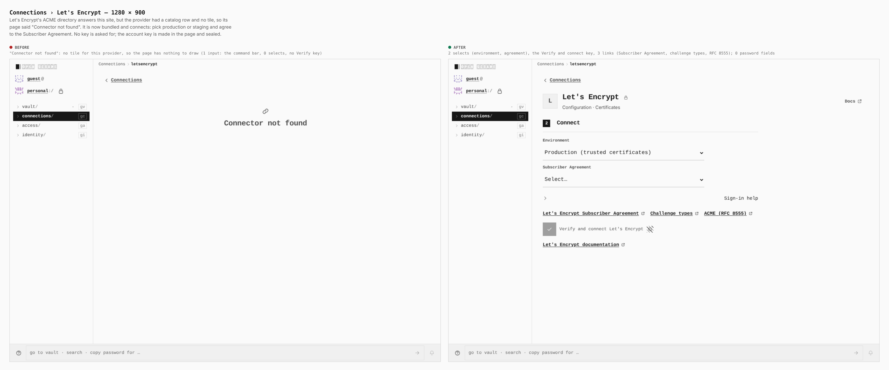

### Connections › Let's Encrypt — 390 × 844

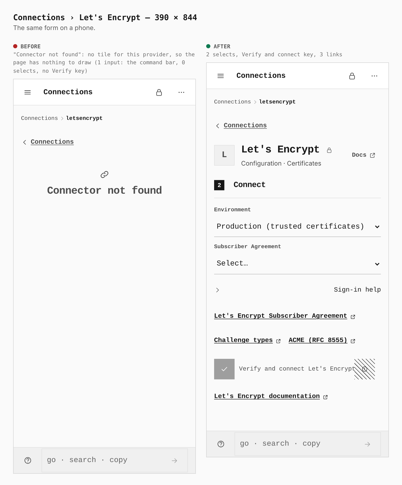

### Connections › AWS STS — 1280 × 900

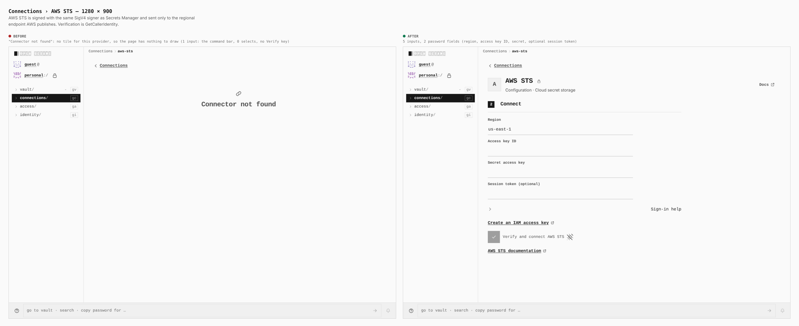

### Connections › Azure App Configuration — 1280 × 900

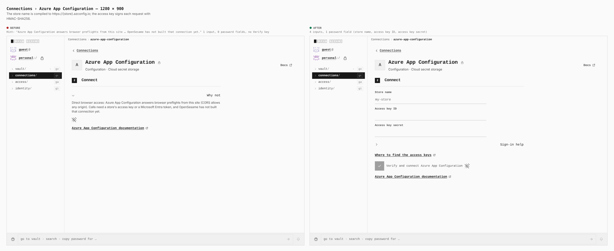

### Connections › Google Cloud Secret Manager — 1280 × 900

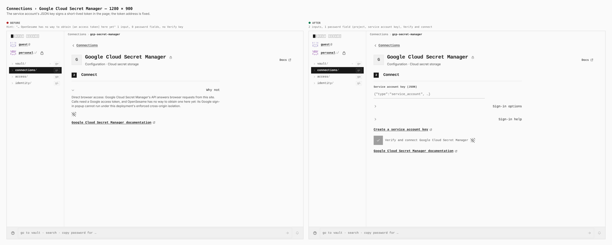

### Connections › Google Cloud IAM credentials — 1280 × 900

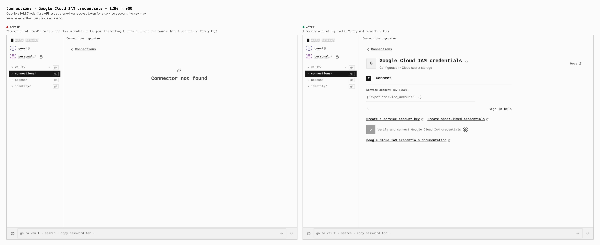

### Connections › Venice AI — 1280 × 900

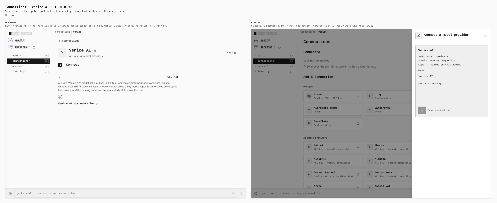

### Connections › Venice AI — 390 × 844

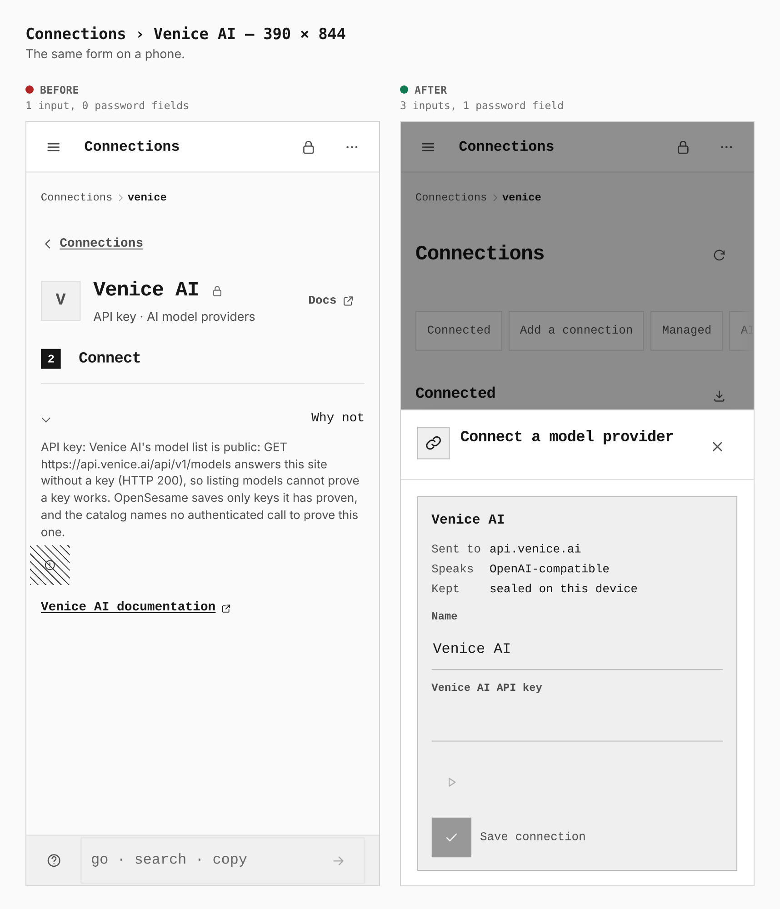

### Connections › StepFun — 1280 × 900

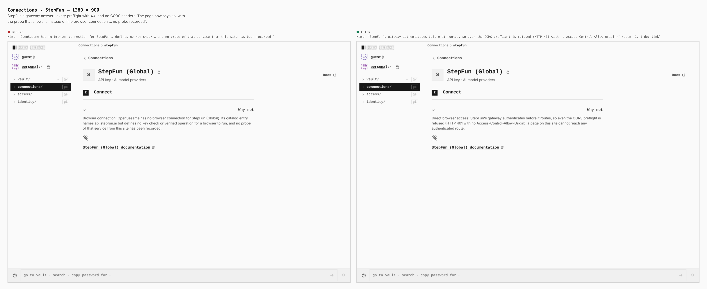

### Connections › Add a connection, tile reasons — 1280 × 900

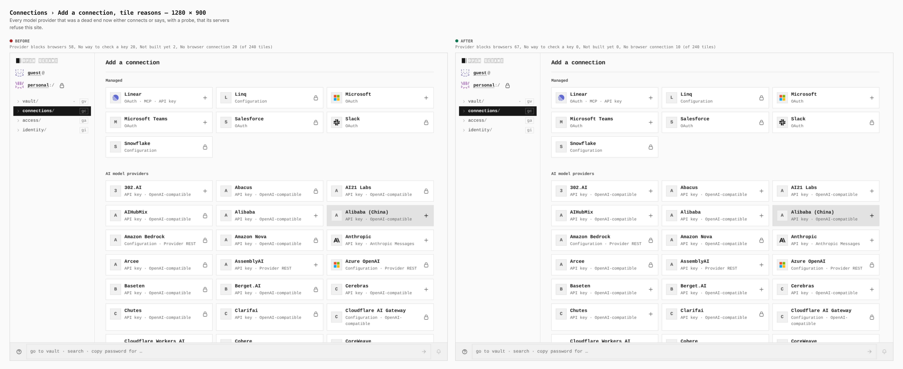

### Connections › Add a connection, tile reasons — 390 × 844

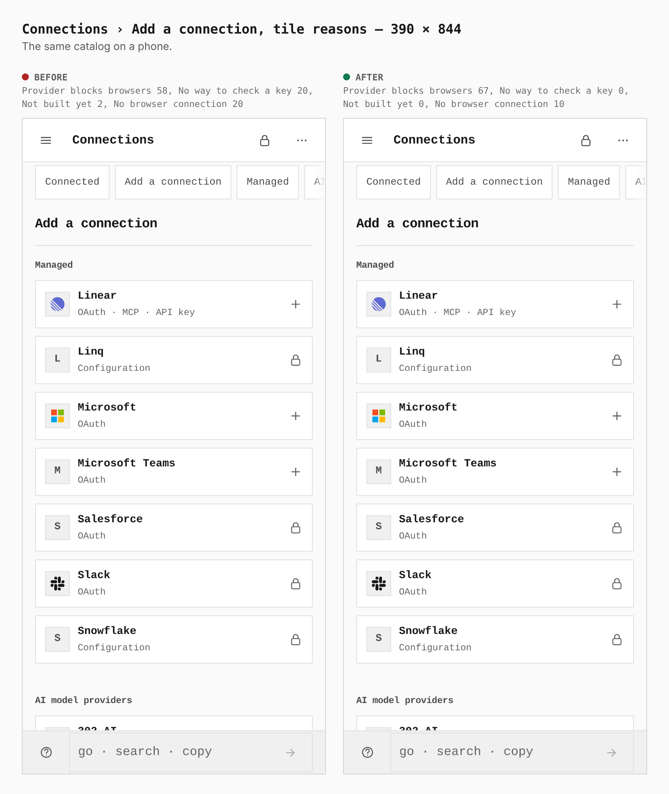

## What this proves

- The forms are drawn from the driver's own description, so a family adds no component.
- **A driver nobody can reach is not a connection.** AWS STS, Google Cloud IAM Credentials and Let's Encrypt had a catalog row and a driver but no tile; both builds answer "Connector not found" for them. This capture found it; the unit tests had not. They are bundled in this change.
- The tile reasons moved with the work: the two "Not built yet" tiles and all 20 "No way to check a key" tiles are gone, 9 providers moved to "Provider blocks browsers" with probes behind them, and 10 model providers connect.

## What this does not show

- A connected state. These are the forms; the flows after Verify and connect are covered by `native-aws.test.ts`, `native-sts.test.ts`, `native-azure-ac.test.ts`, `native-gcp*.test.ts`, `native-acme*.test.ts` (against a CA that enforces RFC 8555) and `NativeKeyDrivers.integration.test.tsx`, which drives the Let's Encrypt form to an opened order. No live provider account was used.
- Let's Encrypt's full issuance needs control of a domain's DNS and was not run against the real CA; account creation, idempotent re-registration and a two-name order with a wildcard were, against Let's Encrypt staging.
