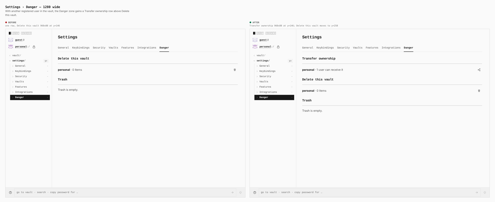
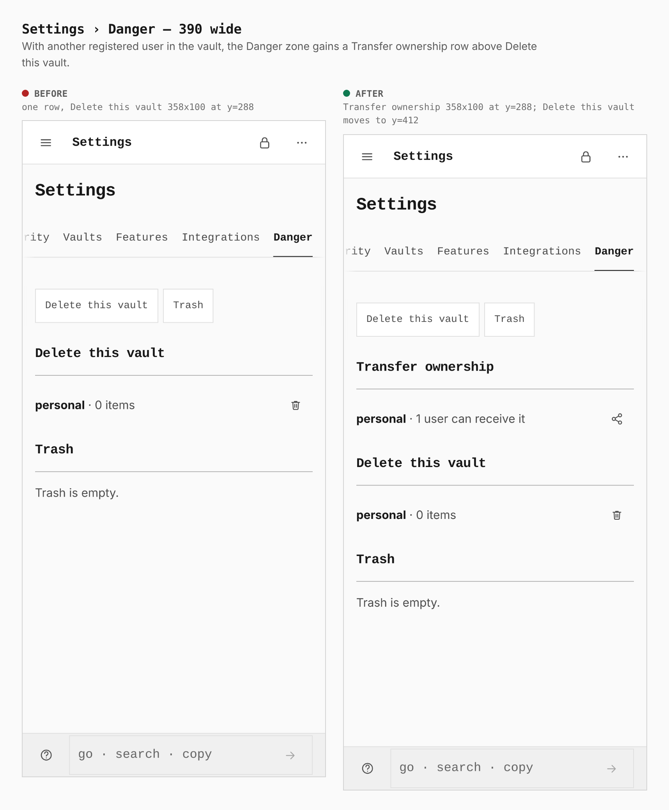
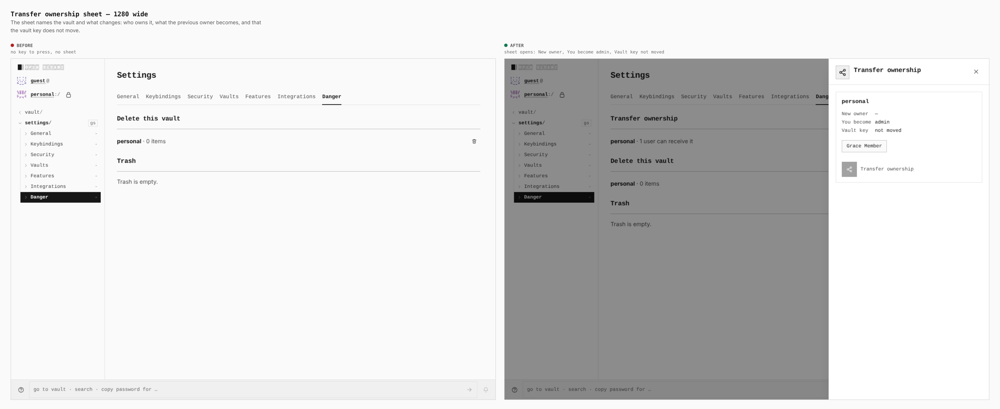
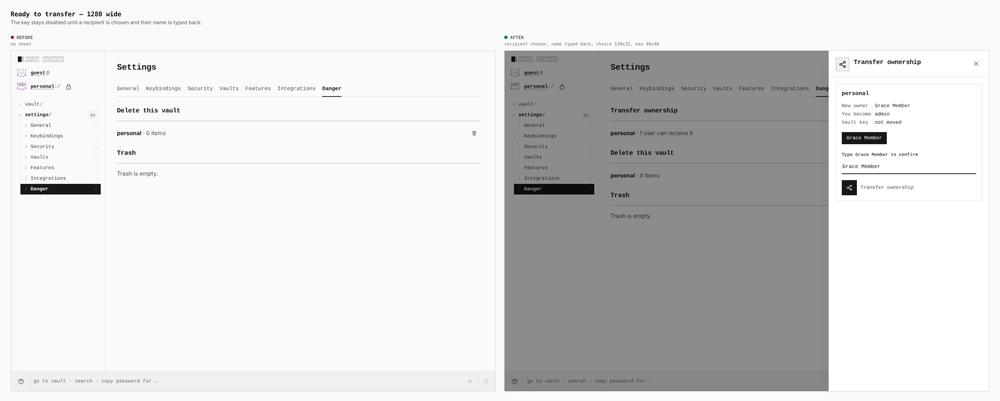
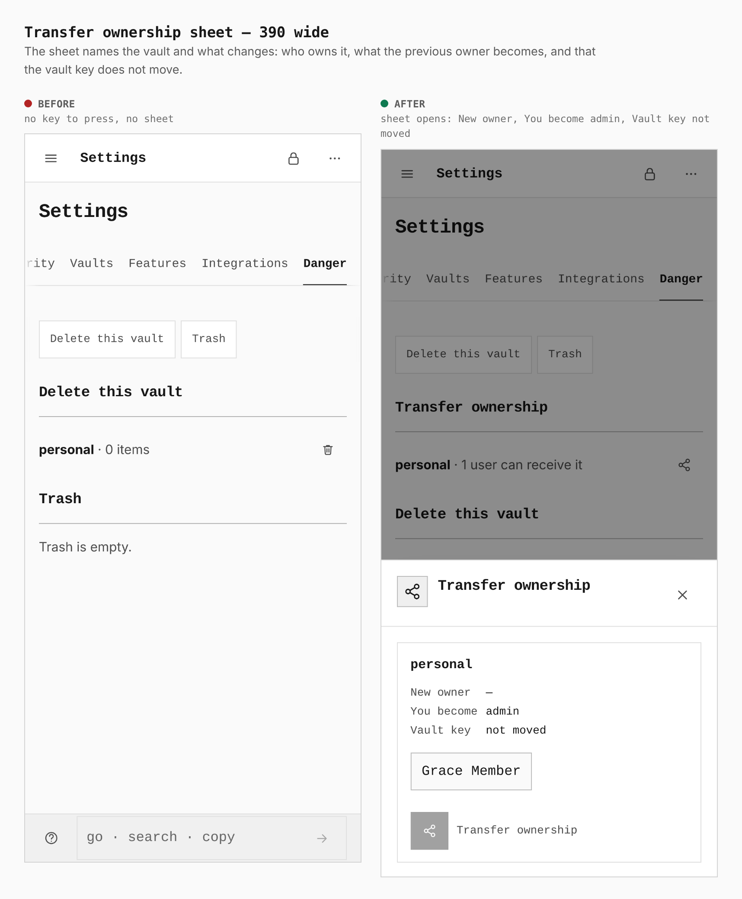
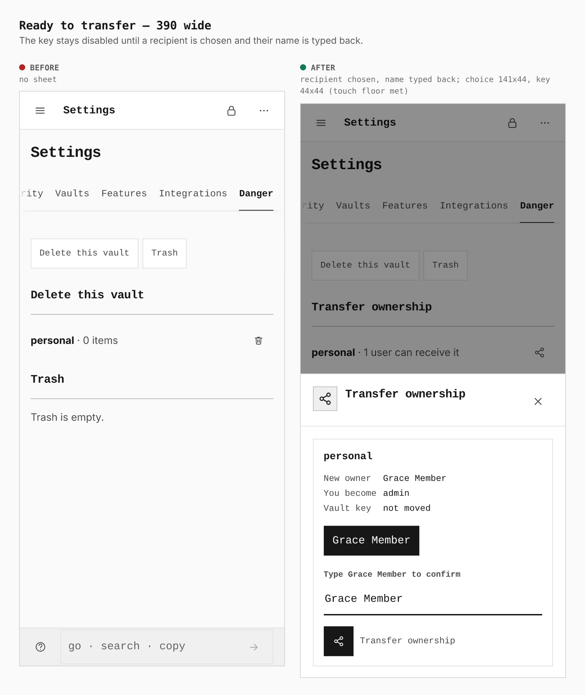

# Transfer ownership in Settings › Danger (ADR 0195)

Before and after from two real builds: `main` (`apps/pages/src` and
`packages/app-core/src` as of `8f4d908f`) and this branch, the same journey at
1280 and 390 wide (`journey.json`). The journey seals a vault without an
account, switches on Directory provisioning, adds a second person (Grace
Member) in Identity, then opens Settings › Danger and walks the sheet. On
`main` the same steps find nothing to press, which is the "before".

Measurements are taken from the browser, not from the CSS.

## Danger zone

| width | before | after |
|---|---|---|
| 1280 | one row, Delete this vault 960×88 at y=146 | Transfer ownership 960×88 at y=146; Delete this vault moves to y=258 |
| 390 | one row, Delete this vault 358×100 at y=288 | Transfer ownership 358×100 at y=288; Delete this vault moves to y=412 |

## The sheet

The sheet names the vault and what changes (New owner, You become admin, Vault
key not moved). The key stays disabled until a recipient is chosen and their
name is typed back.

| width | before | after |
|---|---|---|
| 1280 | no key to press, no sheet | choice 120×32, key 40×40 |
| 390 | no key to press, no sheet | choice 141×44, key 44×44 (the 44px touch floor is met) |

## Not shown

- The row is absent unless the person acting owns the vault and another
  registered user could receive it, so a vault with no second person looks
  exactly like the "before".
- The Settings rail and the section chips list Delete this vault and Trash
  only: the Transfer ownership section is conditional, so it is not a fixed
  entry in the page tree.
