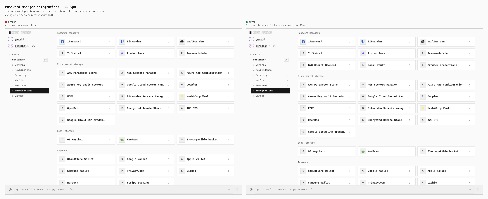
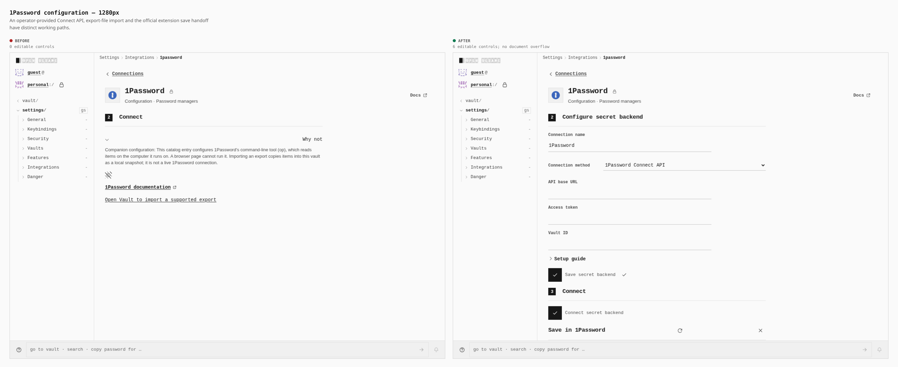
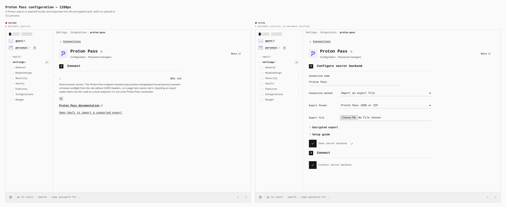
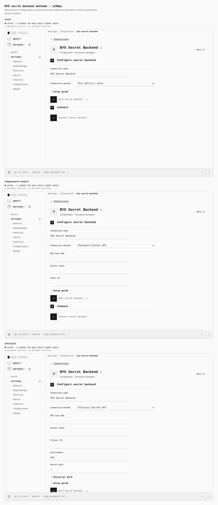
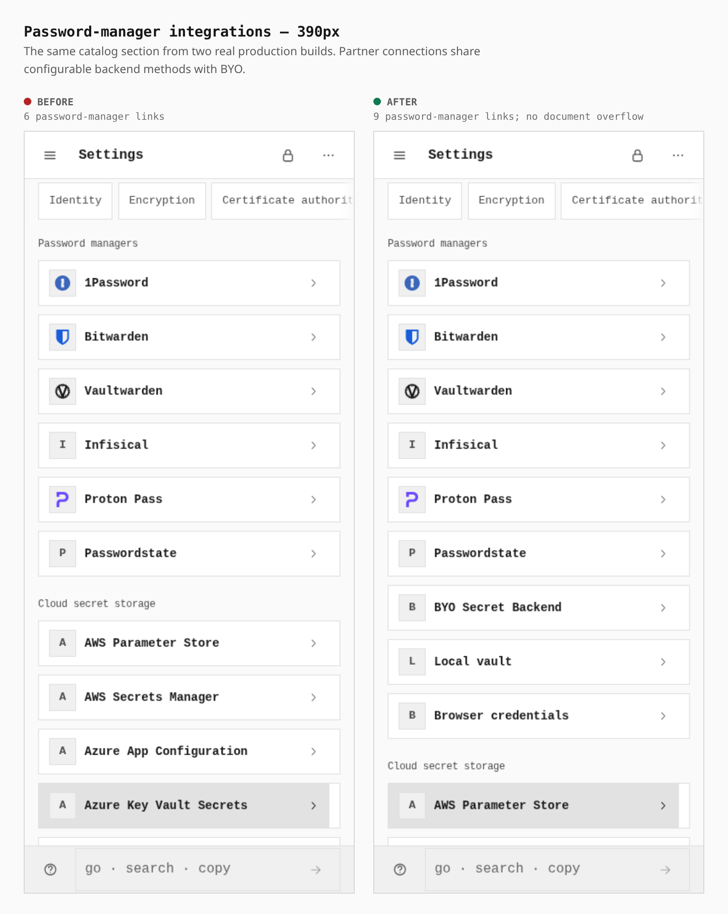
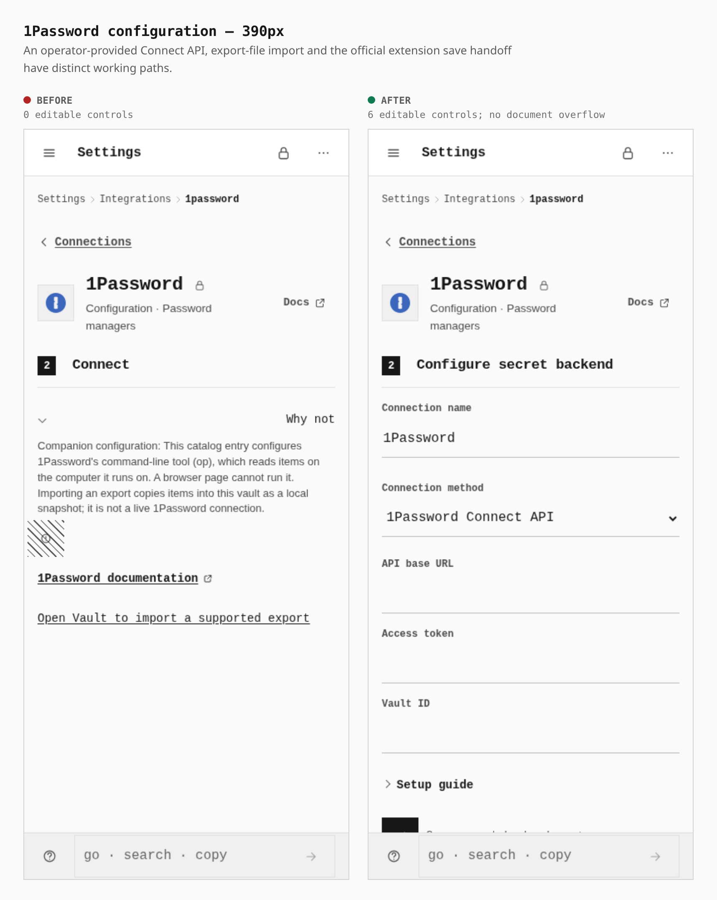
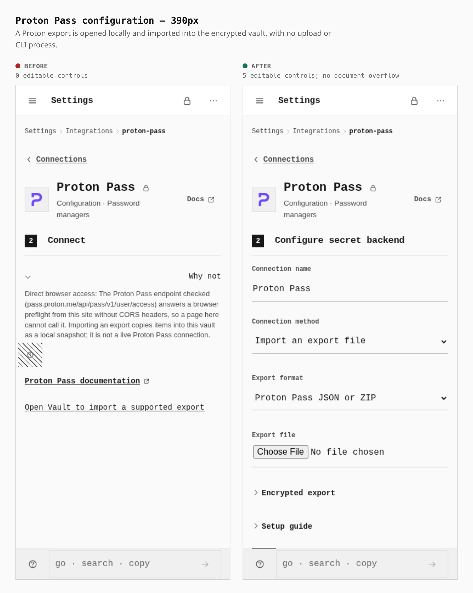
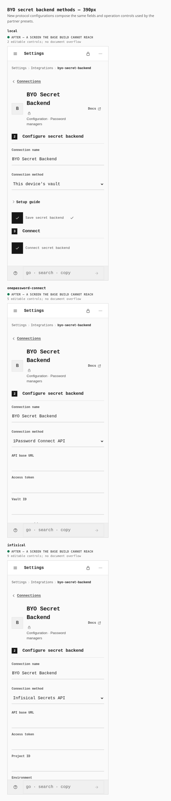

# Configurable secret backends and encrypted vault backups

The Settings forms compose the same backend methods for BYO and partner presets. Access tokens, API keys and client secrets are Token credential items inside the owning vault, protected by its content key and included in encrypted backups. Device-sealed configuration records contain credential-item references. Credential-bearing connections require that vault to be unlocked. Saving validates and persists the configuration; testing or connecting explicitly contacts the backend. An authenticated session remains transient and must be established again after reload. External HTTP operations use the approved Connections capability and its captured transport.

The baseline production artifact is commit `e1c048e63`, read unchanged from the identity worktree. The final loopback build and production captures compile source commit `6ad7b281d6ce450af711e5de2d4e496fb65ba1db`. Captures use the same Settings routes at 1280 × 900 and 390 × 900; the phone context enables touch and mobile behavior. Raw browser frames remain in the system temporary directory. Composed evidence is generated by the repository compositor without altering the app pixels.

## Verified result and measurements

The final canonical run passed **194 assertions**, at both desktop and touch-phone widths, with no page, console, HTTP, missing-asset, unexpected-external-request or worker errors. The five HTTP fixtures received 246 actual API requests and 246 native CORS preflights, including 84 of each through the official Bitwarden Secrets Manager SDK. No hosted partner account is claimed.

The browser explicitly reads and reveals actual Token items after cold unlock. An external Node reader uses the real PIN and vault-core crypto to open the actual uploaded backup and the restored vault’s re-backup: all 13 source items and two folders survive, including four active Token items, while the destination retains its different PIN. Token plaintext is absent from the uploaded ciphertext.

The exact passed checks and canceled-preview diagnostics are recorded in [verification.json](verification.json). The earlier `ca6e7f8` checkpoint passed 178 checks; the final run adds 16 custody and complete-content checks. The new custody assertion also correctly rejected that earlier build, where a saved configuration did not create a vault Token item.

For each installed-PWA run, the worker acknowledged the exact approved connection plan's release and digest before the origin was stopped. There were 134 URLs in the real approved cache. Secure note was explicitly enabled online and its verified definition persisted; the test did not create a note or load the ZIP parser to warm the test. With the app's actual HTTP socket closed, both cold reloads succeeded, the first ZIP import succeeded offline, and the second reload read the imported note from the local vault.

DOM measurements agree at both widths:

| Measurement | Before | After |
| --- | ---: | ---: |
| Password-manager catalog links | 6 | 9 |
| 1Password editable controls | 0 | 6 |
| Proton Pass editable controls | 0 | 5 |
| BYO local editable controls | — | 2 |
| BYO Connect editable controls | — | 5 |
| BYO Infisical editable controls | — | 9 |
| Screens with horizontal document overflow | 0 / 6 | 0 / 12 |

Control counts include native selects, file inputs and fields inside disclosures. The 1Password saved-login origin is read-only and excluded. Raw DOM measurements and capture error logs are in [before-metrics.json](before-metrics.json) and [after-metrics.json](after-metrics.json); the portable steps are in [journey.json](journey.json).

### Desktop: Integration catalog

1280 × 900; 6 → 9 password-manager links; no horizontal document overflow.



### Desktop: 1Password

1280 × 900; 0 → 6 editable controls; no horizontal document overflow.



### Desktop: Proton Pass

1280 × 900; 0 → 5 editable controls; no horizontal document overflow.



### Desktop: Shared BYO configurations

1280 × 900; new Local / Connect / Infisical forms with 2 / 5 / 9 editable controls; no horizontal document overflow.



### Touch phone: Integration catalog

390 × 900; 6 → 9 password-manager links; no horizontal document overflow.



### Touch phone: 1Password

390 × 900; 0 → 6 editable controls; no horizontal document overflow.



### Touch phone: Proton Pass

390 × 900; 0 → 5 editable controls; no horizontal document overflow.



### Touch phone: Shared BYO configurations

390 × 900; new Local / Connect / Infisical forms with 2 / 5 / 9 editable controls; no horizontal document overflow.



## Verification scope

The browser driver uses real loopback HTTP sockets for 1Password Connect, Infisical Universal Auth, Passwordstate and the Bitwarden Vault Management API. These are protocol fixtures with synthetic credentials, not hosted partner accounts. Browser request interception is deliberately absent from the network journey so Chromium performs its native CORS preflights.

Bitwarden Secrets Manager uses the official browser WASM SDK inside the emitted Vite worker. Its fixture independently derives the organization key and authenticates/decrypts AES-CBC/HMAC payloads with Node crypto. The test checks encrypted names, values and notes on the wire as well as create, list, read, update and delete.

The file journey selects real Bitwarden JSON, 1Password CSV, Proton JSON, deflated Proton ZIP and environment files. It previews and explicitly imports them with the browser offline, then reloads the page, unlocks the vault and reads the imported values. The backup journey writes the canonical encrypted vault envelope through Connect, checks the remote item lacks the PIN and known record plaintext, and restores it into an independently sealed vault. That vault must still unlock with its own different PIN after cold reload.

The official `@1password/save-button` custom element and `OPButtonAdded` activation event are exercised. Saving to an actual 1Password account requires an installed, unlocked extension and is not claimed by the fixture run. Chromium's actual `PasswordCredential`/`credentials.store()` path is exercised separately; that API does not choose a particular vendor, enumerate vaults or provide a browser deletion API.

## Proton browser support

Proton Pass provides official CLI CRUD and scoped personal access tokens. Its public Rust core also has a WASM transport; describing it as native-only would be inaccurate. The hosted API currently restricts cross-origin browser access: anonymous preflights to `/account/v4/personal-access-token/session` from the OpenSesame Pages origin returned no CORS grant, while the same request from `https://pass.proton.me` received an explicit matching grant. No account or token was used for those checks. This integration therefore uses the documented local JSON/ZIP export path. Encrypted PGP exports must be decrypted locally before import.

Official references checked on 2026-10-14:

- [Proton developer features](https://proton.me/pass/developer-features), [access tokens](https://proton.me/support/pass-access-tokens), [export formats](https://proton.me/support/pass-export), and [CLI token configuration](https://protonpass.github.io/pass-cli/get-started/configuration/).
- [Proton CLI source](https://github.com/ProtonPass/pass-cli/tree/7ae51e52818bca8df905988e4b149d43d31d4c83), pinned for the WASM/PAT implementation review.
- [Official Save in 1Password button](https://www.1password.dev/web/add-1password-button-website).
- [Credential Management API](https://developer.mozilla.org/en-US/docs/Web/API/Credential_Management_API).

## Reproduce

Run from the repository root with the installed Chromium executable selected by `PLAYWRIGHT_CHROMIUM`:

```sh
pnpm --filter @opensesame/pages build:secret-backends-verify
pnpm --filter @opensesame/pages verify:secret-backends
PAGES_CAPTURE_PHASE=after node apps/pages/scripts/capture-backup-integrations.mjs
node apps/pages/scripts/compose-backup-integrations.mjs
```

The browser profile serves the app on `http://localhost:41901`; fixture ports are 41902–41906. This is the explicitly declared development build, with the normal capability checks and browser CORS enforcement. The evidence capturer defaults to the production `dist` artifact and Pages origin.
