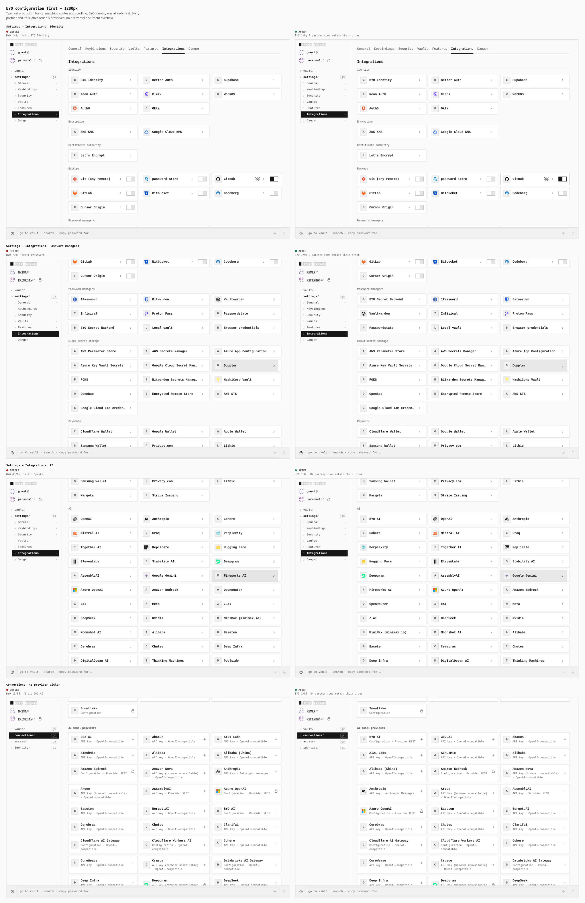
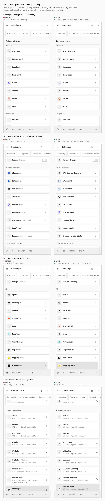

# BYO configuration first

Two real production builds, captured at 1280 × 900 desktop and 390 × 900 mobile
with touch enabled. Each comparison follows the same PIN-vault setup, Connections
feature approval, routes and scrolling. The original screenshot pixels are shown
at 1:1 size; no product content was inserted, removed or blurred.

The before artifact is distribution
`dist:0ce48df1a089fe925a88e7c8cdc410683a08067c15a1742ca9061ad7644bd2b2`,
validated tree `b0a1576fb717a796aa1e34554bdb68ae5e67f3ab`. It was built from
Git head `f6d6a18e79200fdf595f6ab0c7cf3ba8b758f682` plus its 15-file working
overlay; its source is equivalent to signed commit
`bd4e403979978af6151c601a488d8083ada510c4`. It is not relabeled as a clean
build of that later commit. Its full output was preserved before rebuilding.

The after build was compiled from clean signed commit
`6f5781060181d53200aafa1edf25bc6aa508079c`, tree
`db3330c728da122bf47500f4b3cbed89b498f90c`. Its independent production graph
has zero violations/mismatches; the rebuilt default profile passes its bundle
budget. Previously built hardened outputs also pass unchanged limits; those
profiles were not rebuilt for this ordering change. The capability distribution
identity is unchanged. The two actual output inventories
have distinct SHA-256 receipts in metrics.json.

| Rendered list, at both widths | BYO position before → after | Partners retained in the same order |
| --- | --- | ---: |
| Settings: Identity | 1/8 → 1/8 | 7 |
| Settings: Password managers | 7/9 → 1/9 | 8 |
| Settings: AI | 85/85 → 1/85 | 84 |
| Connections: AI provider picker | 15/85 → 1/85 | 84 |

BYO Identity was already first; that pair records the unchanged order. The other
three lists now lead with their generic BYO option. Every list retains its full
provider count and exactly one relevant BYO option. The complete partner ID/name
arrays, excluding that BYO option, match the baseline exactly.

All 16 raw captures have zero horizontal document overflow. The baseline passes
8 overflow checks; the changed build passes 32 ordering/count/overflow checks.
Both captures have zero strict browser failures. [metrics.json](metrics.json)
contains the exact DOM arrays, checks, build identifiers and reproducible journey.

## Desktop

Four matching category views at 1280 px. Settings AI moves BYO from position 85
to 1; the Connections picker moves it from 15 to 1. Password managers moves BYO
from 7 to 1. Partner ordering is preserved throughout.

## Touch phone

The same four views and measurements at 390 px with mobile/touch emulation.
Category headings and first cards remain visible below the normal sticky chrome.

## Reproduce

Build the two source versions separately with the repository-pinned Pages build
command. Serve each actual output through the common Pages static-origin browser
harness. Create a PIN vault and enable the Connections switch in Settings →
Features. Open Settings → Integrations, then scroll the Identity, Password
managers and AI section headings below the sticky header. Open
`/OpenSesame/connections#catalog-ai_model_provider` for the AI provider picker.
Repeat at both viewports. Read all rendered provider rows before taking each
viewport screenshot; compare partner arrays after removing the single BYO row.
