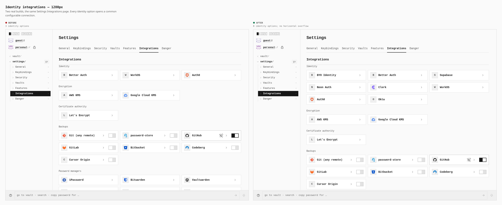
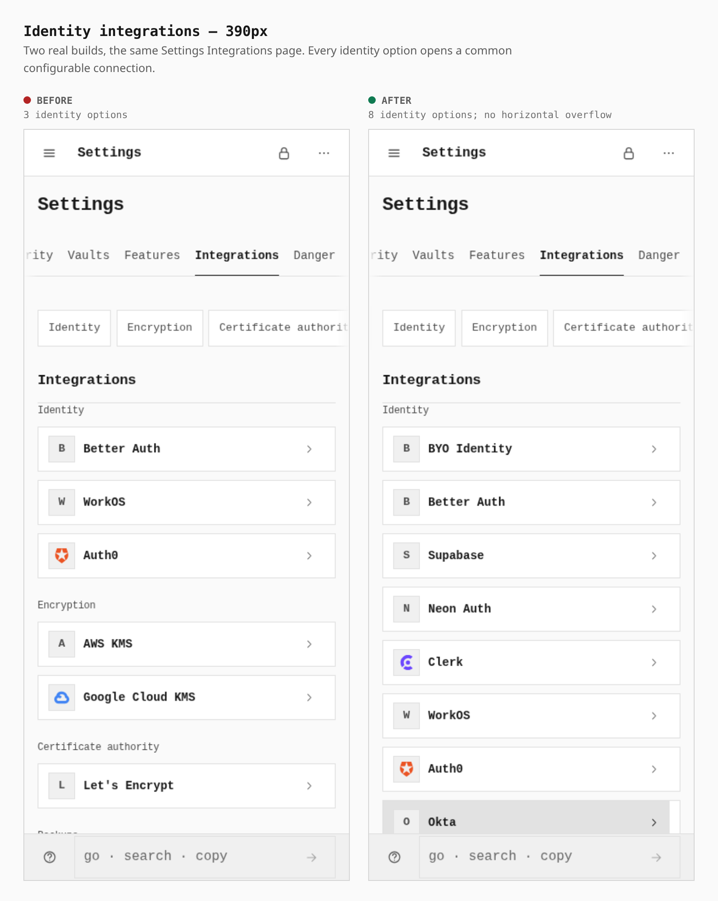
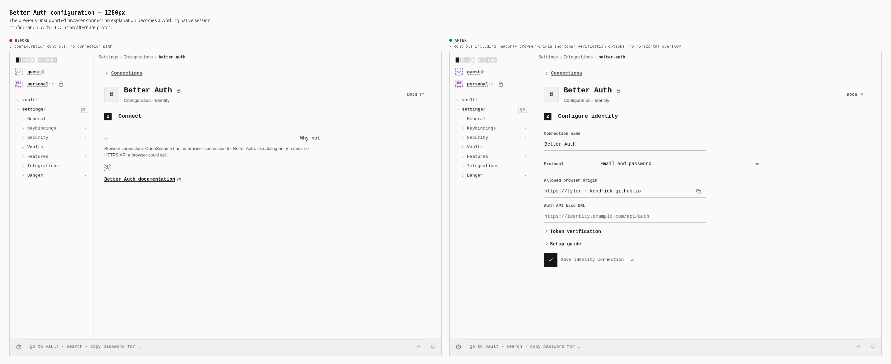
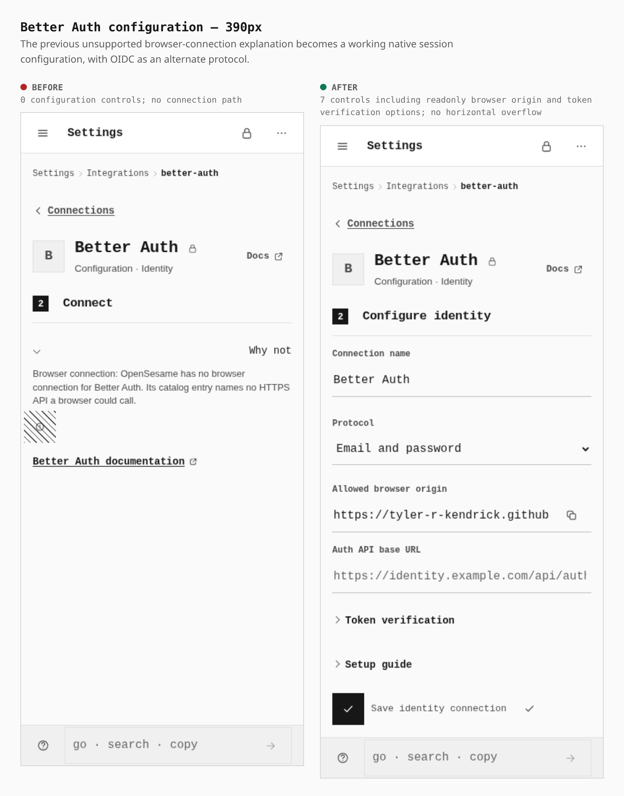
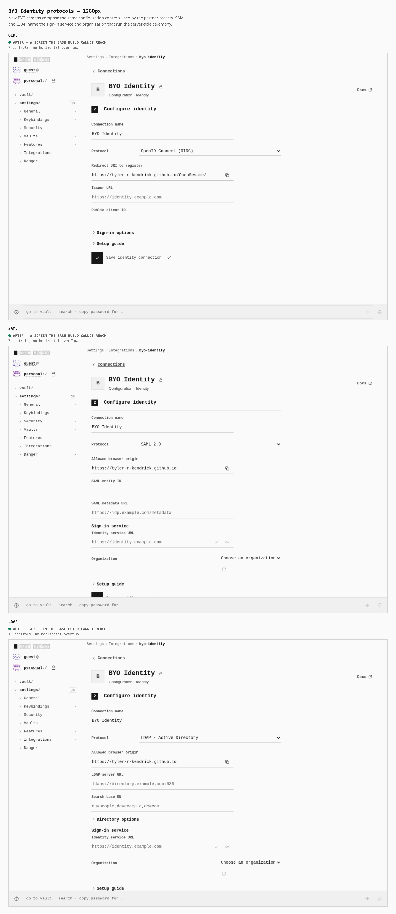
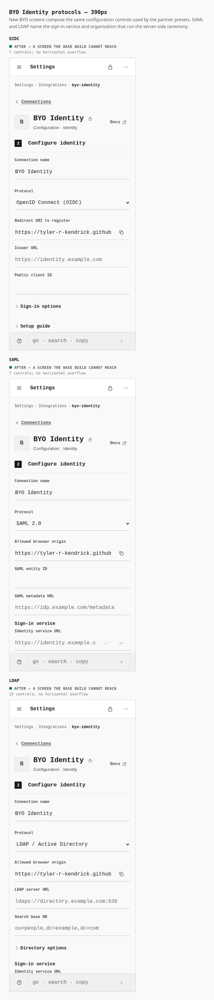

# Configurable identity integrations

Better Auth previously displayed an unsupported browser connection message with
no configuration controls. It now accepts an Auth API URL, optional token
verification overrides, and a native account sign-in; OIDC is an alternate
protocol. The identity catalog includes Better Auth, WorkOS, Auth0, Supabase,
Neon Auth, Clerk, Okta, and BYO Identity. Partner pages compose the same protocol
fields, validation, persistence, and sign-in components as BYO.

These are two real builds: baseline `78f4c6ed0` and the task branch based on
`d09ed22b1`. Both captures use the same production HTTPS origin, local PIN seal,
Connections switch, and catalog-linked routes at 1280 × 900 and 390 × 900. The
390 px context has touch enabled. [journey.json](journey.json) names the actual
capture scripts and steps; provider pages use `settings/connections/<provider>`,
not `settings/integrations/<provider>`.

| Browser measurement | Before | After |
| --- | --- | --- |
| Identity catalog options, both widths | 3 | 8 (seven partners plus BYO) |
| Better Auth configuration controls | 0 | 7: six editable and one readonly |
| BYO OIDC controls | Page absent | 7: six editable and one readonly |
| BYO SAML controls | Page absent | 7: six editable and one readonly |
| BYO LDAP controls | Page absent | 15: fourteen editable and one readonly |
| Horizontal document overflow | None | None |

Control counts include advanced fields inside collapsed details and the
readonly browser origin or redirect URI. Measurements and browser logs are in
[before-metrics.json](before-metrics.json) and
[after-metrics.json](after-metrics.json).

## Identity catalog

The same catalog view changes from three identity entries to eight configurable
options, at desktop and phone width.





## Better Auth

The unsupported connection explanation becomes an editable configuration form.
The readonly browser origin is available for the server's trusted origin and
CORS settings. Token verification options are shared by the native presets.





## BYO protocols

These are new screens; the baseline cannot reach them. OIDC uses a public client
and PKCE, or an organization sign-in service for confidential clients. SAML and
LDAP name the service and organization that run their server-side ceremonies.





## Runtime verification

`verify:identity-connections` passed 88 recorded checks plus browser assertions.
It runs a real static app server and real IdP sockets in Chromium at 1280 and
390 px. Better Auth uses the pinned `better-auth` 1.6.26 implementation with its
JWT plugin; OIDC uses the pinned `oidc-provider` 9.11.2 implementation. The OIDC
journey exercises discovery, authorization, consent, S256 PKCE, nonce, token
exchange, signature verification, callback, and PIN unlock into the solution's
identity.

The native journeys save and reopen configuration, submit transient credentials,
verify signed tokens, retain provider cookies, sign out, reload a fresh app root,
sign in using saved configuration without opening Settings, and unlock with the
vault PIN. Neon and Supabase journeys also reload and revalidate the provider
session before restoring identity; removal revokes the upstream session. The
password is absent from persistent browser storage after sign-in.

The Neon fixture exposes its documented JWKS path through the real Better Auth
handler. The Supabase fixture is an independent GoTrue-compatible HTTP server
with real ES256 signing keys, public-key headers, token/user/JWKS endpoints, and
logout revocation. These verify the protocol adapters; they do not claim a live
hosted tenant login. No hosted partner tenant credentials are used.

The final production static-origin and capability graph gates passed. The
production build and the minimal-local and family-local hardened profiles stayed
within the existing bundle ceilings, with zero profile graph violations.
The final touch contract passed at 320, 390, 430, 844, 1024, and 1366 px.

The keyboard gate passed its desktop identity and navigation contracts, then
timed out establishing a live WebRTC session. The unchanged baseline reproduced
the same failure twice: both peers finished gathering with no remote candidates,
and ICE remained `new`. The identity socket journeys above passed all 88 checks
after the browser permission helper was verified with actual permission queries.

## Reproduce

Set `PLAYWRIGHT_CHROMIUM` when using an installed Chromium instead of Playwright's
bundled browser. Raw captures stay in the system temporary directory; the six
sheets above are composed with the repository's existing browser compositor.

```sh
VITE_BASE=/OpenSesame/ pnpm --filter @opensesame/pages build
PAGES_CAPTURE_PHASE=before PAGES_VERIFY_DIST=/path/to/baseline/dist \
  pnpm --filter @opensesame/pages capture:identity-integrations
pnpm --filter @opensesame/pages capture:identity-integrations
pnpm --filter @opensesame/pages compose:identity-integrations

VITE_BASE=/OpenSesame/ pnpm --filter @opensesame/pages build:identity-verify
pnpm --filter @opensesame/pages verify:identity-connections

pnpm --filter @opensesame/pages verify:static
pnpm --filter @opensesame/pages verify:mobile
pnpm --filter @opensesame/pages verify:keyboard
pnpm --filter @opensesame/pages build:profile --profile minimal-local --mode hardened --gate enforce
pnpm --filter @opensesame/pages build:profile --profile family-local --mode hardened --gate enforce
node scripts/quality/bundle-budget-gate.mjs
```

The identity fixture build uses the declared loopback development profile and
its canonical app origin. The browser grants actual local-network permission;
Local Network Access checks remain enabled. The production static-origin and
layout gates use the production build.
