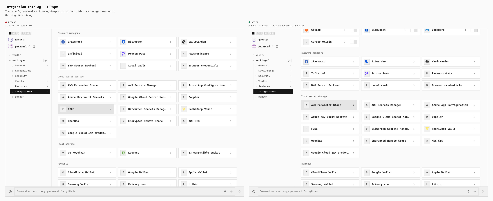
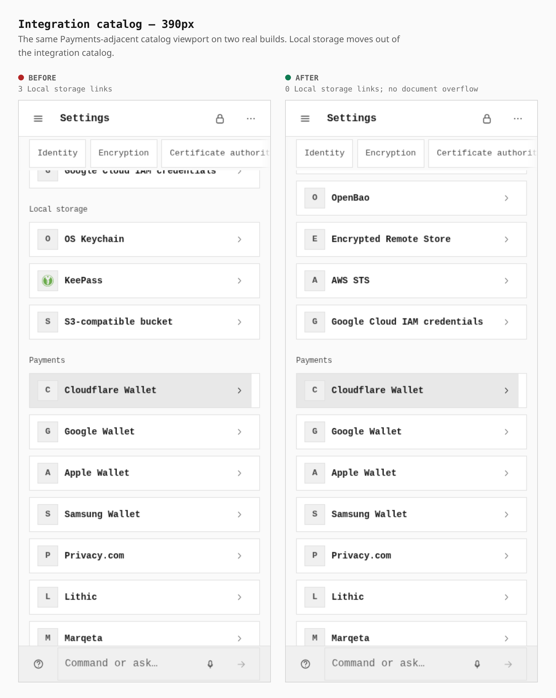
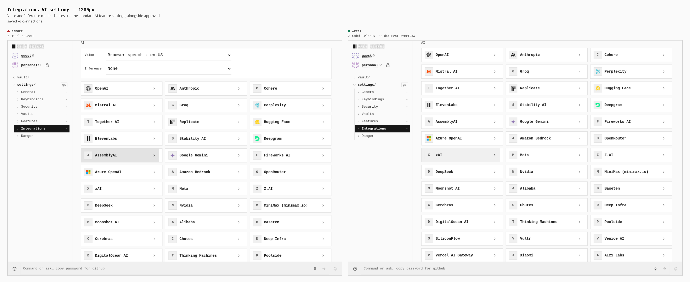
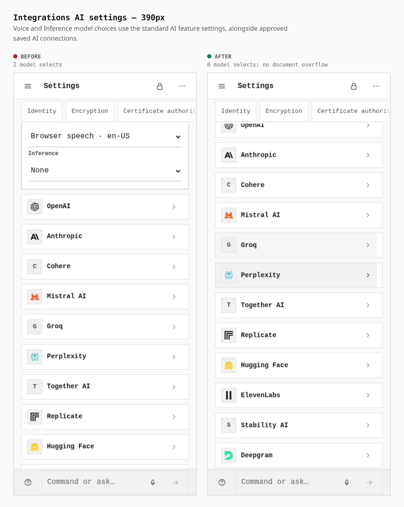
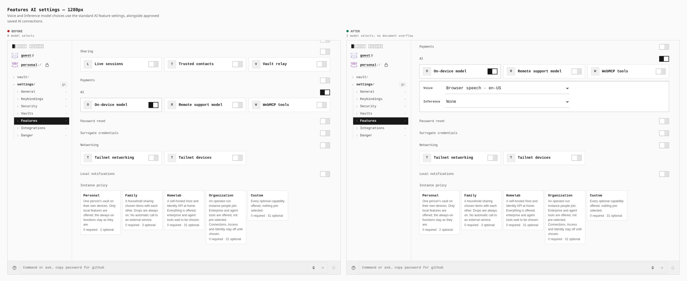
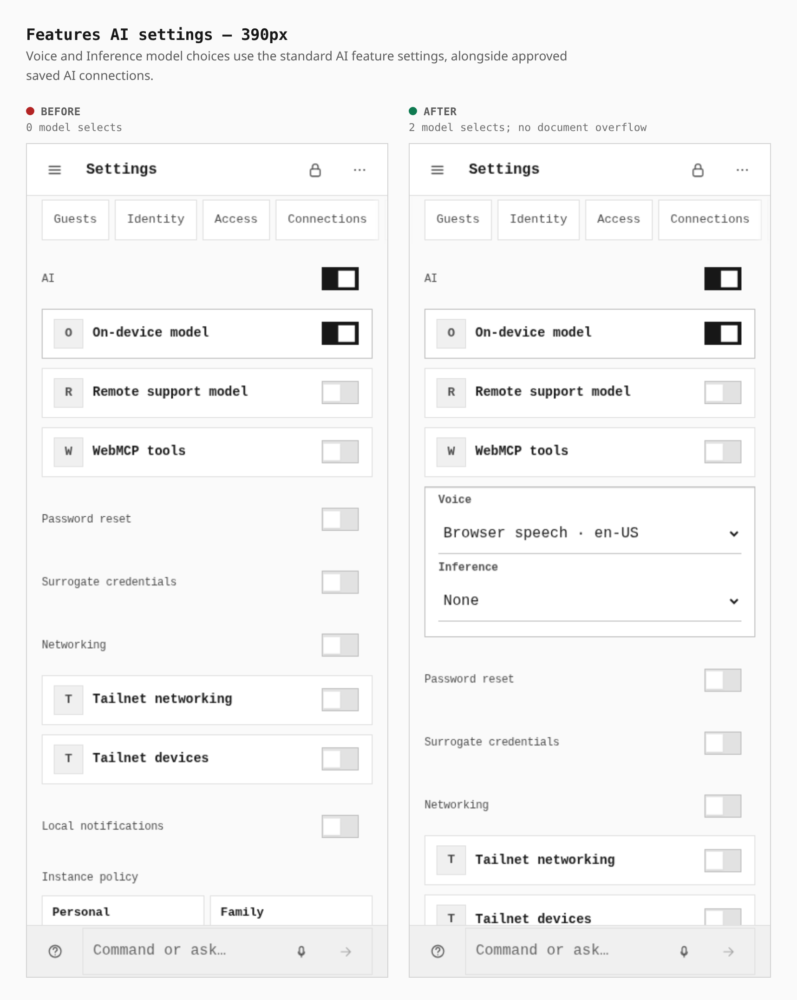
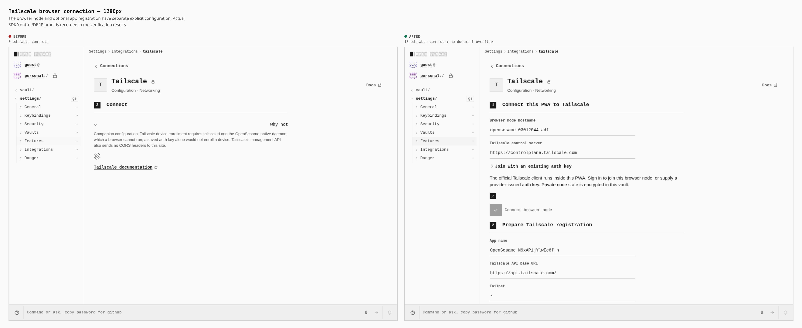
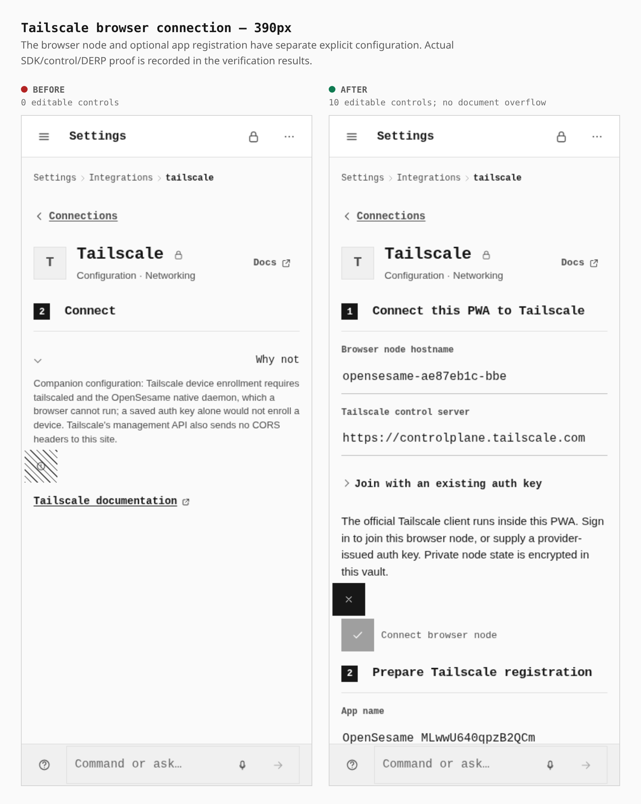
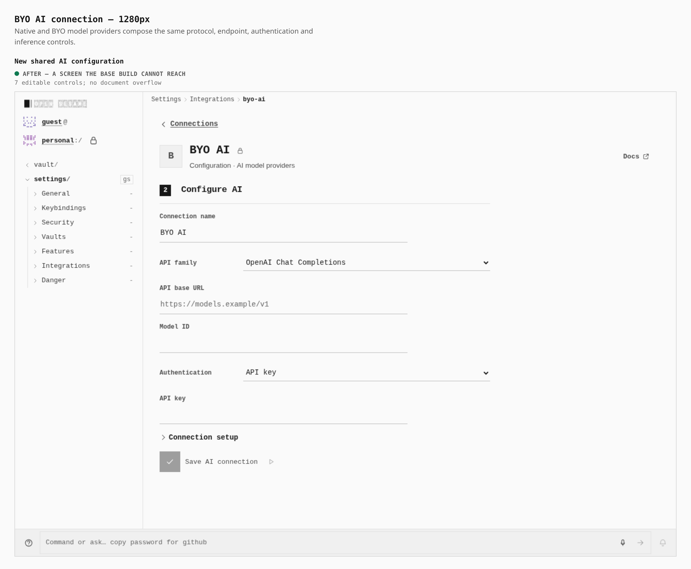
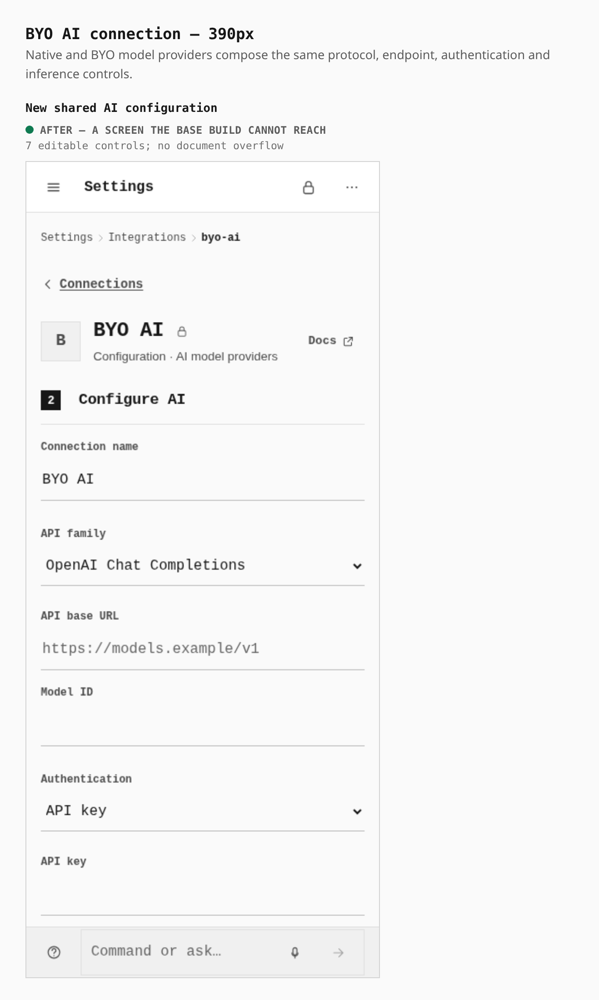

# Integration settings: AI and Tailscale

Two real production builds, captured with the same navigation and feature choices at
1280 × 900 and 390 × 900. The phone context has touch and mobile emulation enabled.
The baseline is `ca6e7f8e5ef2d32ade17dc9c6e58d00cc9221872`; the rendered after
build is `92024686885d00a3c0a05f8cf95d743dfb872cf2`. Later popup cleanup fixes
have no rendered changes and are verified separately.

The captures use the built Pages app at its normal static origin. They enable
Connections and On-device model through Settings. No API fixture response is used
to render these configuration screens. All 18 original frames have zero horizontal
document overflow. BYO AI is an added screen and has no invented baseline image.
The matching configuration captures leave Tailnet networking unapproved, so its
Connect button waits for approval in Settings → Features. The functional browser
journeys approve that feature and exercise the real connection separately.

| Measured DOM, at both widths | Before | After |
| --- | ---: | ---: |
| Local storage integration links | 3 | 0 |
| Local storage integration navigation entries | 1 | 0 |
| Model selectors in Integrations → AI | 2 | 0 |
| Model selectors in Features → AI | 0 | 2 |
| Editable Tailscale configuration controls | 0 | 10 |
| Editable BYO AI controls | — | 7 |

Counts include expandable configuration fields. BYO AI has three native selects:
API family, Authentication and Output token parameter. Full measured labels and
options are in [before-metrics.json](before-metrics.json) and
[after-metrics.json](after-metrics.json); the portable journey is
[journey.json](journey.json).

## Desktop catalog

The same Payments-adjacent catalog viewport shows three Local storage cards removed.
The corresponding integration navigation entry is also absent.



## Phone catalog

Three Local storage links become zero at 390 px, with no horizontal overflow.



## Desktop AI integrations

Integrations → AI retains the provider catalog; its two model selectors move to Features.



## Phone AI integrations

The same relocation removes both model selectors from this phone integration view.



## Desktop AI features

Features → AI gains the Voice and Inference selectors: zero becomes two.



## Phone AI features

Both model selectors appear under the existing AI feature group at 390 px.



## Desktop Tailscale

The old companion-only explanation becomes explicit browser-node configuration
plus optional app registration. Ten editable controls are present in the DOM.



## Phone Tailscale

The same browser-node and registration controls remain usable without document overflow.



## Desktop BYO AI

The added shared form has seven editable controls, including four API-family choices.
Native optimized experiences compose these same controls and runtime.



## Phone BYO AI

The same seven controls fit at 390 px without horizontal document overflow.



## Functional browser evidence

The visual capture is separate from protocol verification. Both functional gates
exercise 1280 px desktop and 390 px touch phone contexts against real sockets.

- AI: **80 assertions passed**, 32 API requests and 32 browser CORS preflights,
  with zero strict browser failures. Native OpenAI Chat/Responses and BYO
  Anthropic/Gemini perform actual authenticated JSON and SSE inference against
  protocol fixtures mounted at a custom URL path. Save independently verifies the
  protocol. The selected connection survives cold reload and PIN unlock; its API
  key is revealed from an actual vault Token item. Compiled source:
  `92024686885d00a3c0a05f8cf95d743dfb872cf2`.
- Tailscale browser node: **41 assertions passed**, with zero strict browser
  failures. The official pinned `@tailscale/connect` WASM client enrolls through
  real Headscale/Noise control and DERP, then reads an actual native Tailscale
  peer over its tailnet address. Eight browser control connections, eight DERP
  connections and eight peer GETs were observed. Compiled source:
  `ffaab80f8de45809defee51134c4a97f9c6d94b5`.
- Installed PWA: an unapproved cache excludes the dedicated Tailscale worker,
  runtime, WASM and license. After explicit Networking approval, all four are
  cached before first SDK use under a matching release/digest readiness signal.
  The actual app server is then stopped, socket unavailability independently
  checked, and cold reload/PIN unlock/reconnection/peer GET succeed through the
  service worker while the separate control/DERP/peer fixtures stay available.
- Conditional management: **22 assertions passed**, with zero strict browser
  failures, against compiled source
  `e834d91a2bc21e5557e993f54d67212298010897`. Six API operations, four native
  CORS preflights and six real HTTPS synthetic-consent GETs cover registration,
  verification, wrong-state rejection, cancellation and successful one-use key
  exchange. Each viewport consumes exactly one issued key. The generated client
  secret survives cold PIN unlock as an actual vault Token item.

AI partner accounts and a hosted Tailscale tenant were not used. The management
fixture serves an explicitly synthetic consent page over real HTTPS with an exact
test certificate pin and hostname mapping; management endpoints use actual HTTP
sockets and browser CORS enforcement. This does not establish CORS support on
Tailscale's hosted management API. The official SDK currently exposes GET, so
mutating tailnet service operations are not claimed.

[verification.json](verification.json) records each passing assertion, the exact
compiled source for each gate, safe wire counts and release/digest-bound cache
measurements. Three genuine failing checkpoints were retained during development:
AI cold selection was lost; the approved PWA cache omitted its dedicated worker;
and the `9202468` management build passed all functional checks but emitted
prohibited popup-close console errors after minification removed its guard. Each
was repaired and the corresponding unchanged browser assertions passed. The final
management guard also has a regression through the actual Vite minifier settings.

## Reproduce

Use the repository-pinned pnpm and an installed Chromium. Build each dedicated
profile serially because stamped builds share `public/security-profile.json`.
The drivers honor `PAGES_VERIFY_DIST` and `PAGES_VERIFY_OUT`.

```sh
pnpm --filter @opensesame/pages build:ai-connections-verify
PLAYWRIGHT_CHROMIUM=/usr/bin/chromium pnpm --filter @opensesame/pages verify:ai-connections
pnpm --filter @opensesame/pages build:tailnet-browser-verify
PLAYWRIGHT_CHROMIUM=/usr/bin/chromium pnpm --filter @opensesame/pages verify:tailnet-browser-node
PLAYWRIGHT_CHROMIUM=/usr/bin/chromium pnpm --filter @opensesame/pages verify:tailscale-provisioning
```

For visual capture, preserve the two real build outputs separately. Run the same
capture script with `PAGES_CAPTURE_PHASE=before` or `after`, the corresponding
`PAGES_COMPILED_SOURCE_COMMIT`, and `PAGES_VERIFY_DIST` pointing to that build.
Then compose the captured frames:

```sh
PLAYWRIGHT_CHROMIUM=/usr/bin/chromium node apps/pages/scripts/capture-integration-settings.mjs
PLAYWRIGHT_CHROMIUM=/usr/bin/chromium node apps/pages/scripts/compose-integration-settings.mjs
```

## Build and workspace checks

The final runtime build `e834d91a2bc21e5557e993f54d67212298010897` passes its independent production graph check (zero mismatches or violations) and the reviewed default bundle budget. Both hardened profiles were built at `9202468`; independent checks confirm Networking, External connectors, Remote AI, the popup module, and every Tailscale SDK/worker asset are absent. The subsequent popup-only fix cannot reach those excluded modules. All three bundle budget outputs pass, with hardened limits unchanged.

All 69 workspace typecheck tasks pass without cached results. The full workspace test run is in progress; its result will be recorded before this evidence PR is marked ready. Scoped strict lint, structural checks, package boundaries, and secret scanning are recorded separately in the implementation PRs.
