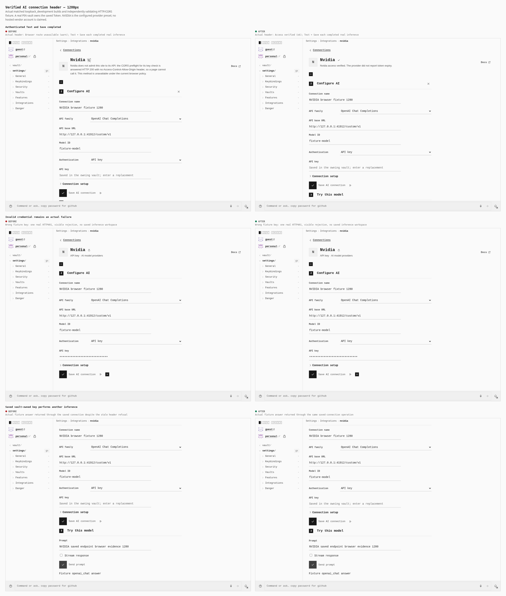
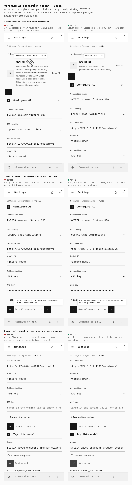

# Verified AI connection projection: actual browser evidence

Two matched production builds exercise the actual NVIDIA shared AI configuration form, a real PIN-sealed durable vault, and an independently validating HTTP/CORS fixture. These journeys use the normal UI: configure, deliberately fail Test with a wrong fixture key, retry Test successfully, Save, send another prompt through the saved connection, then read its actual Token credential in the vault. No configuration, credentials or DOM elements are seeded. No provider request is intercepted or fulfilled by Playwright.

| Build | Source | Index SHA-256 |
| --- | --- | --- |
| Before | Clean `e68e24c18ddaa12c4a5c4b056d413555032a4b8c`, tree `47c818c3a9fe1de488949be748b27918fc26d152` | `9b674124bd7ce7c9d422a9156806a62cb45b5446e27cfcc0f2ff2f21d8f098b7` |
| After | That parent plus the exact eight-file overlay in `source-manifest.json`, tree `8b02a756b1f4f88d4a4cc1e47c689ff13276c0a7` | `27e73c88a8f298e36b80c8d3b643c909d8a55af1fd7806e22269b12d88b4866a` |

Both are actual Vite production builds of the declared `loopback_development` AI verification profile, canonical origin `http://localhost:41911`. The after build was compiled from the frozen overlay before signed publication, so it is identified by parent/tree/file hashes rather than falsely described as a clean build of a future commit. Its exact tree was subsequently published as verified signed commit `ac5d3c43ed68ca9032e7f107ed5df6ef47a7a4b6` in [PR1297](https://github.com/Tyler-R-Kendrick/OpenSesame/pull/1297), with parent/tree/eight-file equivalence independently verified by the root publisher. Chromium is 151.0.7922.173. The static app server serves built files only; the separate HTTP fixture emulates the configured AI service and is not an OpenSesame application backend.





The comparison sheets retain the full captured viewports: desktop 1280 × 900 and mobile/touch 390 × 900. Lossless WebP reduces their publication size without changing a single decoded RGBA byte, resizing, cropping or recoloring. `lossless-gallery-receipt.json` records original PNG/target hashes, dimensions and independently compared pixel hashes. Original PNG sheets and raw captures remain in the private work evidence.

## Results and limits

**60 behavioral checks passed: 29 before and 31 after.** Each build made eight actual POST requests and eight genuine CORS preflights. Each had six authenticated fixture inference successes (Test, independent Save verification, and a saved-connection prompt at both sizes), plus two deliberate wrong-key HTTP 401 refusals. The fixture independently checks endpoint mount, method, authentication, model/protocol body and token parameter. The saved key was readable as a real vault Token and absent from plaintext configuration storage. Both viewport sizes had zero horizontal overflow and the correct desktop/coarse-touch pointer mode.

The before bug is directly observed: after successful Test and Save, the header still says **Browser route unavailable** and repeats the NVIDIA hosted-origin policy, although the configured endpoint is the working fixture. After the fix, the same real operations yield **Access verified** in both viewports. The saved connection performs another real HTTP request and returns its expected fixture answer in both builds.

The deliberately denied Test remains an actual error and does not produce a saved inference workspace. Expected HTTP 401 resource messages and cancellation of those rejected response bodies are recorded separately. A cancellation is accepted only for the exact fixture endpoint, during the deliberate negative step, after an observed HTTP 401. There are no unexpected browser/page/network/fixture errors; the first overly strict classifier run is retained privately as a diagnostic.

Two additional UI issues remain visible and are **not** claimed fixed here: the unsaved NVIDIA header still reads **Not available here** in both builds, and an outer failed-Test flash glyph remains after later successful retry/Save. The screenshots preserve that sticky glyph. The fix verified by this gallery concerns the projection of an actually saved, admitted AI connection.

No hosted NVIDIA or other vendor account was used. Successful synthetic HTTP inference proves configured-endpoint behavior and vault custody in the PWA, not access to NVIDIA's hosted endpoint or global integration completion. Development network consent uses the existing explicit Chromium local-network permission helper; TLS, CORS, CSP and browser security are not disabled. No browser extension is involved.

## Reproduce

Run from the repository root with existing dependencies and the matching frozen builds. Capture scripts do not build or modify the product. The before and after directories must be built with the declared profile used here (`pnpm --filter @opensesame/pages build:ai-connections-verify`). Run phases sequentially because the real app/fixture use ports 41911/41912.

```sh
PWA_AI_EVIDENCE_OUT=/absolute/path/to/new-evidence PAGES_CAPTURE_PHASE=before PAGES_VERIFY_DIST=/absolute/path/to/before/apps/pages/dist-ai-connections-verify PWA_COMPILED_PARENT=e68e24c18ddaa12c4a5c4b056d413555032a4b8c PWA_COMPILED_TREE=47c818c3a9fe1de488949be748b27918fc26d152 PLAYWRIGHT_CHROMIUM=/usr/bin/chromium node docs/evidence/2026-10-15-ai-connection-projection/capture.mjs
PWA_AI_EVIDENCE_OUT=/absolute/path/to/new-evidence PAGES_CAPTURE_PHASE=after PAGES_VERIFY_DIST=/absolute/path/to/after/apps/pages/dist-ai-connections-verify PWA_COMPILED_PARENT=e68e24c18ddaa12c4a5c4b056d413555032a4b8c PWA_COMPILED_TREE=8b02a756b1f4f88d4a4cc1e47c689ff13276c0a7 PLAYWRIGHT_CHROMIUM=/usr/bin/chromium node docs/evidence/2026-10-15-ai-connection-projection/capture.mjs
PWA_AI_EVIDENCE_OUT=/absolute/path/to/new-evidence PLAYWRIGHT_CHROMIUM=/usr/bin/chromium node docs/evidence/2026-10-15-ai-connection-projection/compose.mjs
PWA_AI_EVIDENCE_OUT=/absolute/path/to/new-evidence python3 docs/evidence/2026-10-15-ai-connection-projection/lossless-gallery.py
```

The optional lossless compression step needs Pillow with WebP support and verifies decoded equality before writing its receipt. It adds no application dependency. `before-metrics.json` and `after-metrics.json` include the full actual request/preflight/error observations, measurements and check results.
