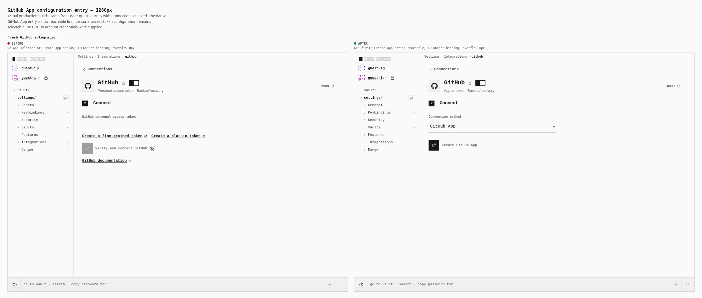
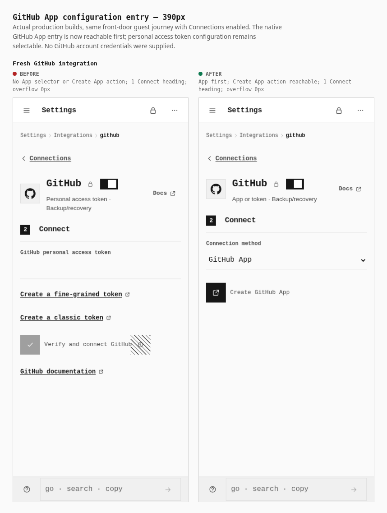

# Native GitHub App configuration entry: browser evidence

These screenshots come from two actual production builds, rendered in Chromium 151.0.7922.173. The browser takes the real guest road, enables Connections in Features, then opens Integrations and the actual mounted GitHub route, `/OpenSesame/settings/connections/github`.

| Build | Source | Index SHA-256 |
| --- | --- | --- |
| Before | Clean parent `d7729f546c23699aa1553b2e02c7b77d8f3f4ba8` | `b08b57c197378edcb190fe91161d06d4ba862f2200cf79c9a2fe027702bca85d` |
| After | That parent plus the frozen six-file overlay, source tree `4595630ce41c148925a359f3f6c74929846e5bc2` | `a66e3bc5a7e2fa209a56847e9e4fc712c696ac4d2fca6eb99cd9708fa49cf8ce` |

The after build was compiled before its signed publication; it is identified by parent, exact frozen overlay file hashes, and tree, rather than falsely described as a clean build of a future commit. Metrics record every dist file digest and the inventory digest. Source hashes were rechecked after captures and remained unchanged.





The primary journeys passed 72 checks: 13 before and 59 after. Both sizes have exactly one Connect heading and zero horizontal document overflow. After: GitHub App is the first method and selected by default, Create GitHub App is reachable, Docs targets `https://docs.github.com/en/apps`, and the existing personal access token form remains usable. The token draft survives switching App → token → App → token. The phone uses real mobile/touch emulation and a coarse pointer, with 44 px controls; the desktop selector is 480 × 44 px and the phone selector is 358 × 44 px.

For each of `github_app=registered` and `github_app=installed`, the actual after route removes the marker and shows one verification error. It reports zero successful App registrations, zero connected header marks, and no fabricated App presence. The screenshots expose the existing status mark's native hover/touch description. No GitHub account credentials were supplied and no external/provider HTTP requests occurred. There were zero browser console errors, page errors, failed requests, HTTP errors, or missing assets in the passing journeys.

These checks prove UI reachability, composition, draft retention, and rejection of forged callbacks. They do not prove a live GitHub account registration, installation, repository selection, or backup write. Registration manifest/state behavior and native REST operations have separate unit/protocol evidence; this UI evidence does not replace it.

Raw captures include the selected token form and both forged-callback failures at each size. JSON receipts preserve measurements and console/network observations. `capture.mjs` and `compose.mjs` reproduce the primary journeys and comparison sheets against the recorded builds.

Private diagnostics retain an initial unsupported `/settings/integrations/github` route attempt, corrected after checking the actual runtime route, and guest-session reload attempts that did not reach Features. A supplemental saved-public-metadata fixture was not exercised: writing raw JSON directly to localStorage is invalid because the production storage port requires an ADR 0149 at-rest seal and removes unsealed app-owned records. The record was confirmed null at GitHub. This was initially mistaken for guest clearing; source inspection identified the sealed-storage rule. No saved-metadata/Forget runtime pass is claimed. These diagnostic attempts are excluded from the comparison images and primary check counts. No production source or build output was altered to obtain the screenshots.


## Reproduce the primary journeys

Run from the repository root, with dependencies already installed. Supply the two matching frozen production build directories; `before` must use clean parent `d7729f546c23699aa1553b2e02c7b77d8f3f4ba8`, and `after` must use that parent with the exact six-file source overlay recorded in `source-manifest.json`. The browser scripts never build or modify the application. Use a fresh output directory to preserve the checked-in receipts.

```sh
PWA_GITHUB_EVIDENCE_OUT=/absolute/path/to/new-evidence PAGES_CAPTURE_PHASE=before PAGES_VERIFY_DIST=/absolute/path/to/before/apps/pages/dist PLAYWRIGHT_CHROMIUM=/usr/bin/chromium node docs/evidence/2026-10-15-github-app-entry/capture.mjs
PWA_GITHUB_EVIDENCE_OUT=/absolute/path/to/new-evidence PAGES_CAPTURE_PHASE=after PAGES_VERIFY_DIST=/absolute/path/to/after/apps/pages/dist PLAYWRIGHT_CHROMIUM=/usr/bin/chromium node docs/evidence/2026-10-15-github-app-entry/capture.mjs
PWA_GITHUB_EVIDENCE_OUT=/absolute/path/to/new-evidence PLAYWRIGHT_CHROMIUM=/usr/bin/chromium node docs/evidence/2026-10-15-github-app-entry/compose.mjs
```

`PWA_GITHUB_EVIDENCE_OUT` defaults to the script directory. `source-manifest.json` is read alongside the capture script. The reproduction script resolves application harness imports from the current repository root; it contains no workspace-specific import paths. The supplemental invalid raw-storage fixture is private diagnostic work and is not part of this published reproduction.
