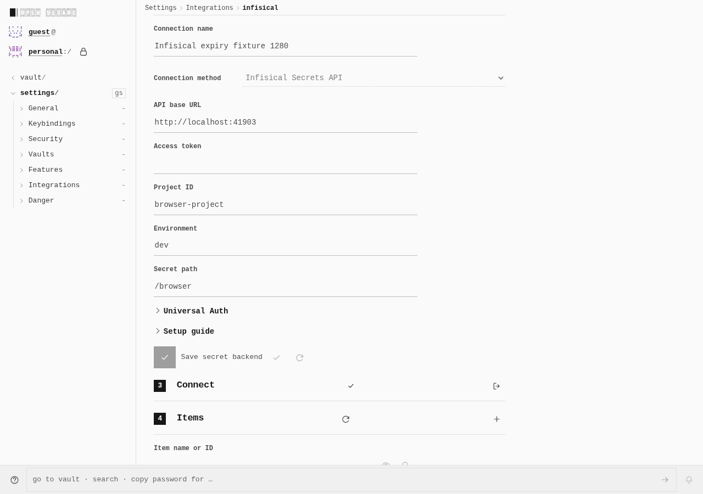
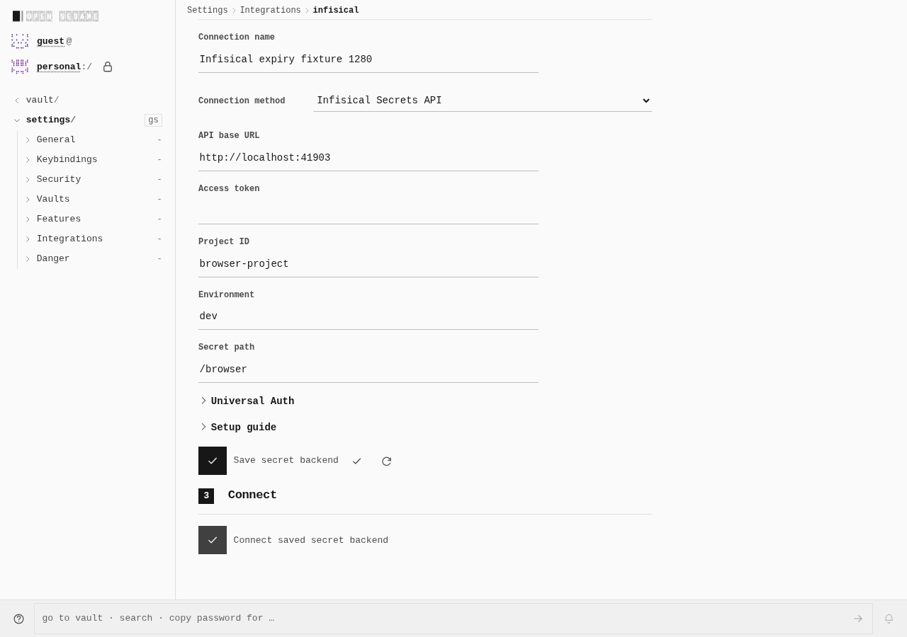
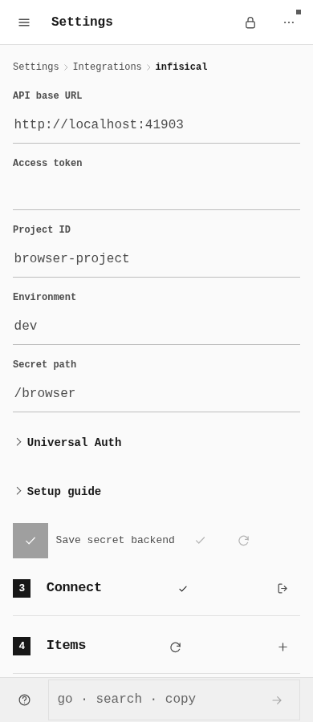
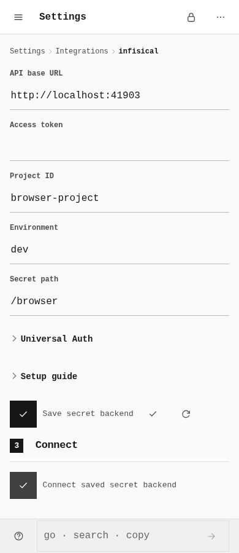
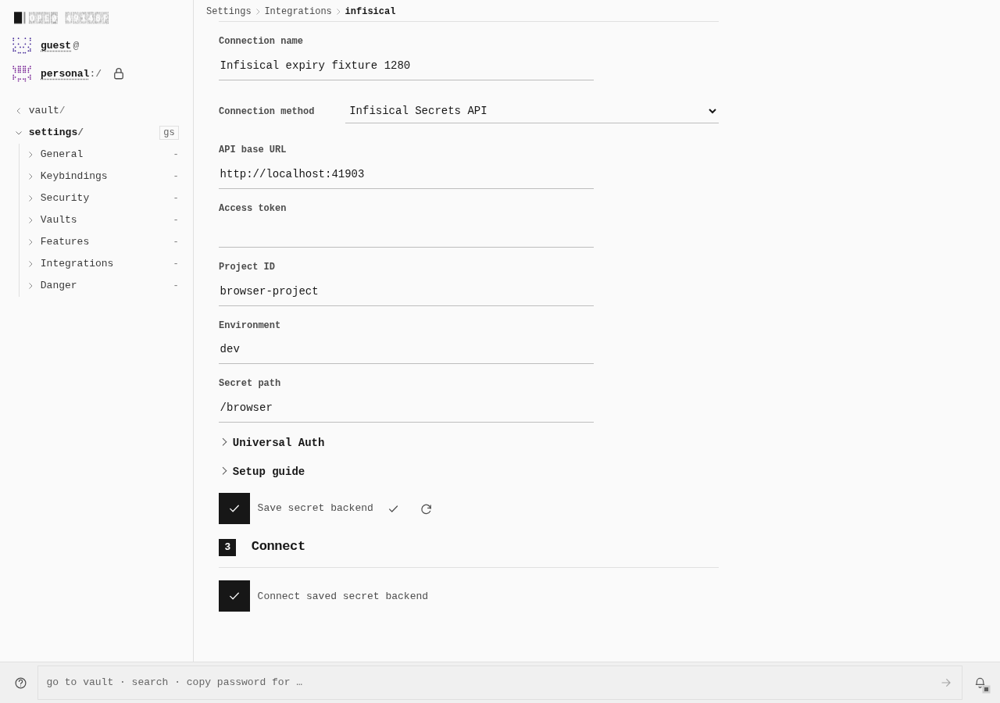

# Infisical lifetime observations and preserved failures

Controlled browser observations showed same-page session withdrawal near six seconds on desktop and in a separate after-only touch journey. Selected terminal-denial and recovery cases passed on both root and subpath builds. **Both original complete paired idle phases remain FAILED** because of unexplained successful-response aborts.

| Journey | Literal result |
|---|---|
| Original `/OpenSesame/` paired idle | **FAIL**. Desktop old stayed active past TTL; new withdrew after 5,991 ms. Touch old idle completed; new Connect received HTTP 200 with 14 decoded / 24 encoded bytes, then `ERR_ABORTED` without native finish. |
| Original `/` paired idle | **FAIL**. Desktop old stayed active; new withdrew after 5,998 ms. Touch failed on the **old dbb** initial Connect, before the new artifact was selected: HTTP 200 with 14 decoded / 24 encoded bytes then `ERR_ABORTED`. |
| Separate after-only touch/subpath | **PASS**. Strict admission, four native finishes/no failures, withdrawal first observed after 5,989 ms, no idle I/O, interaction or navigation. This does not explain or clear the earlier failures. |
| Terminal subpath and root, desktop and touch | **PASS**. Each width/base: three strict positive admissions and three denial/recovery cases; 20 native requests, 19 finished and one established selected 401 body cancellation. Both 403 responses finished. PermissionDenied retried HTTP 200 with the same auth and no login. |

Times are first UI observations after fixture issuance, not exact timer-fire timestamps. Full expected byte counts do not establish application EOF or browser completion; the HTTP 200 abort cause remains unresolved. Terminal401 cancellation is explicitly recorded as **canceled**, never fabricated as native finished. No canceled 403 case was observed.

## Actual desktop baseline and new result

Old a508 desktop, still active after the deadline; a completed branch within a failed overall phase:

New fffa desktop, withdrawn on the same open page:

## Separate after-only touch observation

This is a new-only timeline, **not an old/new touch pair**. The original paired touch failures remain failed.

## Distinct terminal cases

Desktop TokenError 403 withdrew the session; its denial response finished natively:

A different touch PermissionDenied 403 case retained the session and successfully retried with the same auth; these two terminal images are not a before/after pair:

## Identities and limits

All fresh normal/root/subpath archives were compiled from `fffa80768d3df40f67447d33652568968bca8a6e`, tree `4600bb115e72986bfd24e8adaec73e7c9a94db8c`. Old subpath is a508; old root is dbb, not a relabeled a508 build. Terminal execution used clean ef70 with CI delivery and two JSON-whitespace maintenance changes only; the compiled artifacts remain fffa. All 14,868 tracked input identities were restored; independent build graphs and unchanged five budgets passed.

[metrics.json](metrics.json) preserves the partial/failed results and exact expected-cancellation counts. [source-manifest.json](source-manifest.json) records source/build/index/inventory/receipt/harness hashes, ordinary user steps and image identities. Each WebP is lossless: independent Pillow and FFmpeg decodes equal the unchanged native PNG's full RGBA pixels. No crop, resize, stitch, overlay or recoloring was applied. Captures are 900px viewports; nested scrolling does not establish full-form coverage.

The owned Infisical protocol fixture exercised actual HTTP/CORS, PIN and physical browser OPFS, not hosted-account authentication. Verification used localhost:41901→41903, `loopback_development`, header security false and blocked service workers; the normal build also has header security false. Existing automation enters Features/detail through History API/popstate; configuration and actions use rendered controls. No application backend, extension, request interception, fake SDK, raw storage seeding or component-state injection was introduced. All recorded runtime services closed with no owned processes/listeners left. Strict HTTPS/CSP/SW/offline behavior, required CI, full security and broader integration completion remain separate gates.
