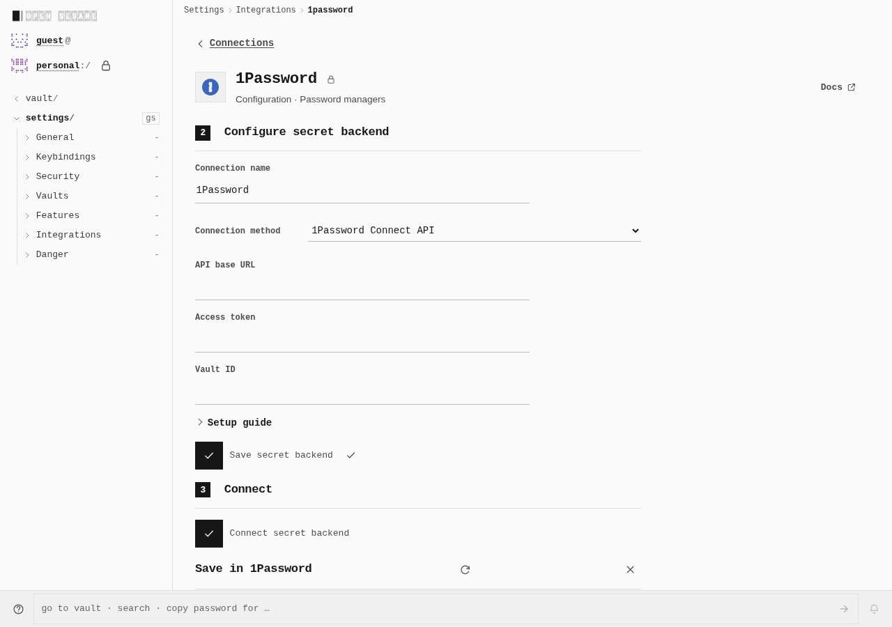
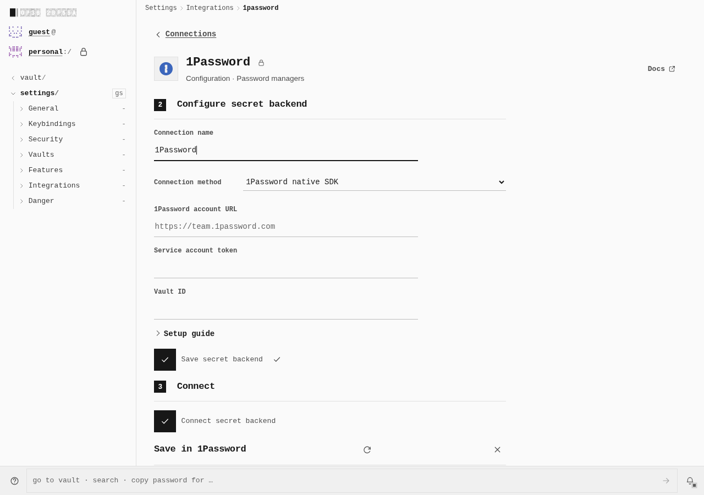
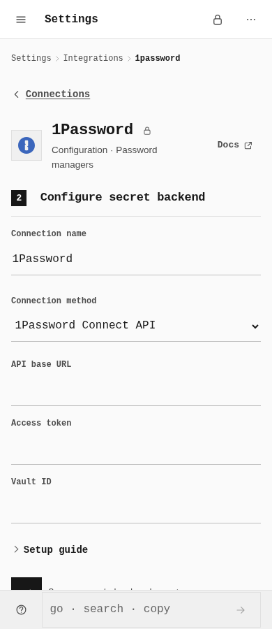
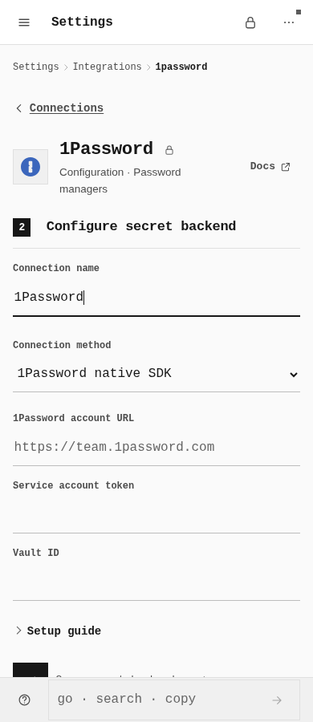
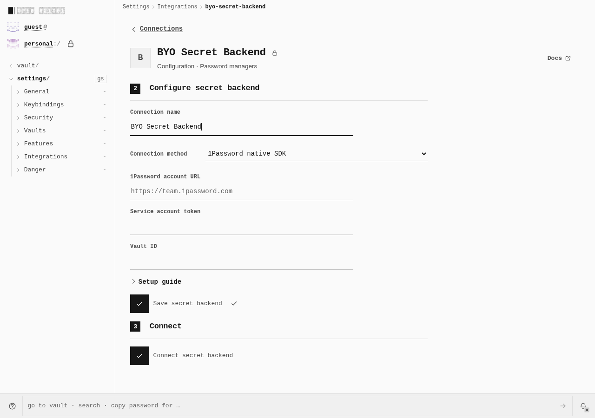
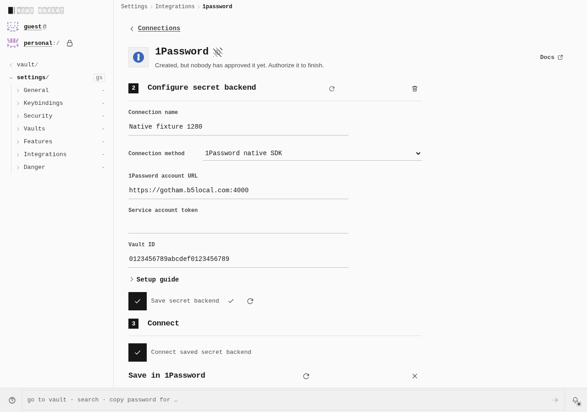
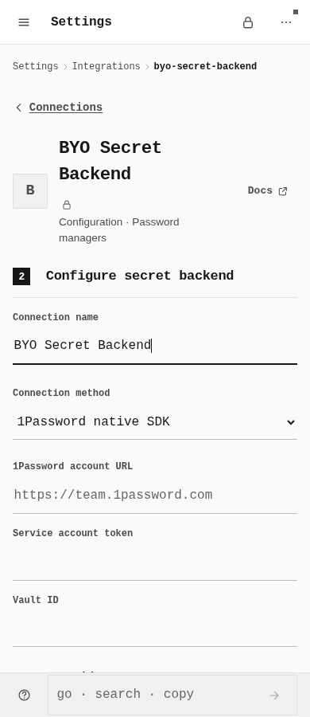
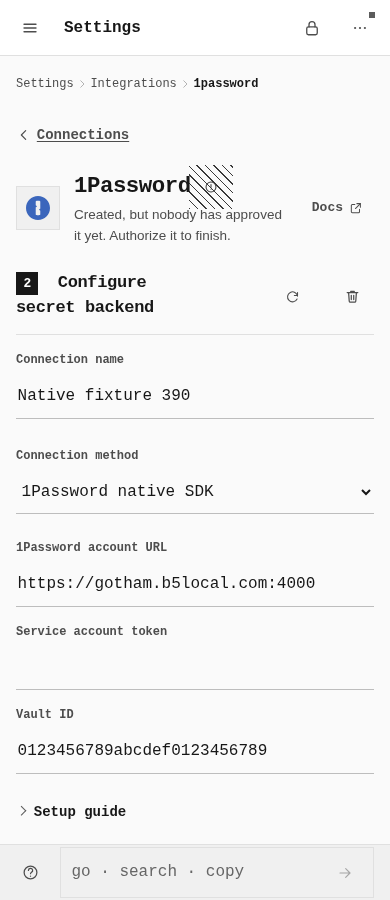

# Native 1Password configuration

PR #1338 makes the native service-account method configurable through the shared secret-backend form. Fresh 1Password drafts select native mode; saved Connect configurations retain their original method. The actual configuration/upgrade journey passed on desktop and touch. **The separate native SDK action run failed; PR #1338 remains draft. This gallery does not establish a working authenticated native session.**

| Observed configuration behavior | Desktop 1280 × 900 | Touch 390 × 900 |
| --- | --- | --- |
| Old default: Connect; new draft: native service account | Passed | Passed |
| Saved Connect retained across real archive upgrade and controlled REST GET | Passed | Passed |
| Partner/BYO account URL, password token and vault ID fields share semantics and sizes | Passed | Passed |
| Partner Save/cold reload/unlock restores configuration with token input blank | Passed | Passed |
| Native SDK assets/workers/API requests at six no-action checkpoints per viewport | 0/0/0 | 0/0/0 |

BYO captures show fresh **unsaved** native fields. Saved-blank-token captures show the **partner** form after cold Save/unlock. They are different checkpoints. A blank token field is a credential-display property, not provider authentication. Touch BYO surrounding content changes vertical positions; common fields have the same labels, types and sizes, not identical page coordinates.

## Default method — before and after

## Shared BYO fields and saved partner configuration

These eight unchanged native viewport captures are lossless WebPs. Independent Pillow/FFmpeg RGBA8 equality preserves original pixels; no crop, resize, stitching, overlay, recolor or DOM alteration. Ten native PNGs were recorded; the two saved-Connect upgrade captures remain in the receipt rather than being duplicated in this gallery. Every checkpoint had no overflow. All 30 frozen inputs and both archives were unchanged; owned UI runtime processes/listeners closed.

## Exact execution and limits

UI before: signed `9b8bb3a436c16cc2b1fb79100bf19ad7d9c8804c`, genuine old `/OpenSesame/` archive. UI after: source PR #1338 `a50848dfe53fdaffc220604e55fc42697573f617`. The same durable browser vault survived the controlled static-host swap, reload and unlock. The successful legacy Connect GET used an owned REST fixture; it is not native SDK authentication. Normal steps, setup-navigation qualification, exact runtime/build/image identities and measurements are in [journey.json](journey.json) and [evidence.json](evidence.json).

The first separate production-PWA native SDK action attempt **failed**: Test never reached its intended fixture 401. Native OPTIONS/POST failed; the full 4,188,530-byte gzip transfer had HTTP 200 followed by an unexpected abort. No native action completed. Its immutable receipt/closure hashes are retained; diagnosis continues separately. All resources closed. No arbitrary raw error, token, header or body is reproduced, and no later result retroactively passes this attempt.

Ordinary root/subpath builds independently passed graph/asset integrity checks. The initial subpath build exceeded the previous unchanged ordinary total/JS/gzip ceilings; that RED result is preserved. PR #1339 (`dbb1729bed6229c1b74f8841873f209e110e9fb6`) separately records the measured native-feature cost with about 1% headroom: total 21050 / JS 7320 / gzip 2210 KiB. CSS, largest asset, other app and hardened-profile budgets remain unchanged. Root measured 21,317,577 bytes / 254 outputs; subpath 21,322,766 bytes / 255 outputs. Different base-path chunk placement is recorded, not hidden.

These builds declare `loopback_development`, HTTP port 41901 and headerSecurity false; they do not prove strict production HTTPS hosting. Minimal-local and family-local hardened static reviews each verify 113 outputs, native implementation/worker/resources absent, and unchanged budgets. Family-local measured 3,929,481 bytes; all five size gates passed. This is static absence, not installed service-worker/cache/offline proof. Twelve zero-action checkpoints establish only observed UI inactivity. Positive native service-account authorization, selected-vault access, item decryption/CRUD, broader integrations, required CI, full security landing gates and verified restacking remain open. No application backend, extension, fake SDK, request interception, raw storage seeding or component-state injection was introduced for this UI journey.
