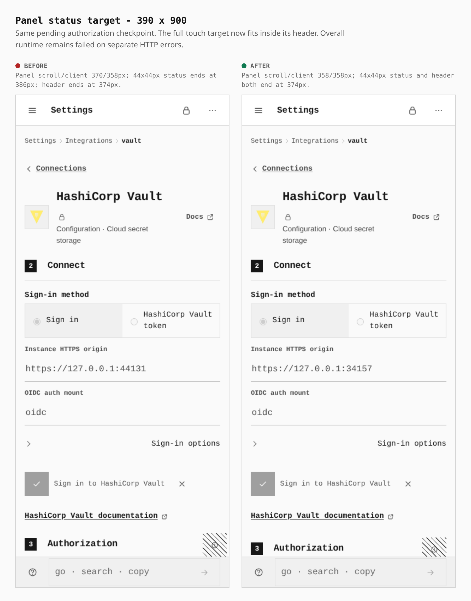
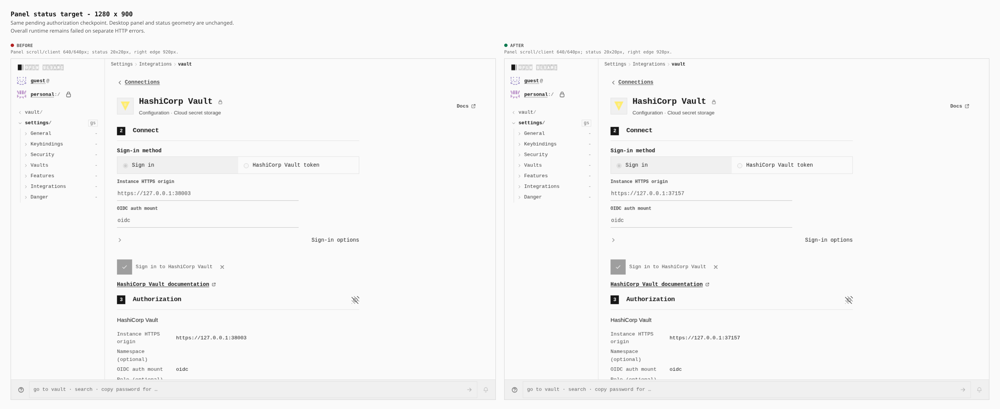

# Panel status touch target

The shared panel header now reserves the status target's full touch area. At 390 × 900, the pending authorization panel fits its 358px content width; the 44 × 44px status target ends at the header's right edge. Desktop geometry is unchanged.

These sheets pair retained, uncropped viewport captures from two actual builds at the same pending sign-in checkpoint. Labels and measurements are outside the captures. [Journey metadata](journey.json) records the build, capture and helper hashes; it is not an executable `capture-evidence.mjs` journey.

| Measurement (CSS px) | Before | After |
|---|---:|---:|
| Touch panel scroll/client width | 370 / 358 | 358 / 358 |
| Touch status right edge / header right edge | 386 / 374 | 374 / 374 |
| Touch status target | 44 × 44 | 44 × 44 |
| Touch status margin | −12 | 0 |
| Touch header height | 40.078125 | 56.1875 |
| Desktop panel scroll/client width | 640 / 640 | 640 / 640 |
| Desktop status target; right edge | 20 × 20; 920 | 20 × 20; 920 |

## Touch — 390 × 900

Actual touch context, coarse pointer, DPR 3. Cancel remains 44 × 44px in its commit row. The full native viewport is framed at its 390px CSS width.

## Desktop — 1280 × 900

Mouse context, DPR 1. Panel width, header height and status target geometry remain unchanged. Both full viewports are framed at their 1280px CSS width.

## Builds and navigation

Before: `31fcee8954fad0469ee713ccc0705cd7ab919b98`, tree `0347a4019b21114589637e883ecae508d20af08d`. After: `eab663e3b1b6d605b53d798832ff416dd387bd35`, tree `4329c8f10946cd35683376b592217e505533ace9`. The after commit's sole parent is `45bd56faddce3970dca6528323206ee88754f892`; the layout comparison uses `31fcee`, the base of the two-commit CSS change.

Both use the strict `dedicated_origin` profile at `https://provider-auth.opensesame.test:46749/OpenSesame/`, with header security enabled. The app is static; owned Vault and identity-provider fixtures are external counterparties, not an OpenSesame backend or extension.

Each journey opens the PWA, completes the ordinary setup/sign-in screens and seals a vault with a PIN. Existing Features helpers enable External connectors and use History API navigation during setup. The decisive Settings → Integrations → HashiCorp Vault links are clicked normally. On touch, the existing method-label corner taps select token and then Sign in. The journey fills the instance origin, starts sign-in and captures the original app viewport while provider consent is pending, with one enabled Cancel sign-in control. Neither app DOM styling nor storage seeding or request interception was used. The same `journey.mjs` and `run.mjs` bytes drove both builds.

## Results and limits

Layout containment passed at both widths after the change. After capture, both widths also observed one actual restricted grant and exchange, an authorized KV read, encrypted-vault PIN reload, replay rejection and provider revocation confirmed by a subsequent 403 lookup. There were zero page errors and no unfinished requests in this after attempt; all owned resources closed normally.

**The overall runtime still failed:** both widths received a 404 on a cold deep-route reload, and the revoke-self response returned 204 followed by Chromium `net::ERR_ABORTED`. Those failures remain failures despite the scoped operations above. The original `45bd` CSS budget failure is preserved; the refined `eab` build passed the unchanged budget and capability-graph checks.

This evidence measures layout containment. It does not establish status-specific tap behavior, show all page content at once, or establish that all integrations work. The broader mobile baseline remains incomplete at its 600-second bound; the earlier workspace CLI test failure and integration audit remain open.
