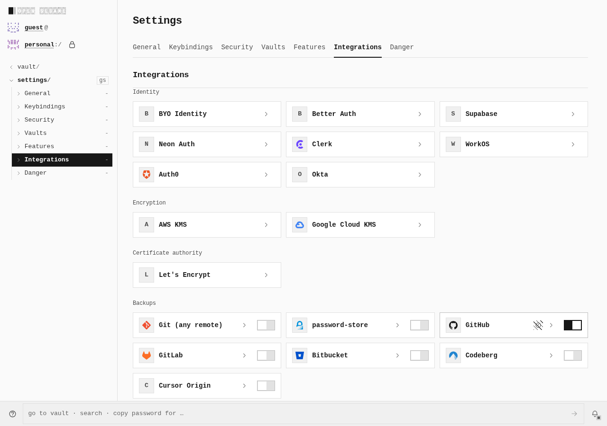
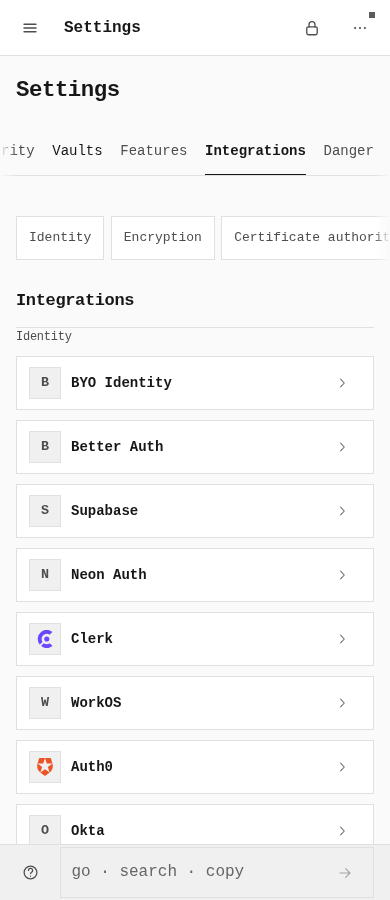

# Secret backend Test cancellation

PR #1336 now withdraws a pending **Test secret backend** action when its connection detail unmounts. The same real-browser journey reproduces the defect before and confirms physical cancellation after, on desktop and touch.

| Viewport | Before: socket after departure | Before: later authenticated GETs | After: close after navigation / before release | After: later authenticated GETs |
|---|---|---:|---|---:|
| Desktop 1280 × 900 | Still open after 306 ms | 1 | 123 ms / 50 ms | 0 |
| Touch 390 × 900 | Still open after 304 ms | 1 | 112 ms / 13 ms | 0 |

After, Chromium reported `net::ERR_ABORTED`, `canceled: true`, **before** deliberate response release. Neither request received an HTTP status or completion; the server response closed unfinished. Both fresh unheld Test controls then completed a real authenticated GET and showed the verified icon. Before, both held requests completed HTTP 200 after release and continued to an authenticated GET.

These four native viewport images show the same ordinary Integrations page after leaving the pending Test. They document the page context, not a layout change; protocol observations establish the cancellation difference. Each WebP is lossless, with independent FFmpeg/Pillow decoded RGBA equality to the unchanged native PNG. No cropping, resizing, stitching, overlays or recoloring were applied.

## Desktop — before and after

## Touch — before and after

## Exact execution and limits

Before: signed `a19ccfa84e917d4902e63c4ed7483bb57ff414fb`, tree `acb0331f12d5f534f59af14203e543a6148e1e26`. After: signed `9b8bb3a436c16cc2b1fb79100bf19ad7d9c8804c`, tree `ffa771d0a58f2c460b5ff440cb565d2d3efdcaf6`. Both archives contain 250 outputs, use the same 18 frozen harness/helper/package pins, and were rehashed after execution. Build/index/receipt hashes, native request identities, exact timing, geometry and image hashes are in [evidence.json](evidence.json); normal reproducible steps are in [journey.json](journey.json).

Both builds used the unchanged `VITE_BASE=/OpenSesame/ pnpm --filter @opensesame/pages build:secret-backends-verify`: declared `loopback_development`, `http://localhost:41901`, `/OpenSesame/`, header security false. The temporary tracked profile stamp was observed and restored exactly; all tracked inputs were restored. The owned actual Infisical UniversalAuth HTTP fixture used port 41903. Existing helpers entered Features/detail routes through History API navigation; PIN, toggle, configuration, Save, Test and departure used actual rendered controls.

Each phase captured six unchanged native PNGs; this gallery selects two per phase. Every checkpoint had no page overflow. Both phases recorded zero console/page errors or unexpected external requests. All contexts, fixtures, browser and app closed; no live owned process or planned listener remained. Two terminated esbuild zombies per build are recorded separately from the clean runtime closures.

This is controlled real HTTP evidence for the shared Probe caller, not hosted provider access, native 1Password SDK/WASM authentication or all integrations working. No application backend, extension, request interception, raw storage seeding, fake SDK or component-state injection was introduced. Required CI, remaining caller/provider work, full security landing gates and verified bottom-up restacking remain open.
