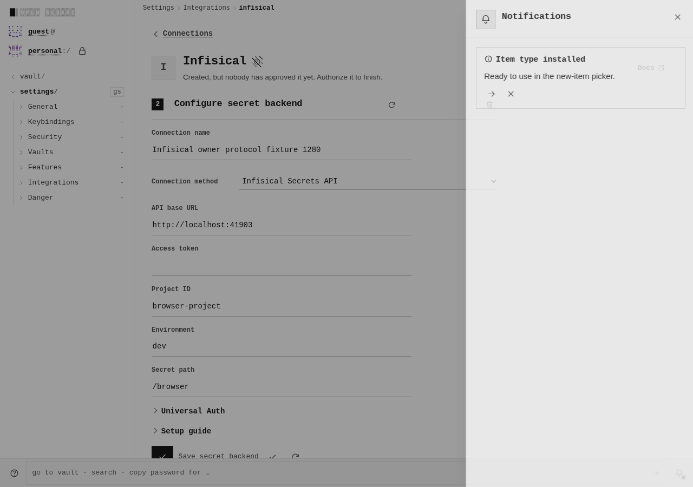
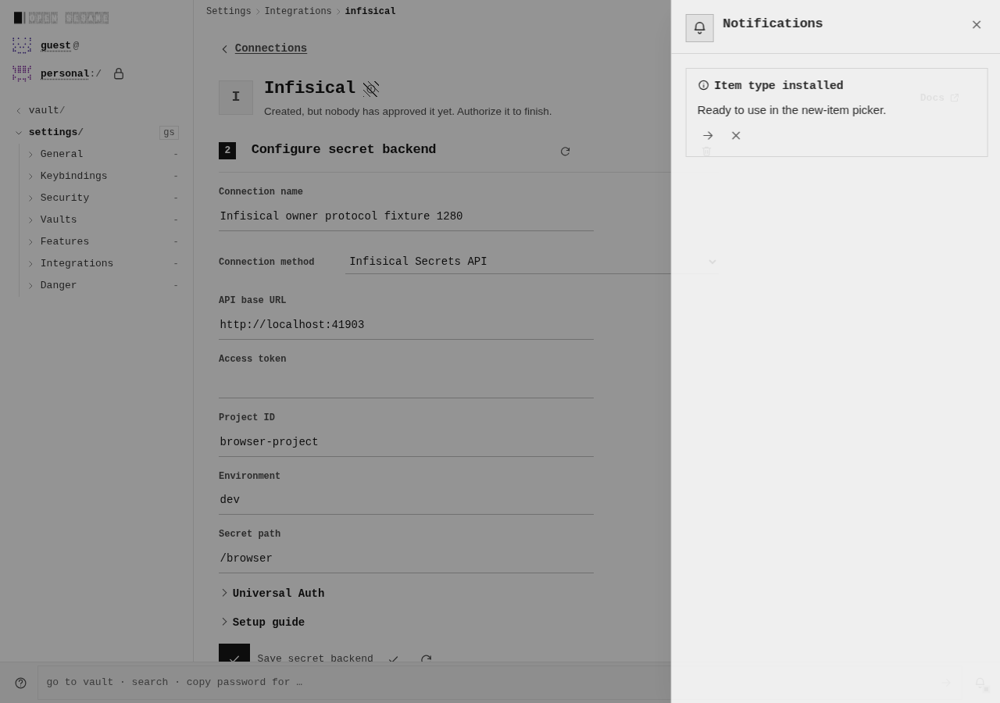
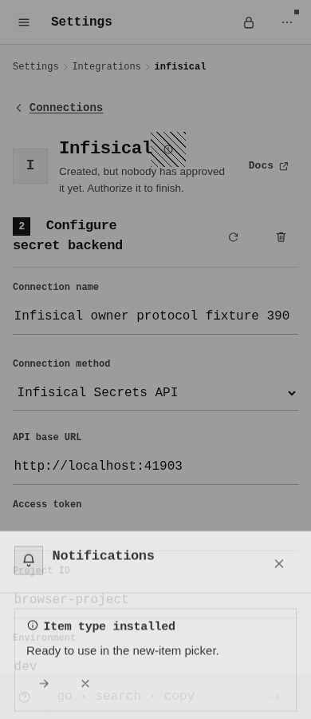
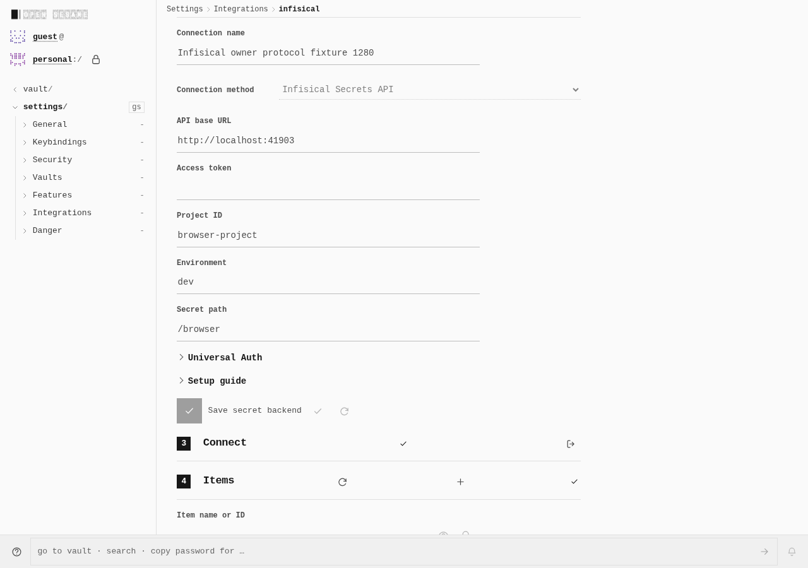
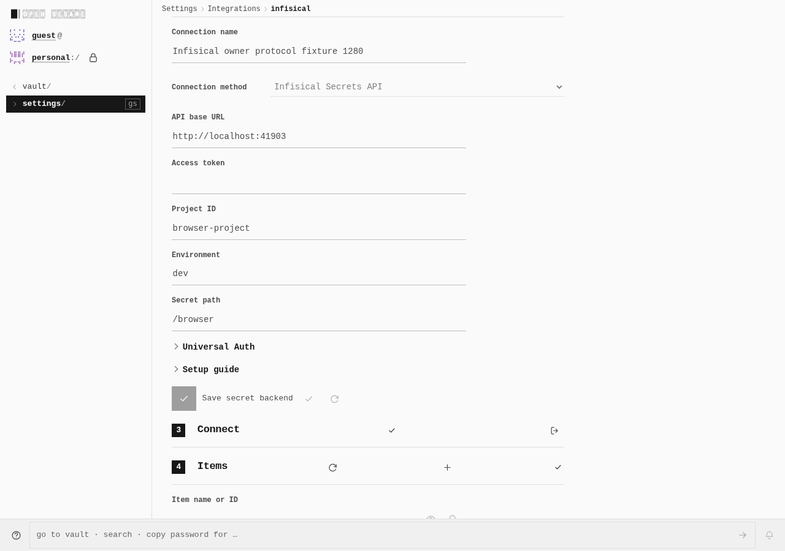
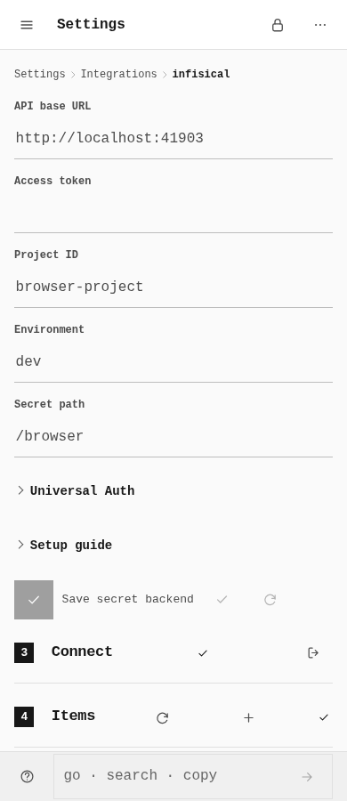

# Mounted secret-backend action ownership

Real desktop and touch captures from the parent build
[`80e245ef`](https://github.com/Tyler-R-Kendrick/OpenSesame/commit/80e245efc3a41cd8822c7c68cfbbb1589f2ff25c)
and published action change
[`fb53fee2`](https://github.com/Tyler-R-Kendrick/OpenSesame/commit/fb53fee28c7d3943c4120232d09a0161b2f5cc41)
([PR #1325](https://github.com/Tyler-R-Kendrick/OpenSesame/pull/1325)).
Both use the declared `loopback_development` build profile at
`http://localhost:41901/OpenSesame/` and an owned REST fixture.

The captures exercise the same common action states in both builds. Stale
credential-refusal notices were not reproduced before or after. Pending authentication cancellation
remains **OPEN**: navigating away leaves the socket open and permits one
follow-up authenticated GET at both sizes in both primary journeys. That is a
separate session-owner defect, not a successful action-cancellation result.

| State, at each viewport | Before | Approved after rerun |
|---|---|---|
| Stale credential-refusal notices, away / returned | 0 / 0 | 0 / 0 |
| Returned after refusal, connected item workspaces | 0 | 0 |
| Explicit reconnect, connected item workspaces | 1 | 1 |
| Selected native viewports with overflow | 0 | 0 |

## Returned after refusal — desktop, 1280 × 900

| Before | After |
|---|---|
|  |  |

## Returned after refusal — touch, 390 × 900

| Before | After |
|---|---|
|  |  |

## Connected after explicit reconnect — desktop, 1280 × 900

The final normal reconnect capture shows one connected item workspace;
the subsequent real List succeeds. The earlier same-named capture was overwritten.

| Before | After |
|---|---|
|  |  |

## Connected after explicit reconnect — touch, 390 × 900

The final normal reconnect capture is shown, using the same selection rule.
One connected item workspace is present; the subsequent real List succeeds.

| Before | After |
|---|---|
|  |  |

## Provenance and limits

Eight separate WebPs retain the native screenshot dimensions and every decoded
RGBA byte. There are no composed labels, added pixels, crops, resizes or DOM
edits. Each primary phase recorded 16 capture events but only 14 unique PNG
files, because the retained filename was reused after reconnect. Four files
from each phase are selected here. Capture events are not independent artifacts.
Hashes, native capture timestamps, selection and lossless receipts are in
[evidence.json](evidence.json).

The approved after trace confirms all six successful login responses delivered
99 bytes, with native loadingFinished, server completion and unique issuance
bound to later authenticated GETs. Two Node `MaxListenersExceededWarning`
messages came from diagnostic fixture keepalive-socket observers; they remain
instrumentation warnings, not PWA browser failures or additional passing checks.

The first after attempt remains a failed, unexplained diagnostic: phone HTTP200
followed by `ERR_ABORTED` and an authenticated GET. Its metrics SHA256 is
`03135f8abc1440718d3ae988b64e8bea452018add88206250d2ea40b8295a724`.
The approved rerun did not reproduce it; it is not retrospectively qualified as
success or included in primary totals.

Before used constant fixture tokens. The approved after rerun added private
unpredictable per-login tokens and CDP/server metadata. Its PWA archive matches
the first after attempt; the configured route and REST protocol shape are
unchanged. This instrumentation difference limits causal comparison. Token
values, request headers and bodies are not included in this gallery. Focus probes
and diagnostic runs remain separate, without aggregate doubling.

The notification drawer can contain the legitimate “Item type installed” notice;
the zero counts above concern stale credential-refusal notices, not all
notifications. The generic awaiting-approval header remains a known
status-projection follow-up. This gallery does not claim to fix that header or
complete the native integration. Metadata retains the literal connected-mark
DOM query count of two; that query does not filter for visibility and is not a
claim of two visible green icons.

These are controlled REST/browser observations, not positive native 1Password
or hosted-provider authentication, provider encryption, a public-origin build,
or completion of all integrations. Full original metrics and diagnostic/build
receipts remain retained separately; outstanding cancellation, CI and security
landing work is not waived.
