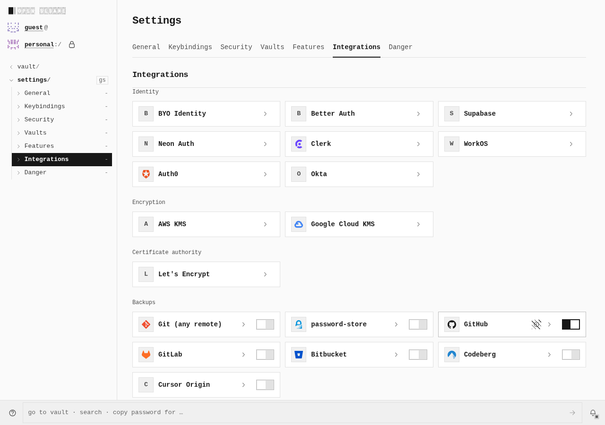
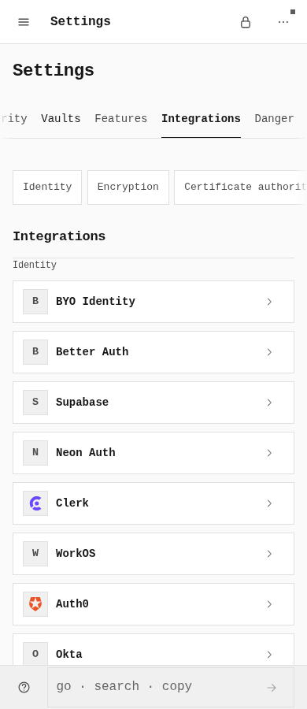

# Secret backend session cancellation

The session owner now cancels a pending provider login when the integration detail unmounts. In both actual browser widths, the native socket closed **before** the fixture deliberately released its response, and no authenticated next GET followed. The baseline socket stayed open and continued to one authenticated GET.

These four native viewport images show the ordinary Integrations page after leaving the pending connection. They document the same visual context, not a layout change; protocol observations establish the lifecycle difference. No image was stitched, resized, cropped, recolored, or staged. `evidence.json` records source PNG, WebP and decoded RGBA hashes with independently decoded pixel equality.

| Phase | Width | Navigate (epoch ms) | Socket closes | Deliberate release | Later authenticated GETs |
|---|---:|---:|---:|---:|---:|
| before | 1280 | 1792057565644 | Not before release | 1792057566007 | 1 |
| before | 390 | 1792057584055 | Not before release | 1792057584436 | 1 |
| after | 1280 | 1792058699524 | 1792058699626 | 1792058699661 | 0 |
| after | 390 | 1792058716237 | 1792058716325 | 1792058716357 | 0 |

The after-phase cancellations were native `ERR_ABORTED` events with no HTTP response status; server response-close observations also reported unfinished responses. These are pending-request cancellation observations. Later successful connections retained the workspace and completed real List calls. Normal second-tab feature disable removed the workspace, local-vault Copy still worked, and re-enabling required a fresh connection. Feature disable already worked in the baseline.

## Desktop — 1280 × 900 each

Before, after leaving the pending login:

After, the same post-navigation context:

## Touch phone — 390 × 900 each

Before, after leaving the pending login:

After, the same post-navigation context:

## Exact execution and limits

Before used the immutable **after-action** archive compiled from signed `fb53fee28c7d3943c4120232d09a0161b2f5cc41`, tree `8e20c50d95ed75005fc97969e43a4167e0f7eba6`; it was not rebuilt or relabeled as the later docs-only parent. After used the immutable **after-session** archive compiled from signed `b3a322b5382f1dde8584410a39adcf8a3bd8b830`, tree `4b1f2dcb15b1ee9897f96a5ed66949ddd6aca7ae`. Both executed the same three-script inventory `51ea4bb30389675efd38c1f0c0090eea60382c98c749ed9bd878fd7986505e35`. Exact index hashes, profile stamps, restored tracked inputs, request identities, native timing, capture timing and receipt hashes are in `evidence.json`.

Both builds used `PATH=/workspace/work/bin:$PATH VITE_BASE=/OpenSesame/ pnpm --filter @opensesame/pages build:secret-backends-verify`: explicitly declared `loopback_development`, `http://localhost:41901`, `/OpenSesame/`. The temporary tracked profile stamp was observed and the default restored exactly. These are actual built-PWA journeys through normal guest, durable PIN, configuration and connection controls against a controlled real REST fixture, not public-origin production or a hosted provider account. No app backend, browser extension, request interception, fake SDK, raw storage seeding, or product changes were introduced for this evidence.

Each phase recorded 14 layout observations with zero overflow, 12 native capture events and 10 unique PNG files; the four selected images are a subset. Both phases ended with no live owned processes, no controlled listeners, no workers and all contexts/fixtures/browser/server closed. Two terminated Chromium zombies per phase are recorded separately. There were no unexpected browser/network errors or Node warnings. Only the after phase had the two expected pre-response cancellation events.

This evidence does not establish native 1Password SDK authentication, all integrations working, or hosted authorization. Generic provider header approval copy has a separate known status-projection gap; the actual workspace, List calls and socket observations are recorded independently. An earlier action-only post-200 abort remains a separate preserved unexplained diagnostic and is not retrospectively qualified by these session runs.
