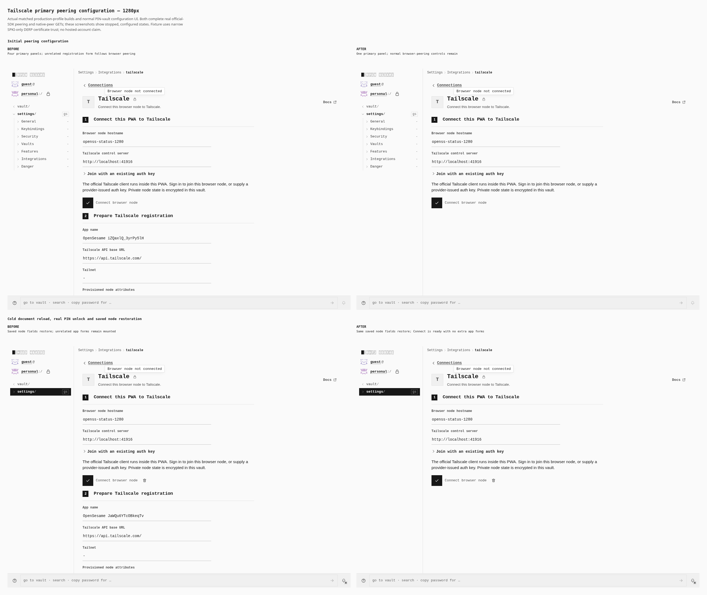
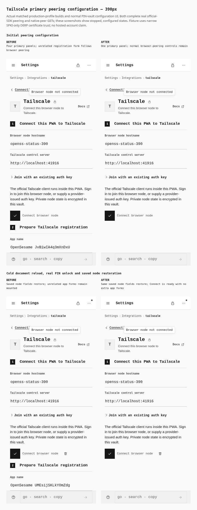

# Peering-only Tailscale primary UI: actual browser evidence

The primary Tailscale page now mounts its browser-peering form without unrelated OAuth app registration, returned-app import or device-provisioning ceremonies. Actual before/after browser journeys configure the official WASM client, join a real Headscale/DERP tailnet, reach a native peer, and cold-reload the document to verify saved configuration and keyless reconnect through a real PIN-sealed vault. No configuration, credentials, SDK state or DOM elements are seeded. No worker is mocked and no provider request is intercepted.

| Build | Actual compiled source | Index SHA256 |
| --- | --- | --- |
| Before | Clean `4437d0981635f8fa3bcb096e457ff08edfff7c8c`, tree `7098ec6c6bd0ea955d1b03c26a466ec15b1b1ed0` | `c40853241d4b1a958b87a01327b5c8d925cac487cedfd7062000c620b32e5b86` |
| After | That parent plus exact five-file overlay, tree `831bfc65f3b563ee89cb798f3c79a6b258956acf` | `fb905fd8b04a9771741a2066cc1ce47ee0c0d1cfcb107825b49a9e555285965a` |

Both are actual Vite production builds of the declared `loopback_development` tailnet verification profile at canonical origin `http://localhost:41911`. The after build was compiled from the frozen overlay before signed publication. Root subsequently independently verified its exact tree, parent, five-file inventory and bytes against signed commit `540dbb8eadb4e4e1501174552c3fe5123f754726` in [PR1303](https://github.com/Tyler-R-Kendrick/OpenSesame/pull/1303). The existing overlay build was retained; it was not rebuilt as a clean signed-head checkout. `source-manifest.json` preserves the exact build receipts, five source paths/hashes, official SDK pins and the unchanged reused helper path/hash. Chromium is 151.0.7922.173.

## Desktop comparison

Native viewports are **1280 × 900**. The complete two-row before/after sheet is **2638 × 2220** pixels. Row 1 shows configured peering before enrollment; row 2 shows restored configuration after a cold document reload and actual PIN unlock, before reconnecting. Both screenshots truthfully show the node stopped. Real membership and peer operations happen later in each captured journey and are recorded separately.



## Touch-phone comparison

Native coarse-touch viewports are **390 × 900**. The complete two-row before/after sheet is **858 × 2220** pixels. The old registration section is visible below peering in both baseline states; actual full-page DOM inventories also identify the other mounted sections below the fold.



All eight embedded viewport images preserve their raw PNG dimensions and decoded RGBA pixels exactly. Captions sit outside the screenshots; no image is resized, cropped, recolored or staged. Independent pixel comparison then verifies both full PNG sheets against their lossless WebPs. `lossless-gallery-receipt.json` records natural coordinates, dimensions, raw PNG hashes, sheet hashes and decoded equality. Raw PNGs and PNG sheets remain private. The unchanged reused home helper additionally saves actual home screenshots privately; they are not additional gallery rows.

## Results

**184 behavioral checks passed: 80 before and 104 after.** The first hostname-helper diagnostic is preserved privately under `first-before/` and excluded. The earlier live-status slice and any later portable-script checks are also excluded.

The baseline mounts four primary panels at all six observations: browser node, OAuth app configuration, returned app configuration and device provisioning. After mounts exactly one browser-node panel at all six observations. No OAuth registration/import/device-management controls or help remain in the mounted primary entry. Observations cover configured, cold-restored and Networking-withdrawn states at both viewport sizes.

Both phases retain working peering and saved-state behavior:

- Actual SDK membership updates the general header before any service GET. A separate GET reaches the real native peer and returns HTTP200 with the fixture's expected response character count.
- Ordinary Connections home shows the exact current node with an ok mark. The expanded desktop Connected rail has count 1 and its hostname leaf; navigation does not stop the worker.
- Explicit stop closes the worker and clears live status. Cold document reload and PIN unlock restore the saved hostname/control URL, an empty auth-key input and an enabled Connect action without automatic reconnect. Connecting without another enrollment key reaches the native peer again.
- Actual vault lock and Networking consent withdrawal terminate their workers and clear live header/home/rail membership. Pending configuration may remain in Needs attention with a warning.

Each phase independently records **6 Noise control upgrades, 6 DERP upgrades and 4 native-peer GET/proof requests**. All six emitted workers per phase close at the intended stop, lock or withdrawal. All 14 provider states and 6 home observations per phase have zero horizontal overflow, with actual desktop/coarse-touch modes. Only the exact `net::ERR_ABORTED: https://derp.fixture.test/derp/probe` cancellations are expected: 24 per phase, retained in logs. There are zero other browser/page/console/HTTP/worker/network errors and zero observed OAuth management HTTP requests.

`metrics.json` contains both full original phase objects under `before` and `after`, with semantic equality independently checked against the original receipts. No fields were dropped. Zero management requests does not prove that an internal OAuth helper was never called; the source slice's integration tests establish direct custody/hydration ownership and independence from OAuth dependencies. Browser evidence verifies the successful cold-restore behavior without manufacturing a hydration error or former-owner completion.

## Provider fixture, custody and limits

The browser loads pinned official `@tailscale/connect@1.102.3-3-tb31d8a75a-g5e651e16f`, unchanged official WASM and extracted intact Go runtime. Gzip/raw-WASM/runtime hashes are checked, and actual owned asset/worker loading is observed. Provider infrastructure runs SHA-pinned Headscale 0.27.1, embedded DERP and a native Tailscale 1.102.4 userspace peer exposing its proof through `tailscale serve`. Native CLI belongs only to test-provider infrastructure; it is never a PWA dependency.

Transparent provider-fixture edges supply CORS/TLS while forwarding real encrypted control/DERP bytes. The static app server serves built files only. Neither is an OpenSesame application backend or browser extension. The generated fixture DERP certificate uses the existing narrowly scoped Chromium SPKI exception and explicit resolver mapping; the native peer trusts its fixture CA. No global TLS ignore or home/system trust changes are used. No hosted Tailscale tenant/account or ordinary hosted PKI validation is claimed.

Enrollment keys are concealed, cleared after submission and omitted from screenshots/serialized input values; exceptions are sanitized. Private SDK Token state is never revealed, printed or exported. Cold reconnect without another enrollment key is a functional vault-custody observation, not a raw-secret screenshot. Fixtures/browser contexts are cleaned up even on failure.

Cold document reload uses the live static server; this is not an installed-PWA/offline-cache test. Networking toggle verifies real capability consent/lease withdrawal, not surgical hot egress-only policy changes. The SDK GET UI exposes status and character count, not a JSON-body equality assertion. Non-2xx result presentation remains a separate source slice; only successful HTTP200 probes are exercised here. No general VPN, host interception, mutations, OAuth registration or universal integration-completion claim is made. Legitimate interactive sign-in for the browser node remains supported; it is distinct from the removed management ceremony.

## Reproduce

Run from the repository root with installed dependencies, the unchanged reviewed `docs/evidence/2026-10-15-tailscale-status/capture-support.mjs` helper and the matching frozen profile builds. The build command is `VITE_BASE=/OpenSesame/ pnpm --filter @opensesame/pages build:tailnet-browser-verify`. Capture does not build or edit the product. Its manifest receipt must match the distribution index hash. Run phases sequentially because the real app/provider fixtures use loopback ports 41911 and 41914–41918.

```sh
PWA_TAILSCALE_PRIMARY_EVIDENCE_OUT=/absolute/path/to/new-evidence TAILNET_FIXTURE_CACHE=/absolute/path/to/verified-tailnet-binaries PAGES_CAPTURE_PHASE=before PAGES_VERIFY_DIST=/absolute/path/to/before-dist PLAYWRIGHT_CHROMIUM=/usr/bin/chromium node docs/evidence/2026-10-15-tailscale-primary-ui/capture.mjs
PWA_TAILSCALE_PRIMARY_EVIDENCE_OUT=/absolute/path/to/new-evidence TAILNET_FIXTURE_CACHE=/absolute/path/to/verified-tailnet-binaries PAGES_CAPTURE_PHASE=after PAGES_VERIFY_DIST=/absolute/path/to/after-dist PLAYWRIGHT_CHROMIUM=/usr/bin/chromium node docs/evidence/2026-10-15-tailscale-primary-ui/capture.mjs
PWA_TAILSCALE_PRIMARY_EVIDENCE_OUT=/absolute/path/to/new-evidence PLAYWRIGHT_CHROMIUM=/usr/bin/chromium node docs/evidence/2026-10-15-tailscale-primary-ui/compose.mjs
PWA_TAILSCALE_PRIMARY_EVIDENCE_OUT=/absolute/path/to/new-evidence python3 docs/evidence/2026-10-15-tailscale-primary-ui/lossless-gallery.py
```

Pillow with WebP support is required only for lossless conversion and independent pixel verification; it adds no application dependency. Fresh captures write separate before/after metrics. The publication combines those complete objects in one file. The portable capture's sole adaptation is reading the identical original build receipts from `source-manifest.json`; actual browser operations/assertions and observer code remain unchanged from the successful two-phase run.
