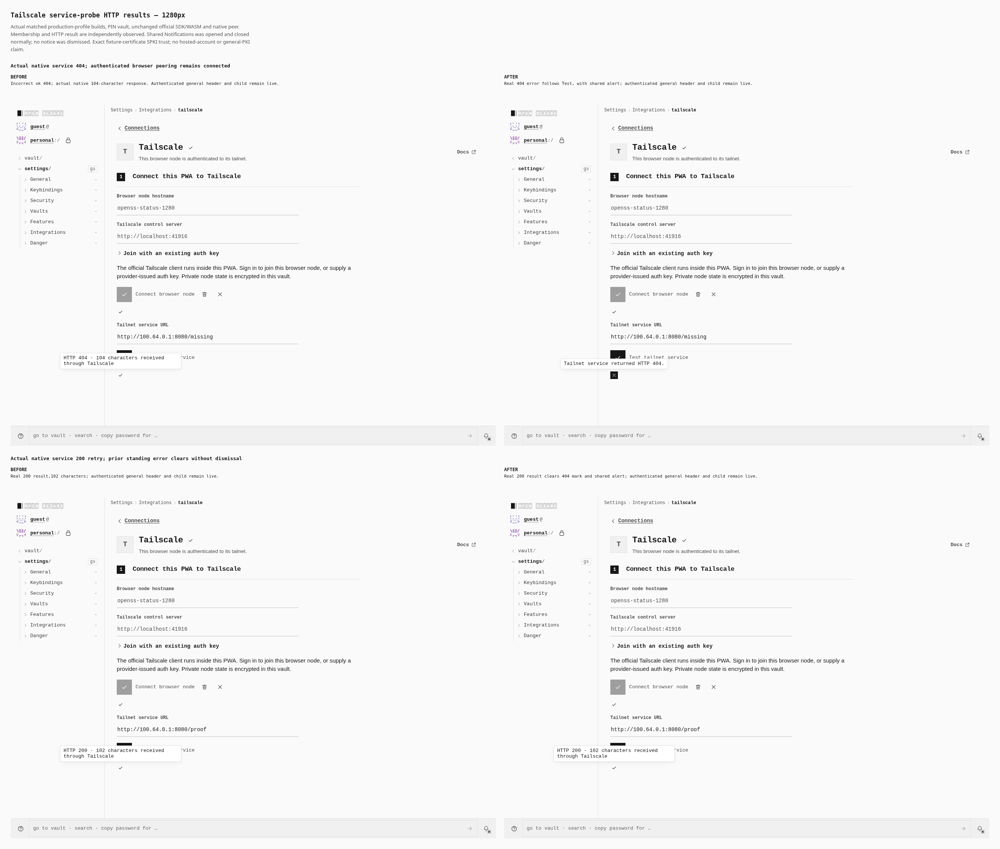
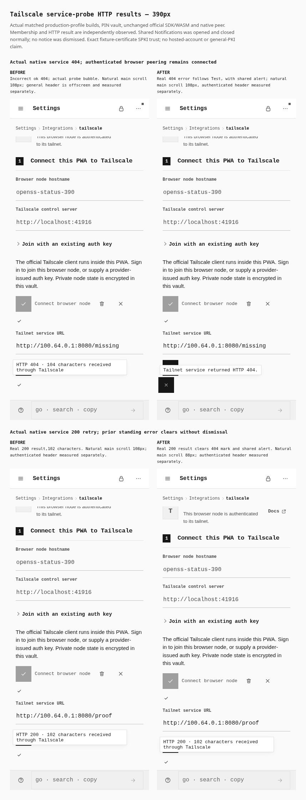

# Tailscale service-probe HTTP results

The native service's 404 response previously received an ok mark. The changed hook and service-result component report `Tailnet service returned HTTP 404.` through the existing error StatusMark and shared Tailscale notification. A subsequent real 200 result clears both without dismissing a notice. Authenticated browser peering stays connected throughout.

The actual production-profile browser journeys passed 52 checks before and 56 after: **108 total**. The four added AFTER checks verify that each 404 error marker follows both the service URL and Test action in actual DOM order. Both desktop 1280×900 and real coarse-touch 390×900 used a normal guest front door, durable PIN vault, Features controls and actual Tailscale settings. The unchanged official SDK/WASM established real membership, then requested `/missing` and `/proof` through the native peer. No provider request interception, fake protocol, state seeding or DOM staging was used.

## Desktop 1280×900



Each embedded screenshot is native 1280×900; full comparison sheet 2638×2240. The first row shows a real 404 result after the Test control, alongside preserved authenticated general and child status. The second shows real 200 and removal of the prior error. The shared notification was separately inspected through its ordinary UI; it is recorded in full metrics rather than overlaid into these images.

## Touch 390×900



Each embedded screenshot is native 390×900; full comparison sheet 858×2240. Actual scrolling differs with the result mark's position: BEFORE 404, BEFORE 200 and AFTER 404 naturally scroll the MAIN container 108px; AFTER 200 scrolls 88px. The general header is offscreen in all four touch states. All general/child statuses are independently measured. No fake fixed header, manual alignment or screenshot crop is used.

The Test action retains the unchanged shared FormCommit check-shaped action affordance. The independently measured service result is the separate err/ok StatusMark. A response body or nonce is never rendered.

## Observations and bounds

For each phase, the independent fixture observed 2 Noise control WebSocket upgrades, 2 DERP upgrades, 2 GET /missing (404) and 2 GET /proof (200): 4 service GETs total. The existing `nativePeerGets` metric counts `/proof` only; `nativePeerMissingGets` and `nativePeerTotalGets` preserve the distinction. Both emitted workers closed on the actual Disconnect action. Each phase has 8 geometry observations with no horizontal overflow and correct pointer mode, 8 exact DERP-probe ERR_ABORTED cancellations, 0 unexpected errors and 0 OAuth management HTTP calls.

After 404, ordinary Notifications contains a Tailscale `role=alert` card with the same bounded error. After 200, that card and the old error mark are absent. The unrelated Item type installed information notice remains. The journey only closes Notifications; it never dismisses a standing notice to simulate recovery.

`metrics.json` retains both complete safe original phase objects. The first BEFORE attempt stopped on a harness evaluate closure error after real 404; its private diagnostic receipt is excluded from 108 and from these screenshots. The corrected full journey completed. A subsequent two-file AFTER 52 run passed protocol checks but placed the service error beside node status; root review rejected that placement before publication. Its metrics/images/package remain private and are excluded from 108. Final three-file AFTER 56 replaces it. Safe observers retain methods/origins/paths, frame counts and lifecycle only; no enrollment keys or private SDK state are published.

The real pinned Headscale/DERP/native peer is test infrastructure. Its CLI is not an app dependency. Transparent fixture CORS/TLS protocol edges and a narrow generated fixture-certificate SPKI exception do not establish hosted tenant authentication, ordinary hosted PKI/CORS, arbitrary VPN or installed offline-cache behavior. No OpenSesame backend or extension is used. Delayed-request races and other status codes are covered by source tests, not claimed as browser observations here.

## Source and reproduction

Source [PR #1306](https://github.com/Tyler-R-Kendrick/OpenSesame/pull/1306) is signed commit `c55d195c8b5f84b400dde7efaf78430df4da9a37`, tree `f9de8fabc24c6a057a8fc096efdcf9d20cb7a36e`. Root independently verified its signature, parent, exact three-file inventory and all frozen bytes. `source-manifest.json` records the exact observed build provenance and complete root before-equivalence receipt. BEFORE reuses the actual historical 4437 parent plus 5 file UI overlay compilation, equivalent to signed 540 production and current signed 433d production; it was not freshly compiled at 433d. AFTER is actual signed 433d parent plus 3 frozen files, tree f9de8fabc24c6a057a8fc096efdcf9d20cb7a36e. The AFTER archive was compiled before signing at its actual 433d parent plus frozen overlay; that exact source tree was subsequently signed as c55d. It was not rebuilt at c55d, and its embedded build HEAD is not described as c55d. Owned official WASM/runtime hashes were verified before each launch.

Run from the repository root with those same archived builds, cached pinned fixture binaries and installed Chromium. Actual network access, including loopback, must be enabled. These commands create temporary owned native-provider fixtures; they do not contact a hosted account. Keep the output directory the same for both phases and subsequent composition.

```sh
PAGES_CAPTURE_PHASE=before PAGES_VERIFY_DIST=/absolute/path/to/frozen-before-dist TAILNET_FIXTURE_CACHE=/absolute/path/to/verified-cache PLAYWRIGHT_CHROMIUM=/usr/bin/chromium PWA_TAILSCALE_PROBE_EVIDENCE_OUT=/absolute/path/to/private-output node docs/evidence/2026-10-15-tailscale-service-probe/capture.mjs
PAGES_CAPTURE_PHASE=after PAGES_VERIFY_DIST=/absolute/path/to/frozen-after-dist TAILNET_FIXTURE_CACHE=/absolute/path/to/verified-cache PLAYWRIGHT_CHROMIUM=/usr/bin/chromium PWA_TAILSCALE_PROBE_EVIDENCE_OUT=/absolute/path/to/private-output node docs/evidence/2026-10-15-tailscale-service-probe/capture.mjs
PLAYWRIGHT_CHROMIUM=/usr/bin/chromium PWA_TAILSCALE_PROBE_EVIDENCE_OUT=/absolute/path/to/private-output node docs/evidence/2026-10-15-tailscale-service-probe/compose.mjs
PWA_TAILSCALE_PROBE_EVIDENCE_OUT=/absolute/path/to/private-output python3 docs/evidence/2026-10-15-tailscale-service-probe/lossless-gallery.py
```

The capture reuses the unchanged published status journey and primary-UI network observers by exact repo paths, with hashes in the manifest. The final helper adds only AFTER DOM-order assertions beyond the BEFORE script; both script hashes are retained. New scripts pass syntax, Biome, strict anti-slop and structural checks. The independent pixel receipt verifies all 8 raw viewport embeddings and both full PNG→losslessWebP decoded RGBA comparisons. The published receipt pins the original capture pixels; a fresh run uses fresh addresses/timing and will generate its own receipt.
