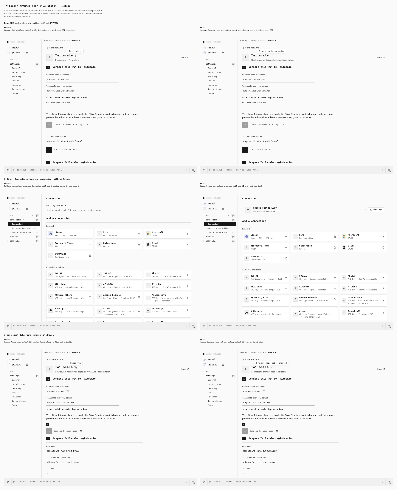
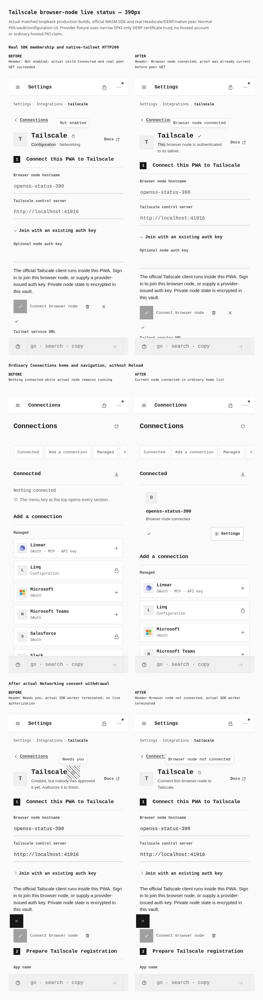

# Tailscale browser-node live status: actual browser evidence

The official Tailscale WASM SDK joins a real Headscale/DERP tailnet from the PWA and performs an encrypted GET to a native Tailscale peer. These before/after journeys use the actual configuration form, a real PIN-sealed durable vault, ordinary Connections navigation, and actual stop, vault lock and Networking feature controls. No configuration, credentials, Running/netmap state or DOM elements are seeded. No provider request is intercepted or fulfilled by Playwright. Native binaries run only the test provider/peer, never the PWA.

| Build | Actual compiled source | Index SHA256 |
| --- | --- | --- |
| Before | `c2f227d97dab7e0d2c10dd5220d4892299fd792c` plus exact four-file fence overlay; tree `5a87eff485c82da3ac906eeaa979c3b4ff9a5f52` | `bbf3879d816d803891b128db373a26f8b8f7fa9fed2cce4ee9be0373e3858d3d` |
| After | `e9b48f1a794bcfe57a9f0d8b6414a2efc89d2fdd` plus exact eleven-file live-status overlay; tree `d3b5b806196b9049843b5f7308e8e7df9b9d755d` | `c40853241d4b1a958b87a01327b5c8d925cac487cedfd7062000c620b32e5b86` |

Both are actual Vite production builds of the declared `loopback_development` tailnet verification profile, canonical origin `http://localhost:41911`. They were compiled from signed parents plus frozen overlays, not clean future-head checkouts. Root independently verified the before tree against signed commit `e9b48f1a794bcfe57a9f0d8b6414a2efc89d2fdd` in [PR1300](https://github.com/Tyler-R-Kendrick/OpenSesame/pull/1300). Root subsequently independently verified the after tree, parent, inventory and bytes against signed commit `1093cff9e0e0a194b2aea529dfa3351d1770c92a` in [PR1301](https://github.com/Tyler-R-Kendrick/OpenSesame/pull/1301). The existing overlay build was retained; it was not rebuilt at that signed HEAD. `source-manifest.json` includes both exact source inventories, build receipts and SDK pins. Chromium is 151.0.7922.173. The static app server serves built files only.

## Desktop: 1280 × 900 native viewports

Three matched before/after states; full gallery 2638 × 3256 pixels.



## Touch phone: 390 × 900 native viewports

Three matched before/after states; full gallery 858 × 3256 pixels.



Each three-row comparison uses full untouched viewports, desktop 1280×900 and touch 390×900. Captions are outside the captures. The compositor preserves the natural image dimensions; independent decoded RGBA comparison verifies all 12 embedded viewport images against their raw PNGs. A second independent comparison verifies every decoded pixel of each full PNG sheet against its lossless WebP. `lossless-gallery-receipt.json` includes dimensions, hashes and pixel-equality receipts. No viewport is cropped, resized, recolored or staged. Original raw PNGs and full PNG sheets remain in private evidence.

## Observed results

**120 behavioral checks passed: 54 before and 66 after.** Earlier exploratory/header-only receipts remain private and are excluded. Each phase observed 6 real Noise control WebSocket upgrades, 6 DERP upgrades and 2 native-peer GET/proof requests. Each viewport started 3 actual emitted SDK workers; all 6 workers per phase terminated at the intended explicit stop, vault lock or capability withdrawal. Ordinary detail/home navigation preserved the running node. Both phases have zero horizontal overflow in 12 provider states and 6 home observations, with actual desktop/coarse-touch modes.

The baseline shows **Not enabled** in the general header despite real SDK Connected membership and successful native-peer HTTP200. Ordinary home says **Nothing connected**, and the expanded desktop Connected rail has an empty count and no node. After lock/unlock and Networking withdrawal, the old baseline instead places pending metadata under both Needs attention and Connected, with Needs you/warn; the desktop Connected rail then incorrectly counts that pending entry.

After the fix, **Browser node connected** appears before any service GET. The subsequent real peer GET returns HTTP200 and the fixture's expected response character count. Home has the exact current hostname and an actual Connected/ok mark; desktop rail count 1 includes that hostname leaf. Explicit stop, actual lock/unlock and Networking withdrawal change the general header to **Browser node not connected**. Stopped/withdrawn nodes leave Connected and the desktop Connected rail; pending configuration remains only in Needs attention with a warning. Phone measurements record the actual page index; its section drawer has no nested connection-count rail.

The membership proof is the production controller's actual SDK Running state, MachineAuthorized/unlocked netmap, nonempty addresses, sealed owner receipt and current capability lease. It is independent of arbitrary service reachability. Service proof is separate: a native peer independently receives the actual GET/proof through its tailnet listener. The UI exposes HTTP status and character count, not the returned JSON body; no stronger body-equality assertion is claimed.

Only the exact `net::ERR_ABORTED: https://derp.fixture.test/derp/probe` cancellations are classified as expected, 24 per phase, retained in full logs. There are zero unexpected browser, page, HTTP, worker or network errors. `metrics.json` preserves both full phase receipts, requests, status/geometry observations, protocol records, worker events and checks without semantic alteration.

## Provider fixture, privacy and limits

The PWA loads pinned official `@tailscale/connect@1.102.3-3-tb31d8a75a-g5e651e16f`, extracted intact Go runtime and official WASM. Gzip, raw WASM and runtime SHA256 pins are checked before running; actual resource loading and emitted worker ownership are observed. Provider infrastructure uses SHA-pinned Headscale 0.27.1 and native Tailscale 1.102.4, embedded DERP and a userspace native peer exposing its proof listener via `tailscale serve`.

Transparent test-provider edges supply fixture CORS/TLS while forwarding actual encrypted protocol bytes. They are test control/DERP infrastructure, not an OpenSesame application backend or browser extension. Chromium uses the fixture's narrowly scoped DERP certificate SPKI exception and resolver mapping; the native test peer trusts its generated fixture CA. No global certificate ignore or home/system trust changes are used. This is not ordinary hosted PKI validation or a hosted Tailscale tenant/account test.

Enrollment keys are entered only into the normal concealed field, cleared after submission and excluded from all serialized fields/screenshots; exceptions are sanitized. Private SDK state remains in the actual encrypted vault and is never revealed, recorded or printed. Fixtures and browser contexts are cleaned up after each phase.

Networking toggle verifies real capability consent/lease withdrawal. It does not simulate surgical hot egress-only policy edits while Networking remains enabled. This status journey does not repeat the historical installed-PWA stopped-static-socket/cache proof. That separate historical 41-check receipt has 9 control/9 DERP upgrades and 8 peer GETs; prior prose claiming 8 upgrades was inaccurate and is not reused as a new-build result.

Official browser SDK GET behavior is exercised here. No arbitrary browser VPN, host interception, mutation API, vault-drive PUT, OAuth app management, hosted registration or universal integration-completion claim is made. The older OAuth/device-management panels visible below the browser node remain a separate UI cleanup.

## Reproduce

Run from the repository root with installed dependencies, the matching frozen profile builds and the existing verified binary cache. Build command used for each matching source is `VITE_BASE=/OpenSesame/ pnpm --filter @opensesame/pages build:tailnet-browser-verify`. Capture scripts do not build or modify product source. The before/after archived distributions used above are checked against the manifest's index hash. Phases run sequentially because provider/app fixtures use loopback ports 41911 and 41914–41918.

```sh
PWA_TAILSCALE_EVIDENCE_OUT=/absolute/path/to/new-evidence TAILNET_FIXTURE_CACHE=/absolute/path/to/verified-tailnet-binaries PAGES_CAPTURE_PHASE=before PAGES_VERIFY_DIST=/absolute/path/to/before-dist PWA_COMPILED_PARENT=c2f227d97dab7e0d2c10dd5220d4892299fd792c PWA_COMPILED_TREE=5a87eff485c82da3ac906eeaa979c3b4ff9a5f52 PLAYWRIGHT_CHROMIUM=/usr/bin/chromium node docs/evidence/2026-10-15-tailscale-status/capture.mjs
PWA_TAILSCALE_EVIDENCE_OUT=/absolute/path/to/new-evidence TAILNET_FIXTURE_CACHE=/absolute/path/to/verified-tailnet-binaries PAGES_CAPTURE_PHASE=after PAGES_VERIFY_DIST=/absolute/path/to/after-dist PWA_COMPILED_PARENT=e9b48f1a794bcfe57a9f0d8b6414a2efc89d2fdd PWA_COMPILED_TREE=d3b5b806196b9049843b5f7308e8e7df9b9d755d PLAYWRIGHT_CHROMIUM=/usr/bin/chromium node docs/evidence/2026-10-15-tailscale-status/capture.mjs
PWA_TAILSCALE_EVIDENCE_OUT=/absolute/path/to/new-evidence PLAYWRIGHT_CHROMIUM=/usr/bin/chromium node docs/evidence/2026-10-15-tailscale-status/compose.mjs
PWA_TAILSCALE_EVIDENCE_OUT=/absolute/path/to/new-evidence python3 docs/evidence/2026-10-15-tailscale-status/lossless-gallery.py
```

The compression/independent pixel checks require Pillow with WebP support; this adds no application dependency. Fresh capture outputs keep separate before/after metrics. Published `metrics.json` contains those full receipts under `before` and `after`. Source publication/provenance updates must retain the distinction between compiled overlay and later verified signed equivalent.
