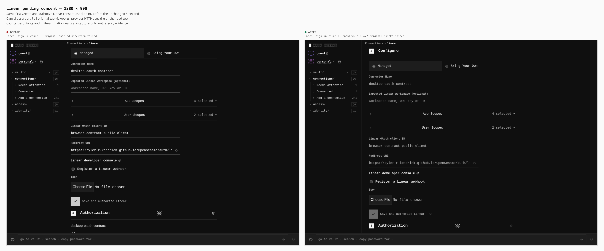
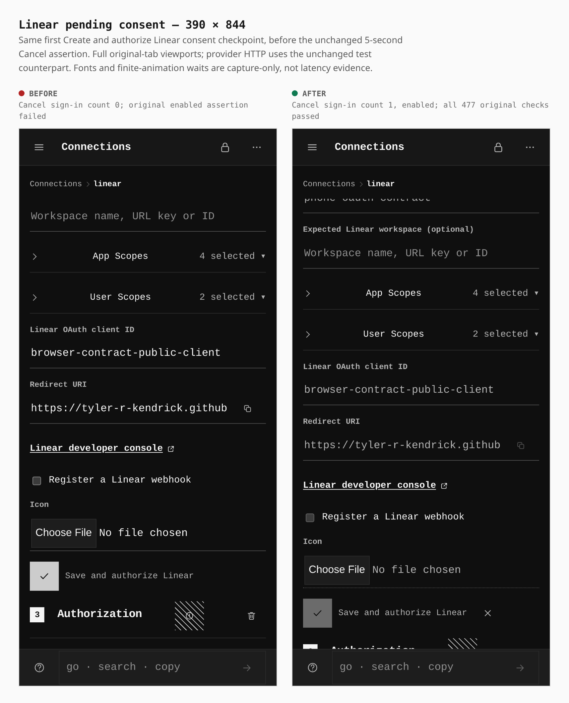

# Linear pending consent keeps Cancel available

The originating Linear configuration now keeps one enabled **Cancel sign-in** control while the real consent popup is open. Before, that control was absent. These sheets show the first **Create and authorize Linear** checkpoint, immediately before the same unchanged 5-second enabled-Cancel assertion.

| Actual observation | Before | After |
|---|---|---|
| Cancel count, desktop and touch | 0 (absent) | 1, enabled |
| Desktop Cancel target | Absent | 32 × 32 CSS px |
| Touch Cancel target | Absent | 44 × 44 CSS px |
| Desktop document / viewport width | 1280 / 1280 | 1280 / 1280 |
| Touch document / viewport width | 390 / 390 | 390 / 390 |
| Main form / control count, both widths | 1 / 25 | 1 / 26 |

## Desktop — 1280 × 900

Mouse, DPR 1; raw viewport 1280 × 900 pixels.

## Touch — 390 × 844

Actual coarse-pointer touch context, DPR 3; raw viewport 1170 × 2532 pixels.

## Builds, journey and results

Before: `6f6947c97a0fa99de3afa343dfbae3ed391b46d4`, tree `7b37fac837ab27249c4cd8bb0c39d721c769f134`, includes the core authorization guard before the UI change. After: `41f506e6bf9f5ed3dd01a5a5c1dd8aedc8599a87`, tree `bec8ce9d4d71bfb980fcde4147378ca3c386ae6b`; its sole parent is the before commit. Both fresh default builds passed in 93.56s and 93.10s, within their 240-second bounds.

Both use `shared_origin_demo` at `https://tyler-r-kendrick.github.io/OpenSesame/`, with header security disabled. The actual PWA runs ordinary PIN setup, encrypted credential storage, API-key refusal/verification, operations and sealed reload before entering the first managed consent. The popup/callback is a real Chromium window; **the unchanged standard harness intercepts static-origin and Linear provider HTTP**. This is fixture protocol evidence, not a hosted Linear account or an OpenSesame backend.

Before ran independent desktop/phone copies, mechanically filtering only the original matrix row and relocating imports. It failed the original 5-second Cancel assertion at both widths after 60 and 54 preceding checks; those failures remain failures. After used the full original entry and passed all **477 original checks in order**, including PKCE, independent actors, PIN custody, wrong-key refusal and denial/retry flows, in 109.53s of the unchanged 600-second bound. Source, artifact, tool and manifest pins remained unchanged; owned processes and listeners closed normally without fallback.

The exact first-action captures match desktop `001` and phone `001` before to desktop `001` and phone `010` after; the full after run shares one sequence across widths. The same passive helper waits for fonts and existing finite animations before each viewport capture. Natural original scroll positions and different geometry are retained: this is neither an equal-scroll nor a latency comparison. Raw captures are unchanged; the shared `composeSheet` frames full images at native CSS widths, rendering the comparison sheet at DPR 2. Only sheet labels/layout surround the app images; no app styling, cropping or masking was applied.

This establishes the displayed enabled control and the stated fixture checks; it does not claim an unperformed Cancel click or all-integrations completion. Separate durable-fence, summary-actor and CI work remains open.

## Retained provenance

SHA-256 hashes identify the private retained originals and receipts; raw captures are not committed.

| Original | SHA-256 |
|---|---|
| before desktop capture | `213cd64bc2359ed0d5096a649a188ce1fed28291bc7afa0862f60dab5fe52b40` |
| after desktop capture | `8968b0d2f8b1e1d64b1974c0caee5efd96dda34549767754b0c58fa4708a795c` |
| before phone capture | `ba9754090a8c7460498ae0dd9accd263e490a86ad1470f58b3c2506d0d69a01e` |
| after phone capture | `82025a69bd910eaf9f2fd090485816fd300029d1fe1a5fab2b49e8074806ec45` |
| before build receipt | `e74da0f310bb08c0733c94056399e3d0ee68f9dcabd6b8af173d8237e7cb8b54` |
| before runtime receipt | `97d91db833777bac20309c118bef814d8eb4f84a54511bead45ed2c16768abc3` |
| after build receipt | `d1b116b90b6b6c40845ac28bddb8e0551c597372021198dd325d6e27e0ffb02b` |
| after runtime receipt | `a622ed3cb6ab38ec9d186bf8773641255ea347dd4a10b2ee3e482cd864554f3a` |

Capture helper: `c5c768328ee518f39e035c512b4f1a2436306248bb97dcae1e99616d731868da`; guarded consent hook: `273c33c5952c5ee318fea98637dbcc566d860de6518c052a1cd38310cc267e8c`. The original consent helper remains byte-identical except for one declared capture import and await, reversed and hash-checked privately. These are retained custom-journey captures, not a `capture-evidence.mjs` recreation.
