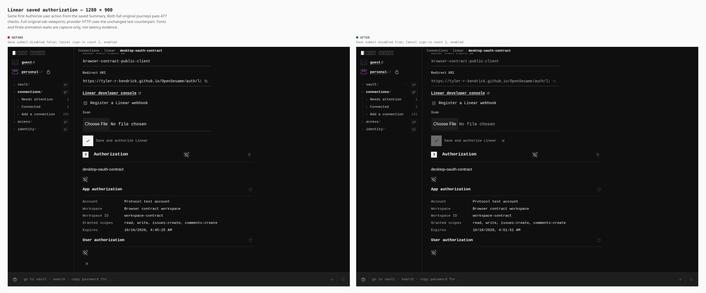
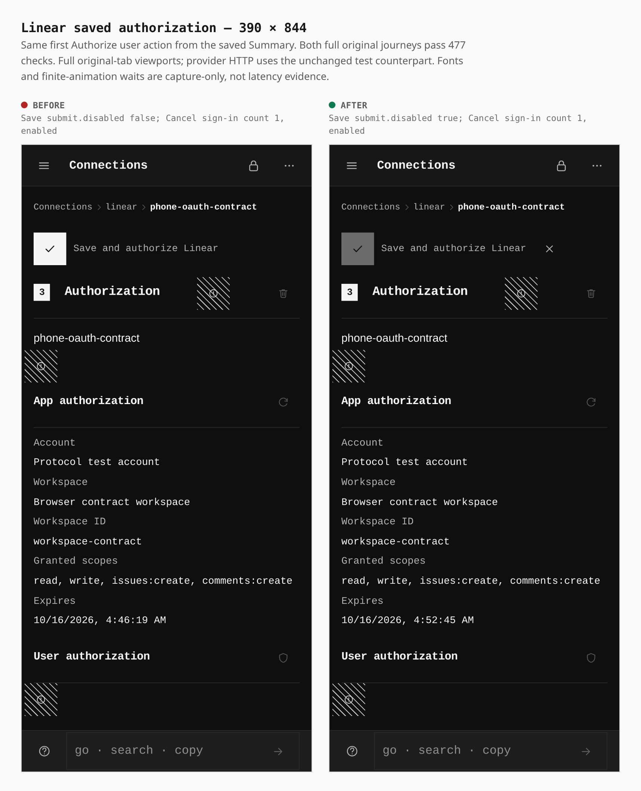

# Saved Linear authorization shares the pending controls

Authorizing a saved Linear actor now places Cancel beside Save in the shared FormCommit row and disables Save while consent is pending. **Cancel was already enabled before this change.** These sheets compare the first actual **Authorize user** action at each width.

| Actual capture observation | Before | After |
|---|---|---|
| Save submit button’s own `disabled` property, both widths | `false` | `true` |
| Cancel sign-in, both widths | 1, enabled | 1, enabled |
| Desktop Cancel target; x / y (CSS px) | 32 × 32; 280 / 799 | 32 × 32; 534.234375 / 337.125 |
| Touch Cancel target; x / y (CSS px) | 44 × 44; 16 / 772.84375 | 44 × 44; 274.234375 / 117.765625 |
| Desktop document / viewport width | 1280 / 1280 | 1280 / 1280 |
| Touch document / viewport width | 390 / 390 | 390 / 390 |

The direct submit property is measured from the actual button. A child control’s `disabled` property does not establish inherited fieldset semantics. Those field/actor and negative owner/same-ID route regressions have separate unit proof; the positive browser journeys below do not replace it. No actual browser Cancel click is claimed.

## Desktop — 1280 × 900

Mouse, DPR 1; raw viewport 1280 × 900 pixels.

## Touch — 390 × 844

Real touch/coarse-pointer context, DPR 3; raw viewport 1170 × 2532 pixels. Cancel remains 44 × 44 CSS px.

## Builds and verification

Before: `8ad0f8e105e4d665afc70e390c9fad6603d69265`, tree `77b9293b06b9632579540aa38807a572f3353591`. After: `cef89ce1c70669fe6c0eb8de629b8c8a8b872844`, tree `3f6c7af6b7ace14e67851ceee58873ce56783827`; its sole parent is the before commit. Fresh default builds passed in 96.67s and 85.73s, within their unchanged 240-second command bounds.

Both run `shared_origin_demo` at `https://tyler-r-kendrick.github.io/OpenSesame/`, header security disabled. The actual PWA, encrypted PIN credential store and popup/callback execute in Chromium; **the unchanged standard harness intercepts static-origin and Linear provider HTTP**. These are provider-protocol fixtures, not a hosted Linear account or an OpenSesame backend.

Both full original desktop/touch journeys passed all **477 original checks in order**, in 111.56s before and 110.39s after, within the unchanged 600-second bounds. Ordinary setup, API-key refusal/verification, encrypted reload, PKCE, separate actor approvals and denial/retry flows precede or follow the pictured checkpoint. Source, artifact, tool and manifest pins remained fixed; child processes and listeners closed normally without fallback.

Before was built from the clean signed parent inside the guarded controller, then all four frozen candidate files and modes were restored exactly. The controller receipt passed in 219.56s, and its build/browser children have actual exit 0 evidence. Its exec PTY was lost: the top controller process exit status was not collected and is not inferred.

Both pairs are the first actual `Authorize user` metadata match per width: desktop sequence `003`, phone `012`, in each full run. Captures occur before the unchanged enabled-Cancel assertion and retain their natural, differing scroll and geometry. The same passive helper awaits fonts and finite animations; this is not an equal-scroll or latency comparison. Raw PNGs remain unchanged. The unchanged shared `composeSheet` frames each full viewport at its CSS width and renders the sheet at DPR 2; sheet pixels are not claimed to equal original raw pixels. No app DOM/style edits, cropping or masking were used.

This gallery records the displayed pending controls and the stated fixture checks. Hosted-provider configuration, negative owner cases, CI and remaining integration gaps must be judged from their separate evidence.

## Retained provenance

Raw captures and receipts remain private; only these comparison sheets are committed. SHA-256:

| Original | SHA-256 |
|---|---|
| before desktop PNG | `e34e5e47c706eec979914750fa52b495afc478aaece88c5bfb1613551f1a7956` |
| after desktop PNG | `0ca25f84141996292293e167a6e1300de8d65ebdad6101f7b281a975e3e4b0e9` |
| before phone PNG | `22c70a6e56a3ad4a727c5d954b790dbbc31cc6ed371642e2f5b1a2dafa335c51` |
| after phone PNG | `b4b75e104dedf1f1bb44ba77dc006de77892307fd347500e6907139a6c4a0ce8` |
| before build receipt | `a36e83bb107fda81926178b182c9cbf9a3a35fc1e123b77d364e1032cb9792cf` |
| before runtime receipt | `bd0dab807187aea17062a2c4fcd4c8379523456b7ba2c896082426c59bed399c` |
| after build receipt | `262def7cf490841b6b95eedf5c07c46ed8f6da2c6f2a9ab4f1f6855f2c5a0455` |
| after runtime receipt | `ff285354f30f7b51a5572981a9cb04f7b37c900fd6da59abd2feee5d8905901a` |

Passive capture helper: `c5c768328ee518f39e035c512b4f1a2436306248bb97dcae1e99616d731868da`; consent hook: `273c33c5952c5ee318fea98637dbcc566d860de6518c052a1cd38310cc267e8c`. Both phases use these same bytes and the unmodified full standard entry; the hook adds only the declared capture import/await to the exact original consent helper. These retained custom captures were not recreated through `capture-evidence.mjs`.
