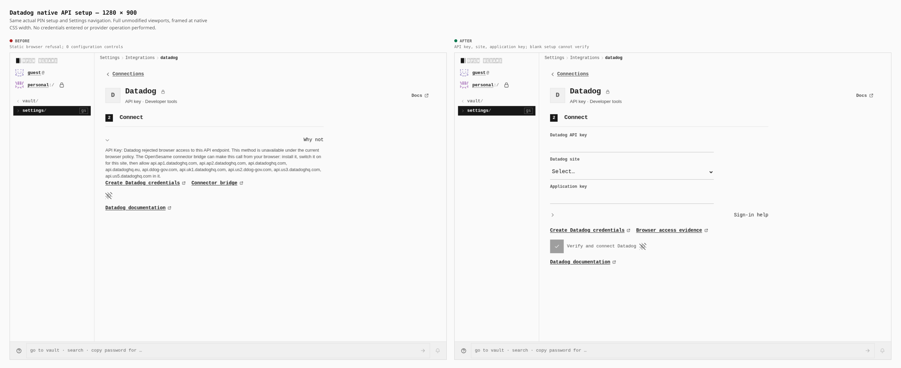

# Native API setup stays configurable

The signed PWA now exposes Datadog’s shared API key, site and application-key form. Configuration controls change from 0 to 4; password inputs from 0 to 2; document width remains 1280px. Blank credentials keep Verify disabled. No provider operation is claimed.

This first viewport slice compares actual builds `1876ae9b17c239d000baf5542ea436789a98d6a9` and `1483f508d9fd9e11f4354602e4f7fd3a010f0cb4`, following the same PIN setup and Settings journey. The phone sheet and full measurements/provenance follow in the next bounded gallery commit.
