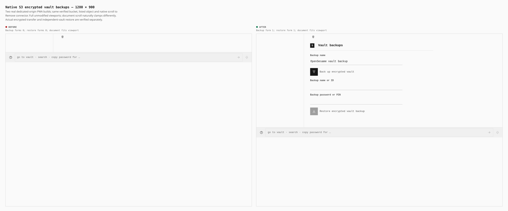
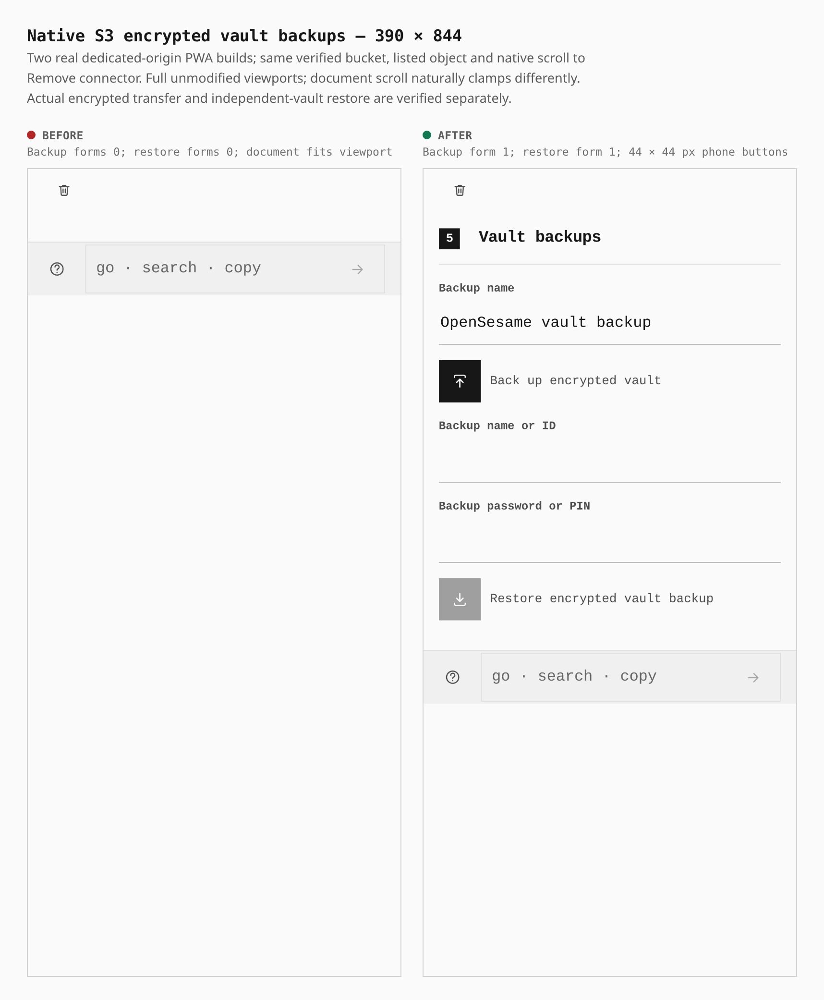

# Native S3 encrypted vault backups

The verified native S3 page now mounts the shared backup and restore forms. Two real production builds use the same dedicated HTTPS origin, `/OpenSesame/` base and security headers. The server serves static files; the provider is pinned real MinIO over HTTPS with actual Chromium local-network consent. No app backend, extension or intercepted provider responses are involved.

| Measurement | Before → after |
|---|---|
| Backup / restore forms | 0 / 0 → 1 / 1 at both widths |
| Phone upload / restore buttons | Added, both 44 × 44 CSS px |
| Document width | 1280 / 390 px, equal to each viewport |

## Desktop, 1280 × 900

## Phone, 390 × 844

Both captures were taken from the verified native `browser-verified-bucket` on `/OpenSesame/connections/s3`; that summary is above the viewport after the matching scroll action. They follow the same genuine PIN setup, Features approval, bucket verification and object listing, then scroll the existing Remove connector button to the start. This matches the action, not scroll positions or sidebar visibility. Native document scroll clamps differently; the short before page has no forms below that button. Full original viewports are retained, with no crop, mask, injected UI or styles. Fonts and finite animations settle before capture. The unchanged compositor frames them at native CSS widths in DPR2 sheets; raw captures use desktop DPR1 and phone DPR3.

The separate **74.37 s / 240 s** compiled-browser operation passed at both widths: cold-PIN saved S3 connection; conditional `PUT` (`If-None-Match: *`) and exact ciphertext `GET` readback (2248 / 2240 bytes); wrong backup PIN rejected with the source item demonstrably absent and the target item preserved; then successful restore into a separately sealed vault. After cold reload, the target's different PIN still unlocks it, and actual Copy secret actions read both the imported source value and the later target value. No PIN or plaintext canary appears in uploaded ciphertext; both pages report zero page errors. Every owned process and listener closed normally.

Before build: `3176ff3271add7caa8627cea74158efb836fc44e`, tree `cfb75608fc417704beb982115e258dd70fac36b1` (106.11 s). After build: exact candidate tree `642039abab21366f26b611d033b7bef30c82e73f`, independently matched after signing to `44aaa7ccdf9f38163cde028b532801f495a56ff4` (105.23 s). The original after receipt remains parent-stamped; it is not represented as a commit-stamped build. Matched original S3 journeys pass in 43.43 / 49.87 s, including real wrong-key refusal, cold PIN, removal and durable absence.

[Proof and hashes](proof.json) record artifact inventories, raw captures, measurements, actual operation results and ownership receipts. Earlier interrupted builds, shared-origin loopback refusal and insufficient offscreen captures remain preserved. This evidence covers native S3 backup/restore with an owned real provider; it does not claim hosted-account validation, every network lifetime, or completion of all integrations.
