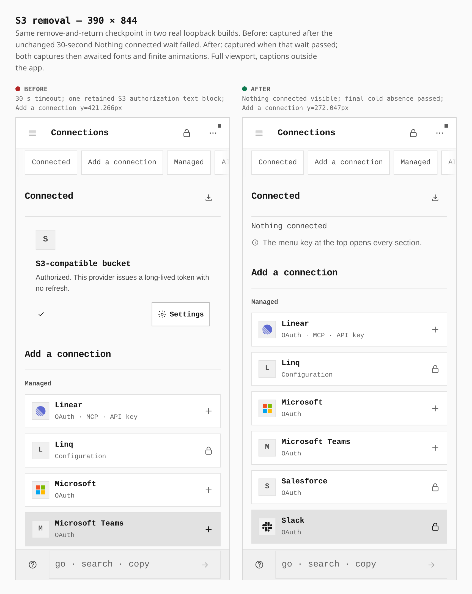
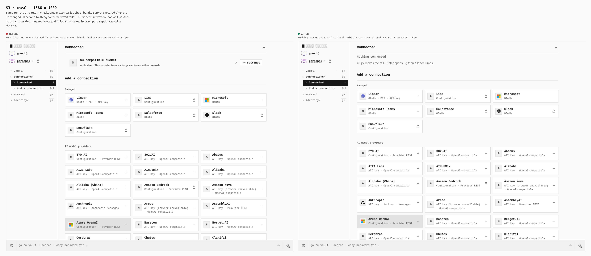

# S3 removal clears the Connected list

Removing a verified S3 connection now clears its retained Connected row before a cold reload. These sheets show the same remove-and-return checkpoint in two actual builds, using a real MinIO provider and the unchanged original S3 journey.

The before captures follow a failed **30-second** wait for “Nothing connected”; the after captures follow that same assertion passing. Both captures then waited for fonts and existing finite animations. The settle intervals differ; there is no equal-duration latency measurement. Full viewport pixels and the journey’s original scroll position are preserved, with labels outside the captures.

| Observation | Before | After |
|---|---|---|
| Nothing connected after removal, both widths | 30-second timeout | Passed |
| Retained S3 authorization text blocks in saved failure DOM, both widths | 1 | No failure DOM collected; empty-state assertion passed |
| Final cold reload: removed S3 status absent | Not reached | Passed, both widths |
| Desktop Add a connection heading y (CSS px) | 164.875 | 147.15625 |
| Touch Add a connection heading y (CSS px) | 421.265625 | 272.046875 |
| Desktop document / viewport width (CSS px) | 1366 / 1366 | 1366 / 1366 |
| Touch document / viewport width (CSS px) | 390 / 390 | 390 / 390 |

The geometry capture records headings and controls, not DOM card counts. The before text-block count comes from the saved failure DOM text; the after empty-state result comes from the actual visible-heading assertion.

## Touch — 390 × 844

Real touch/coarse-pointer context, DPR 3; raw captures are 1170 × 2532 pixels. Both full viewports are framed at their 390px CSS width.

## Desktop — 1366 × 1000

Mouse context, DPR 1; raw captures are 1366 × 1000 pixels. Both full viewports are framed at their 1366px CSS width.

## Builds and actions

Before: `935f112107a51898aa73b413646ba3a8c5781d8d`, tree `0649c56f6cebb7e78ec1147240c9ae63b90fbba5`. After: `7f8cd7e0d6de3b3c66e9dadd8ff15fc51e7dcd66`, tree `5f6f77bbdfa0add9b58a8acbc40515507afb1832`; sole parent `dfa1bf438844cdf99c8520050bcb31baf104e733`. The older retained before build differs by one production source file, `useTailscaleConnectionState.ts` (the shared native-connection projection hook), and seven test/helper files. Both are 255-file artifacts built with the same loopback command and profile.

Both serve a static PWA at `http://localhost:41911/OpenSesame/`, profile `loopback_development`, header security disabled. An owned MinIO `RELEASE.2025-09-07T16-13-09Z` HTTPS provider uses a generated certificate, scoped browser SPKI trust and exact-origin CORS. It is a provider test counterparty, not an OpenSesame backend.

At each width the ordinary setup seals a vault with a PIN, enables External connectors, opens S3 configuration, supplies the real fixture endpoint/bucket/key and confirms an incorrect signing secret is rejected. The journey then verifies the correct secret, checks the input clears, lists `fixture/sealed-document`, cold-reloads/unlocks, removes and confirms the connector, waits for its status region to detach, and returns to Connected. After the capture, the successful journey cold-reloads/unlocks again and confirms the removed status remains absent. Existing helpers use in-app History API navigation; no storage seeding, request interception, app DOM/style injection, cropping or masking was used.

Before failed independently at both widths; both original failures remain recorded. After passed both complete original journeys: real provider 403/200 responses, signed key listing, cleared secret, PIN reload and durable removal, with zero page errors. The before and after wrappers finished in 88.3165s and 38.6427s respectively, inside their unchanged 240-second bounds, with source/artifact/tool pins unchanged and all owned processes/listeners closed normally.

This is scoped S3 configuration, listing and removal evidence. The listed provider object is empty: no encrypted-backup upload, restore or decryption result is claimed. This loopback profile does not satisfy the dedicated-origin/header-security CI verifier, and the gallery does not establish that all integrations work.

## Retained capture provenance

Only the two comparison sheets and this README are committed here. Raw captures, geometry/results, failure DOM text, build inventories and unchanged journey/helper copies remain retained privately. The sheets use the unchanged `apps/pages/scripts/lib/visual-evidence.mjs` `composeSheet`; composition launches no app or provider.

| Capture | SHA-256 |
|---|---|
| before desktop | `6f398e0176380129fb9007aa29ac5a078009c07285b3136a190c82918e07d234` |
| after desktop | `25784bebf5468536089d2e0f2093c11ca256210003a56bf2ff1e63534c55ac32` |
| before phone | `1af805755afa9d925b6186d06fbb30742fcb679987d27fa62b4fa6c97fc8348b` |
| after phone | `f8b5304a1dd61dee1799df39b473978c0b130e88d7ef5b17a327951a2cd1b31a` |

Journey helper SHA-256: `ed91716d2057a5d43321b8e1a0b2dd90fca7fbf30b0cf5d152e923ff23c543a9`. Bootstrap SHA-256: `29f5cf04a0c11402bbaac5248743d3e227f72b336d449320c0f1c1644aeb7461`. The same exact helper bytes drove both builds; these are retained custom-journey captures, not a claim that `capture-evidence.mjs` recreated the provider workflow.
