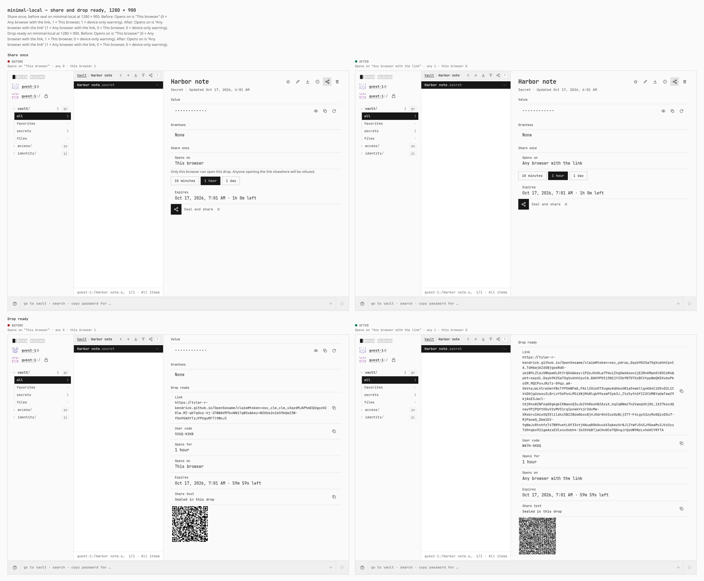
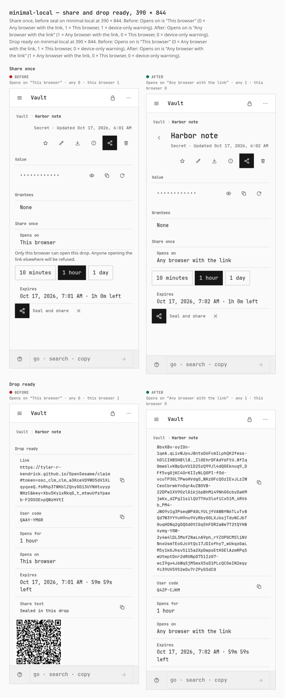
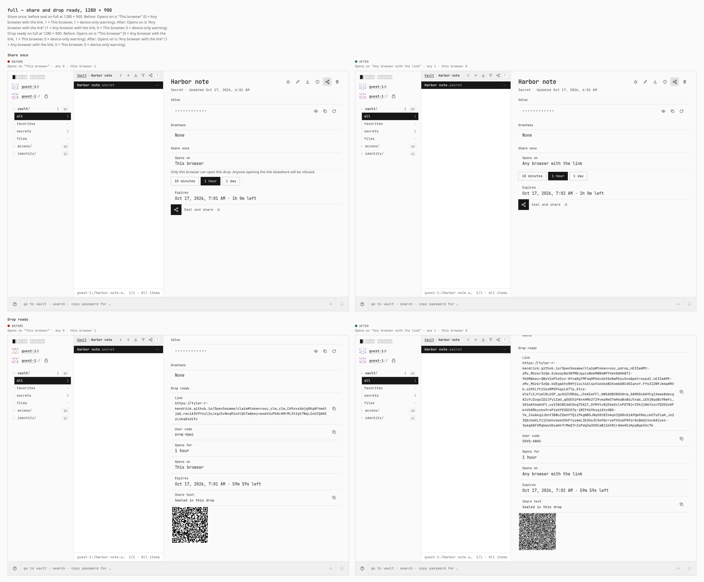
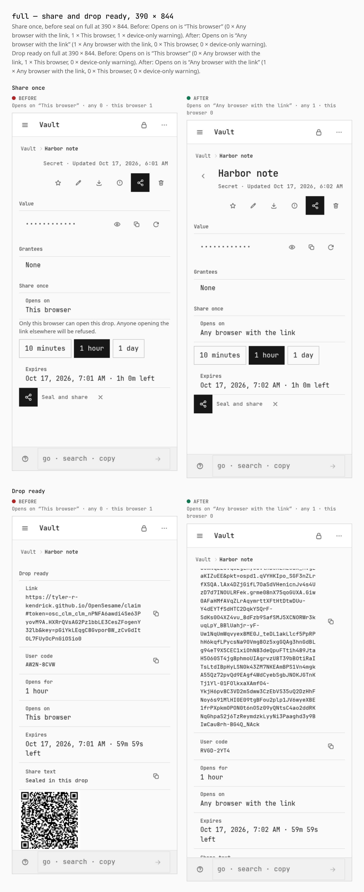

# Portable drop on four install profiles

Before `40681647c9ea585c6ec5fb920e81e2c7a70b12da`. After `51f27bc95716afda76eeae4629a18abfd03115ba`.

Each profile is a real Pages dist: `security-profile.mjs`, then `vite build` with `VITE_BASE=/OpenSesame/`. Desktop is 1280 × 900 with a mouse. Phone is 390 × 844, touch, coarse pointer.

Guest flow, same steps as `verify-portable-drop.mjs`: Skip on the front door, a new secret, Share once, then Seal and share. The pair is the Opens on row on the share form and again inside Drop ready.

Profiles:

- `minimal-local` (Minimal): capability profile minimal-local.json

- `default` (Default): no capability-profiles/default.json; stock build, setup choice Default

- `custom` (Custom): no capability-profiles/custom.json; setup choice Custom on the stock build

- `full` (Full): capability profile full.json

## minimal-local — share and drop ready, 1280 × 900

Share once, before seal on minimal-local at 1280 × 900. Before: Opens on is “This browser” (0 × Any browser with the link, 1 × This browser, 1 × device-only warning). After: Opens on is “Any browser with the link” (1 × Any browser with the link, 0 × This browser, 0 × device-only warning). Drop ready on minimal-local at 1280 × 900. Before: Opens on is “This browser” (0 × Any browser with the link, 1 × This browser, 0 × device-only warning). After: Opens on is “Any browser with the link” (1 × Any browser with the link, 0 × This browser, 0 × device-only warning).

## minimal-local — share and drop ready, 390 × 844

Share once, before seal on minimal-local at 390 × 844. Before: Opens on is “This browser” (0 × Any browser with the link, 1 × This browser, 1 × device-only warning). After: Opens on is “Any browser with the link” (1 × Any browser with the link, 0 × This browser, 0 × device-only warning). Drop ready on minimal-local at 390 × 844. Before: Opens on is “This browser” (0 × Any browser with the link, 1 × This browser, 0 × device-only warning). After: Opens on is “Any browser with the link” (1 × Any browser with the link, 0 × This browser, 0 × device-only warning).

## default — share and drop ready, 1280 × 900

Share once, before seal on default at 1280 × 900. Before: Opens on is “This browser” (0 × Any browser with the link, 1 × This browser, 1 × device-only warning). After: Opens on is “Any browser with the link” (1 × Any browser with the link, 0 × This browser, 0 × device-only warning). Drop ready on default at 1280 × 900. Before: Opens on is “This browser” (0 × Any browser with the link, 1 × This browser, 0 × device-only warning). After: Opens on is “Any browser with the link” (1 × Any browser with the link, 0 × This browser, 0 × device-only warning).

## default — share and drop ready, 390 × 844

Share once, before seal on default at 390 × 844. Before: Opens on is “This browser” (0 × Any browser with the link, 1 × This browser, 1 × device-only warning). After: Opens on is “Any browser with the link” (1 × Any browser with the link, 0 × This browser, 0 × device-only warning). Drop ready on default at 390 × 844. Before: Opens on is “This browser” (0 × Any browser with the link, 1 × This browser, 0 × device-only warning). After: Opens on is “Any browser with the link” (1 × Any browser with the link, 0 × This browser, 0 × device-only warning).

## custom — share and drop ready, 1280 × 900

Share once, before seal on custom at 1280 × 900. Before: Opens on is “This browser” (0 × Any browser with the link, 1 × This browser, 1 × device-only warning). After: Opens on is “Any browser with the link” (1 × Any browser with the link, 0 × This browser, 0 × device-only warning). Drop ready on custom at 1280 × 900. Before: Opens on is “This browser” (0 × Any browser with the link, 1 × This browser, 0 × device-only warning). After: Opens on is “Any browser with the link” (1 × Any browser with the link, 0 × This browser, 0 × device-only warning).

## custom — share and drop ready, 390 × 844

Share once, before seal on custom at 390 × 844. Before: Opens on is “This browser” (0 × Any browser with the link, 1 × This browser, 1 × device-only warning). After: Opens on is “Any browser with the link” (1 × Any browser with the link, 0 × This browser, 0 × device-only warning). Drop ready on custom at 390 × 844. Before: Opens on is “This browser” (0 × Any browser with the link, 1 × This browser, 0 × device-only warning). After: Opens on is “Any browser with the link” (1 × Any browser with the link, 0 × This browser, 0 × device-only warning).

## full — share and drop ready, 1280 × 900

Share once, before seal on full at 1280 × 900. Before: Opens on is “This browser” (0 × Any browser with the link, 1 × This browser, 1 × device-only warning). After: Opens on is “Any browser with the link” (1 × Any browser with the link, 0 × This browser, 0 × device-only warning). Drop ready on full at 1280 × 900. Before: Opens on is “This browser” (0 × Any browser with the link, 1 × This browser, 0 × device-only warning). After: Opens on is “Any browser with the link” (1 × Any browser with the link, 0 × This browser, 0 × device-only warning).

## full — share and drop ready, 390 × 844

Share once, before seal on full at 390 × 844. Before: Opens on is “This browser” (0 × Any browser with the link, 1 × This browser, 1 × device-only warning). After: Opens on is “Any browser with the link” (1 × Any browser with the link, 0 × This browser, 0 × device-only warning). Drop ready on full at 390 × 844. Before: Opens on is “This browser” (0 × Any browser with the link, 1 × This browser, 0 × device-only warning). After: Opens on is “Any browser with the link” (1 × Any browser with the link, 0 × This browser, 0 × device-only warning).

