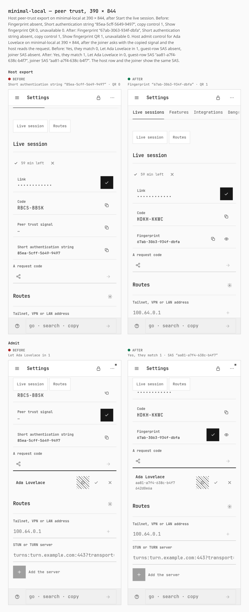
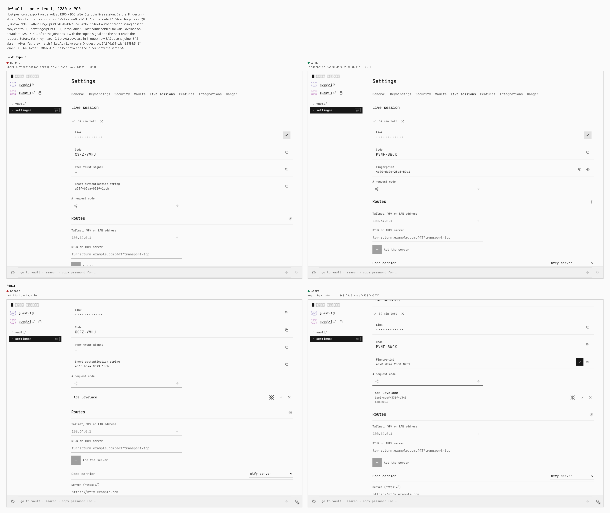
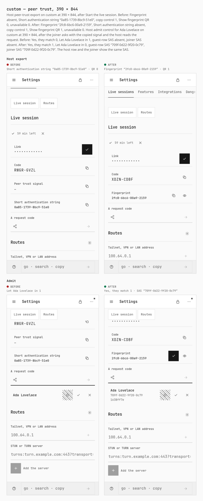
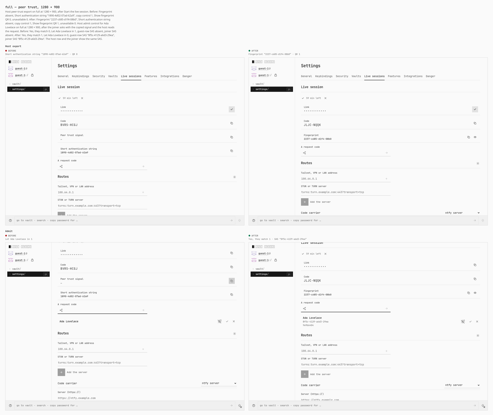
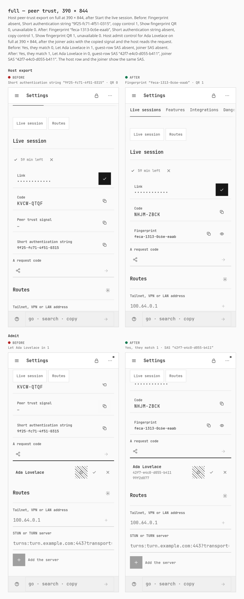

# Peer trust on four install profiles

Before `51f27bc95716afda76eeae4629a18abfd03115ba`. After `a1c7a7ce97e24cf1926ebd005e1d62a23c05f133`.

Each profile is a real Pages dist: `security-profile.mjs`, then `vite build` with `VITE_BASE=/OpenSesame/`. Desktop is 1280 × 900 with a mouse. Phone is 390 × 844, touch, coarse pointer.

Guest flow into a live session, the same host steps as `verify-peer-trust-two-context.mjs` through the admit control. The joiner pastes the copied peer-trust signal and asks. The host reads the request. The sheet stops there, with Yes, they match or Let in still on screen. WebRTC connect is not part of this gallery.

Profiles:

- `minimal-local` (Minimal): capability profile minimal-local.json

- `default` (Default): no capability-profiles/default.json; stock build, setup choice Default

- `custom` (Custom): no capability-profiles/custom.json; setup choice Custom on the stock build

- `full` (Full): capability profile full.json

## minimal-local — peer trust, 1280 × 900

Host peer-trust export on minimal-local at 1280 × 900, after Start the live session. Before: Fingerprint absent, Short authentication string “dcda-4ea1-1263-949a”, copy control 1, Show fingerprint QR 0, unavailable 0. After: Fingerprint “8616-7dd8-09ac-d2e7”, Short authentication string absent, copy control 1, Show fingerprint QR 1, unavailable 0. Host admit control for Ada Lovelace on minimal-local at 1280 × 900, after the joiner asks with the copied signal and the host reads the request. Before: Yes, they match 0, Let Ada Lovelace in 1, guest-row SAS absent, joiner SAS absent. After: Yes, they match 1, Let Ada Lovelace in 0, guest-row SAS “d628-9ed8-212f-67a0”, joiner SAS “d628-9ed8-212f-67a0”. The host row and the joiner show the same SAS.

## minimal-local — peer trust, 390 × 844

Host peer-trust export on minimal-local at 390 × 844, after Start the live session. Before: Fingerprint absent, Short authentication string “85ea-5cff-5649-9497”, copy control 1, Show fingerprint QR 0, unavailable 0. After: Fingerprint “67ab-3063-934f-dbfa”, Short authentication string absent, copy control 1, Show fingerprint QR 1, unavailable 0. Host admit control for Ada Lovelace on minimal-local at 390 × 844, after the joiner asks with the copied signal and the host reads the request. Before: Yes, they match 0, Let Ada Lovelace in 1, guest-row SAS absent, joiner SAS absent. After: Yes, they match 1, Let Ada Lovelace in 0, guest-row SAS “aa81-a7f4-638c-b4f7”, joiner SAS “aa81-a7f4-638c-b4f7”. The host row and the joiner show the same SAS.

## default — peer trust, 1280 × 900

Host peer-trust export on default at 1280 × 900, after Start the live session. Before: Fingerprint absent, Short authentication string “a53f-b5aa-0329-1dcb”, copy control 1, Show fingerprint QR 0, unavailable 0. After: Fingerprint “4c70-dd2e-25c8-89b1”, Short authentication string absent, copy control 1, Show fingerprint QR 1, unavailable 0. Host admit control for Ada Lovelace on default at 1280 × 900, after the joiner asks with the copied signal and the host reads the request. Before: Yes, they match 0, Let Ada Lovelace in 1, guest-row SAS absent, joiner SAS absent. After: Yes, they match 1, Let Ada Lovelace in 0, guest-row SAS “6a61-cdef-338f-b343”, joiner SAS “6a61-cdef-338f-b343”. The host row and the joiner show the same SAS.

## default — peer trust, 390 × 844

Host peer-trust export on default at 390 × 844, after Start the live session. Before: Fingerprint absent, Short authentication string “53b4-f20d-a9ea-9f71”, copy control 1, Show fingerprint QR 0, unavailable 0. After: Fingerprint “a2bc-839f-0779-47bd”, Short authentication string absent, copy control 1, Show fingerprint QR 1, unavailable 0. Host admit control for Ada Lovelace on default at 390 × 844, after the joiner asks with the copied signal and the host reads the request. Before: Yes, they match 0, Let Ada Lovelace in 1, guest-row SAS absent, joiner SAS absent. After: Yes, they match 1, Let Ada Lovelace in 0, guest-row SAS “45fc-aa27-a198-136a”, joiner SAS “45fc-aa27-a198-136a”. The host row and the joiner show the same SAS.

## custom — peer trust, 1280 × 900

Host peer-trust export on custom at 1280 × 900, after Start the live session. Before: Fingerprint absent, Short authentication string “4beb-e31f-be34-6dcc”, copy control 1, Show fingerprint QR 0, unavailable 0. After: Fingerprint “b1b1-69dc-f923-3a84”, Short authentication string absent, copy control 1, Show fingerprint QR 1, unavailable 0. Host admit control for Ada Lovelace on custom at 1280 × 900, after the joiner asks with the copied signal and the host reads the request. Before: Yes, they match 0, Let Ada Lovelace in 1, guest-row SAS absent, joiner SAS absent. After: Yes, they match 1, Let Ada Lovelace in 0, guest-row SAS “fe10-4fb2-5620-8beb”, joiner SAS “fe10-4fb2-5620-8beb”. The host row and the joiner show the same SAS.

## custom — peer trust, 390 × 844

Host peer-trust export on custom at 390 × 844, after Start the live session. Before: Fingerprint absent, Short authentication string “0a85-1739-8bc9-51e0”, copy control 1, Show fingerprint QR 0, unavailable 0. After: Fingerprint “2fc8-6bc6-00a9-2159”, Short authentication string absent, copy control 1, Show fingerprint QR 1, unavailable 0. Host admit control for Ada Lovelace on custom at 390 × 844, after the joiner asks with the copied signal and the host reads the request. Before: Yes, they match 0, Let Ada Lovelace in 1, guest-row SAS absent, joiner SAS absent. After: Yes, they match 1, Let Ada Lovelace in 0, guest-row SAS “709f-0d22-9f20-0c79”, joiner SAS “709f-0d22-9f20-0c79”. The host row and the joiner show the same SAS.

## full — peer trust, 1280 × 900

Host peer-trust export on full at 1280 × 900, after Start the live session. Before: Fingerprint absent, Short authentication string “1890-4d02-07ad-62a9”, copy control 1, Show fingerprint QR 0, unavailable 0. After: Fingerprint “2237-c685-d1f4-08b0”, Short authentication string absent, copy control 1, Show fingerprint QR 1, unavailable 0. Host admit control for Ada Lovelace on full at 1280 × 900, after the joiner asks with the copied signal and the host reads the request. Before: Yes, they match 0, Let Ada Lovelace in 1, guest-row SAS absent, joiner SAS absent. After: Yes, they match 1, Let Ada Lovelace in 0, guest-row SAS “8f5c-4129-a6d3-29ea”, joiner SAS “8f5c-4129-a6d3-29ea”. The host row and the joiner show the same SAS.

## full — peer trust, 390 × 844

Host peer-trust export on full at 390 × 844, after Start the live session. Before: Fingerprint absent, Short authentication string “9f25-fc71-4f51-0315”, copy control 1, Show fingerprint QR 0, unavailable 0. After: Fingerprint “feca-1313-0c6e-eaab”, Short authentication string absent, copy control 1, Show fingerprint QR 1, unavailable 0. Host admit control for Ada Lovelace on full at 390 × 844, after the joiner asks with the copied signal and the host reads the request. Before: Yes, they match 0, Let Ada Lovelace in 1, guest-row SAS absent, joiner SAS absent. After: Yes, they match 1, Let Ada Lovelace in 0, guest-row SAS “42f7-e4c0-d055-b411”, joiner SAS “42f7-e4c0-d055-b411”. The host row and the joiner show the same SAS.

