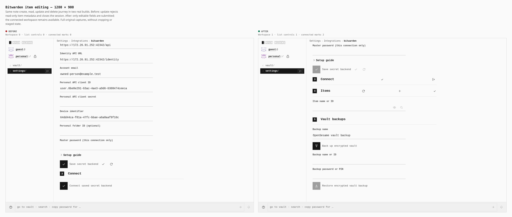
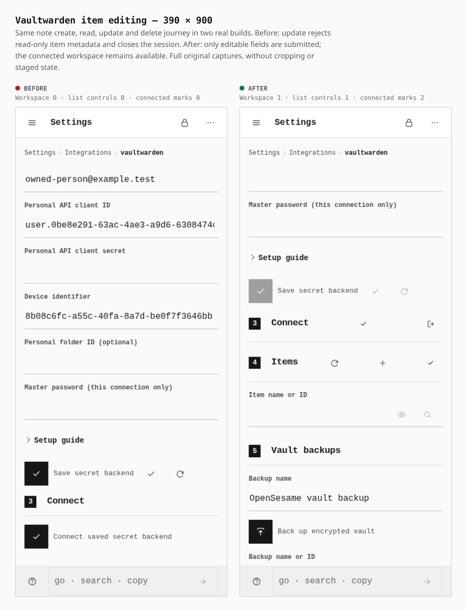

# Native password-manager item editing

Two real normal builds of the same note create/read/update/delete journey: before `19a7f3f20af97960574b9e5877a8972d683380ff`, after `481401fc1e135be0999625715b374477b7b18879`. The original browser captures are unmodified; the repository composer adds labels and measurements. Natural focus/scroll positions differ because the failing update closes the connection.

The edit form now projects only editable fields, retaining the strict worker schema. Before, transport-only item metadata caused update rejection and session disposal. After, note/login/secret create/read/update/delete and encrypted backup/restore complete through the actual PWA and native WASM transport.

## Desktop — 1280 × 900

Measured workspace count **0 → 1**, list controls **0 → 1**, connected session marks **0 → 2** after the same note operation sequence.

## Phone — 390 × 900

Measured workspace count **0 → 1**, list controls **0 → 1**, connected session marks **0 → 2**. Document width remains 390px, without horizontal overflow.

## Functional verification

All three original bounded browser cases pass 53 checks each (159 total): Bitwarden legacy PBKDF2; Vaultwarden modern COSE/PBKDF2; Vaultwarden Argon2id v19 (16MiB, 2 iterations, 1 lane). No browser errors, forced cleanup, lingering owned processes or listeners. These use controlled official-protocol TLS fixtures and the emitted app/worker/WASM assets; they do not certify customer accounts.

The repaired normal build passes the unchanged bundle budgets: total 21,018/21,050 KiB; JavaScript 7,271/7,320 KiB; gzip 2,210/2,210 KiB; CSS 180/180 KiB. Hosted CI is reported separately. `journey.json` preserves exact capture hashes and browser measurements.
