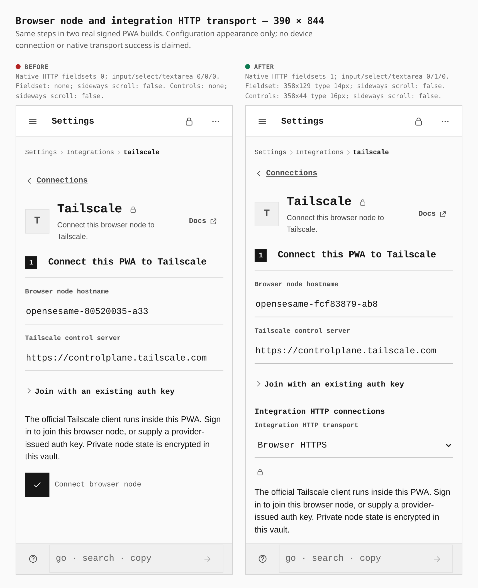
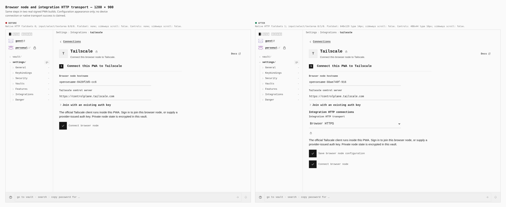

# Tailscale integration transport controls

Before: `327db0b9ec82382a97b144691f740ce79b53077a`. After: `3a9c5f138d96ed1bf6c8fa8e15ead6277b339195`.

Phone and desktop comparisons from two actual compiled PWA builds, following the same [capture journey](tailscale-native-1574.json). Captures completed in 48.70s before and 53.81s after; composition completed successfully. The original screenshot bytes and composed before/after labels are preserved.

These images show the configurable integration HTTP transport. The visual harness serves application assets and blocks service workers; it captures rendered configuration. The later functional acceptance uses a separate build and real Worker/WASM/provider operations.

## Phone: 390 × 844

The native HTTP fieldset changes from absent to 358 × 129 CSS pixels. Its transport selector measures 358 × 44 pixels with 16px text. Neither build scrolls sideways.

## Desktop: 1280 × 900

The native HTTP fieldset changes from absent to 640 × 129 CSS pixels. Its transport selector measures 480 × 44 pixels with 16px text. Neither build scrolls sideways.

## Capture coverage

The unchanged journey also records native-route and certificate-trust checkpoints for the following small gallery commits. The original phone operator-CA image clips the textarea below the footer; its image and caption remain unchanged. Separate, completed phone and desktop scroll captures show the complete CA control and will accompany those comparisons. This first gallery commit includes the two transport-selector sheets above.

The archived after build is `3a9c5f1`; these screenshots do not depict the later `d5c6237` build. All dimensions come from the browser capture logs.
