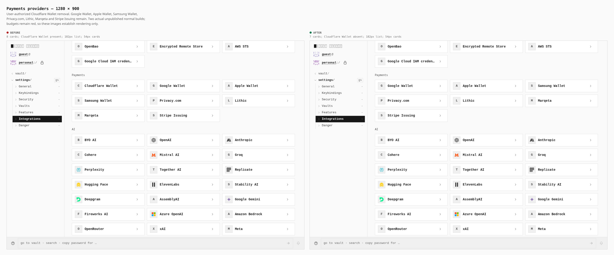
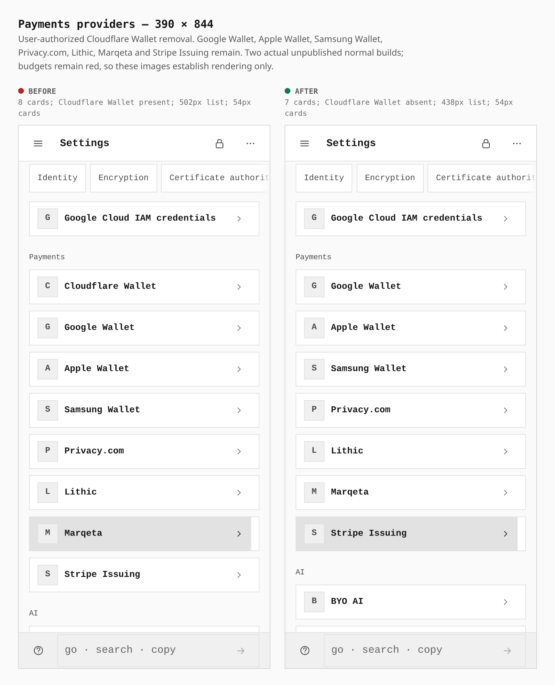

# Cloudflare Wallet removal

The user authorized removing Cloudflare Wallet. These pairs show Settings → Integrations → Payments from two actual normal builds, using the same PIN-seal, strict Connections switch, navigation and scrolling steps at desktop and phone widths.

| Screen | Before → after | Preserved layout |
|---|---|---|
| Desktop, 1280 × 900 | 8 → 7 cards; Cloudflare Wallet 1 → 0 | 54px cards; list height 182px → 182px; no horizontal overflow |
| Phone, 390 × 844 | 8 → 7 cards; Cloudflare Wallet 1 → 0 | 54px cards; list height 502px → 438px; no horizontal overflow |

Google Wallet, Apple Wallet, Samsung Wallet, Privacy.com, Lithic, Marqeta and Stripe Issuing each remain once, in their original relative order.

## Desktop

## Phone

## Build and capture provenance

Before: reviewed unpublished35 tree `ff4ce897452a131c7a53be37ec1b95176aff570a`, actual normal build 111.76s. After: reviewed unpublished43 tree `e46c703781198e2860358fd2a6b07701893b68af`, actual normal build 105.88s. The source snapshots differ only by the eight authorized Cloudflare Wallet removal paths. Both strict capability-graph checks passed.

Both bundle budget gates remain **red**: before total 21283/21050 KiB, JavaScript 7458/7370, JavaScript gzip 2291/2235; after total 21282/21050, JavaScript 7458/7370, JavaScript gzip 2291/2235. These images do not establish aggregate build, hosted CI or publication acceptance.

The official capture harness served the archived build files unchanged by static route fulfillment with service workers blocked. No identity/bridge/daemon stub, provider credential, DOM modification or provider operation was used. This is rendering evidence, with no native transport, security-header, provider-account or wallet-operation acceptance claim. Captures closed normally with unchanged artifacts and helpers.

Browser measurements and raw-frame hashes are in [measurements.json](measurements.json). The journey is [wallet-removal-pair-revealed-2452.json](wallet-removal-pair-revealed-2452.json). Composition only places the unchanged captures side by side with these measurements.
