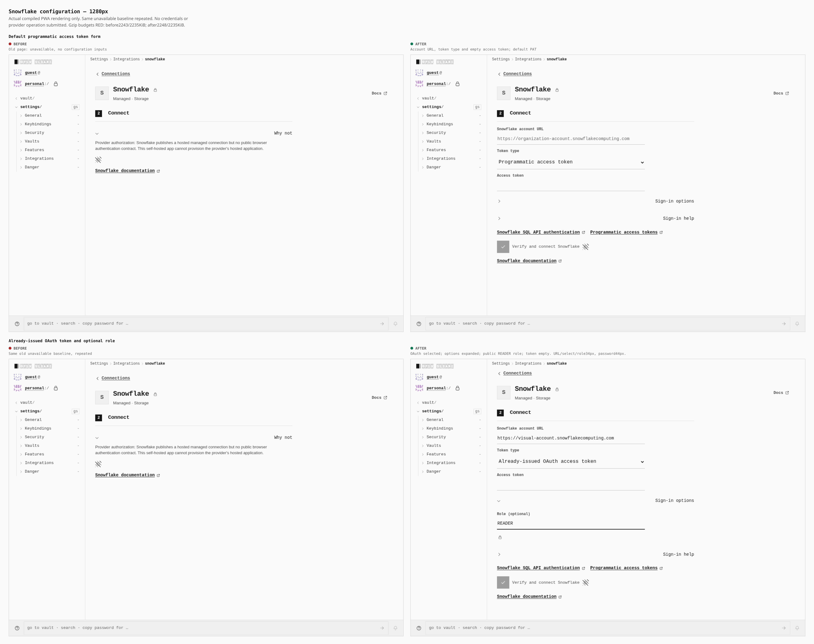
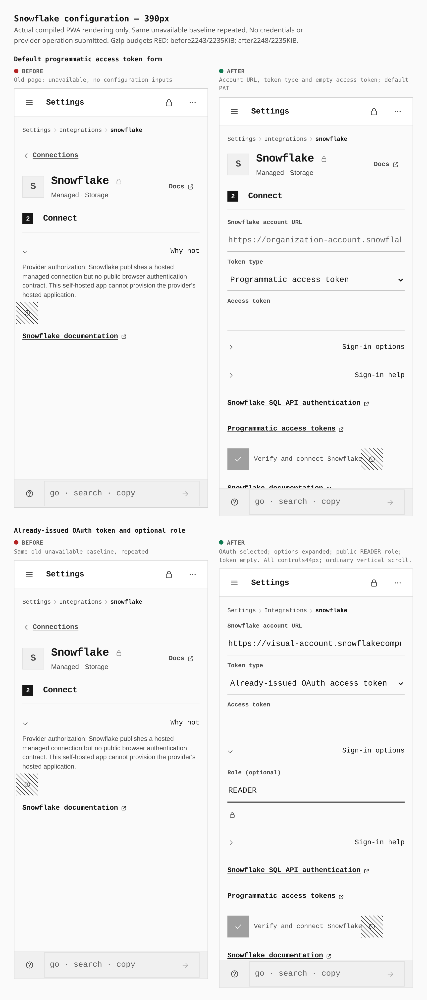

# Snowflake configuration

Actual compiled PWA screens at desktop 1280×900 and touch 390×844. The old page had no configuration inputs and reported “No public browser contract”. The new form provides account URL, token type and access token, plus an optional role under the shared Sign-in options disclosure. PAT and already-issued OAuth use the same form.

## Desktop

## Phone

The old baseline is deliberately repeated in both comparison rows. After frames use ordinary vertical scrolling; original frames remain retained with hashes in [provenance.json](provenance.json). Role READER and the account URL are public examples; the credential remains empty. The long URL scrolls inside its input, without horizontal page overflow.

Measured desktop URL/select/role controls: 34 px high/14 px type. Password: 44 px/16 px. Touch phone:all four 44 px/16 px. These are actual measurements, not an assumed 54 px claim. Header, labels, token options, role and verification control are readable across captured scroll states.

Before build 2474 matches signed tree e0a19754ff8d03d2d30df9601bcf711f529e680c; after build 2482 matches signed tree afa1e5198e1ed0fd2863e751f0880ee98097a5fc. Both normal builds and strict graph checks passed. Unchanged gzip budget gates remain **red**: before 2243/2235 KiB, after 2248/2235 KiB. These pictures do not establish aggregate acceptance. Crypto/codec and CI changes also occur between the trees.

The unchanged capture harness served exact archived files at the configured provider-auth origin through static route fulfillment, with service workers blocked. Actual PIN sealing and Features→Connections were used. No backend, extension, credential, config stub, DOM injection or provider operation was used. No Verify/Connect or List databases action was submitted. This is UI evidence only; no live CSP/header/native transport, hosted Snowflake account, zero-browser-error or query success is inferred.

The separate [Snowflake implementation PR 1743](https://github.com/Tyler-R-Kendrick/OpenSesame/pull/1743) passed 41 owned-TLS/mounted tests. Those tests have a different proof boundary. [Provenance](provenance.json) records exact signed commit/tree identities, build/capture receipt hashes, measurements, raw-frame hashes and original bounds.
