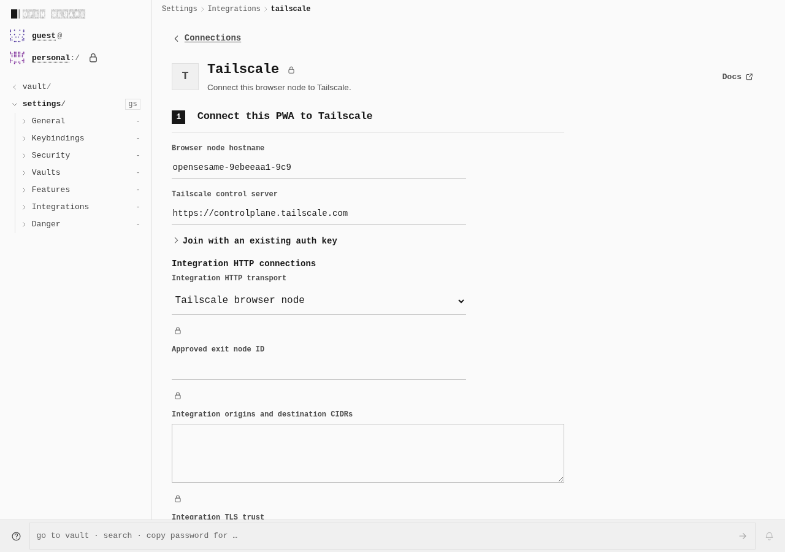
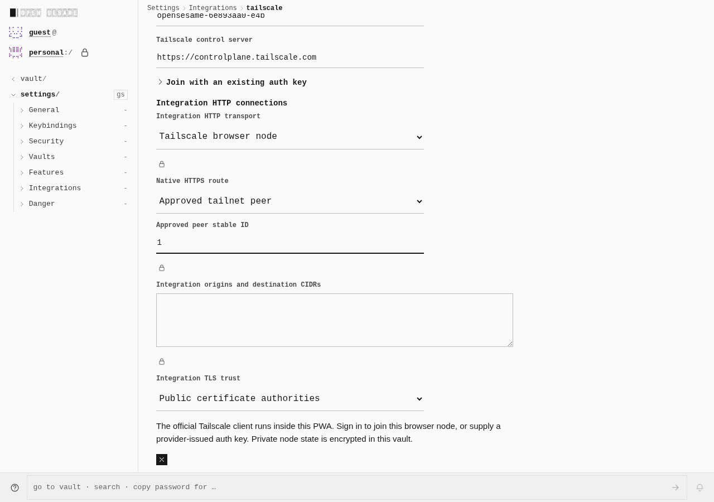
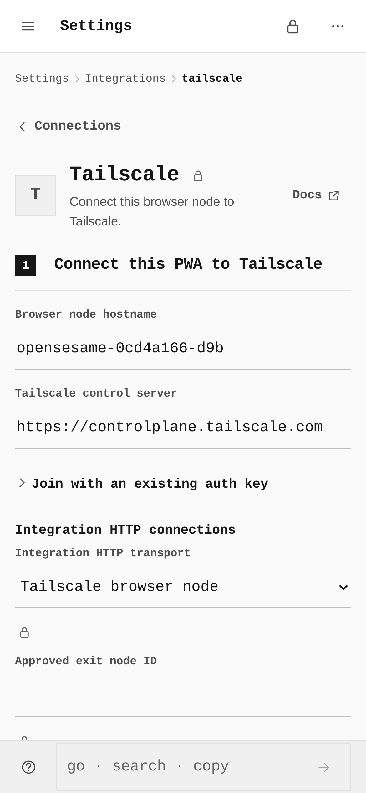
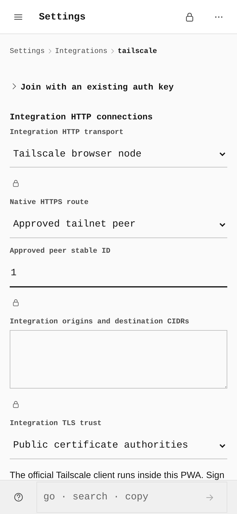
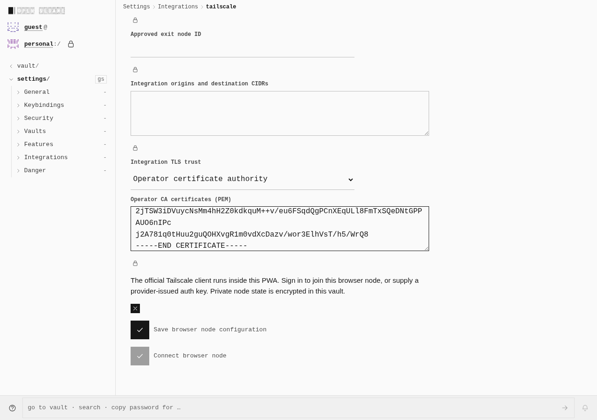
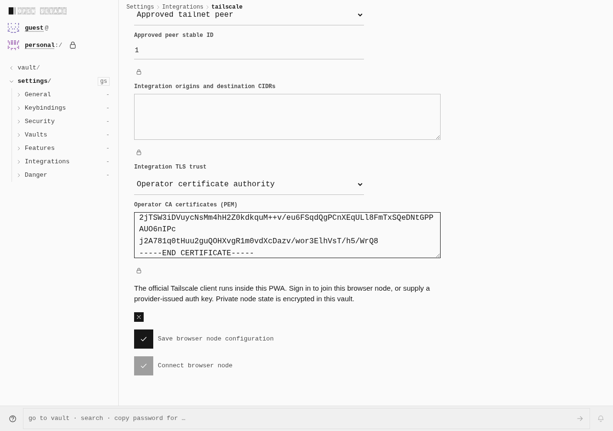
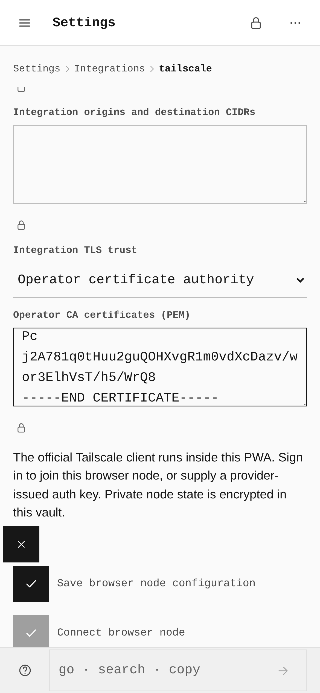

# Tailscale peer routing in the shared connection form

Captured on 2026-10-19 from two real, retained PWA builds. The current form adds **Native HTTPS route → Approved tailnet peer** and **Approved peer stable ID** beside the existing integration origin/CIDR and TLS trust controls.

| Actual browser measurement | Before | After |
|---|---|---|
| Native HTTPS route selector, both widths | 0 | 1, `peer` selected |
| Route identity field | Approved exit node ID | Approved peer stable ID |
| Desktop route input size | 480 × 34 CSS px | 480 × 34 CSS px |
| Phone route input size | 358 × 44 CSS px | 358 × 44 CSS px |
| Operator CA textarea, desktop | 640 × 96 CSS px | 640 × 96 CSS px |
| Operator CA textarea, phone | 358 × 96 CSS px | 358 × 96 CSS px |

The original PNGs are unchanged. Desktop is 1280 × 900 at DPR 1; phone is 390 × 844 at DPR 3, yielding 1170 × 2532 pixels. Captures retain their natural scroll and focus positions; they are not an equal-scroll geometry comparison. The historical before build and current after build span several commits, rather than an isolated immediate-parent diff.

[Open the standalone side-by-side gallery](gallery.html). The pairs also render below in GitHub.

## Desktop route controls

Before:

After:

## Phone route controls

Before:

After:

## Desktop operator certificate authority

Before:

After:

## Phone operator certificate authority

Before:

After:

## Capture provenance and limits

Before: compiled `2eaa4e8fe959fb872fe7a3f7b0c9b176ca301983`, observed by helper `e610d6a60dba8e6ee57aaf23ff90c4540cd82765`. After: signed `76f1beaba4f77f81e3fafd48ca903e9f5e740fd2`, tree `0e668479918f415a14b89e62c2f7c79b35a78258` (PR1631). The actual SourceE normal build passed within the unchanged 240-second bound; its receipt SHA-256 is `164cbcead1f18ee0fa2a5db61c9ad6cacfd878a1089b2025d8b96385978ebc7d`. Original bundle budgets and strict capability-graph checks passed separately.

These photographs show configuration only: neither capture saved credentials, connected a browser node, or issued a provider operation. The visible PEM is a public fixture CA certificate. No auth key or private key is included. Both capture guards retained exact artifact/helper bytes, reported no browser errors, and closed owned processes normally without fallback (before 17.776s; after 18.294s, unchanged 180s whole/45s phase bounds).

The raw after-observation record retains an inherited “SourceD” caption. Its actual compiled head, image metadata and SourceE build/artifact pins identify the after build above; the original record was preserved. Previous failed functional attempts remain separate retained evidence and are not relabeled by this gallery.

Separate functional browser evidence passed **300 checks across ten independent cases** on the exact after build: five owned provider-protocol authorities at desktop and phone widths. Each case keeps its original 180-second whole / 45-second phase bounds. The timings below are per case; no aggregate 180-second claim is made.

| Provider protocol | Desktop 1280 | Phone 390 | Checks per case |
|---|---|---|---|
| Algolia indexes | 42.601s | 44.115s | 30 |
| Postmark outbound messages | 44.613s | 42.035s | 30 |
| Cloudflare zones | 44.934s | 42.560s | 30 |
| Contentful spaces | 44.851s | 42.875s | 30 |
| AgentMail inboxes | 43.741s | 44.992s | 30 |

These runs exercised the real emitted PWA Worker and source-built WASM against an independent owned native TLS peer, including saved configuration, locked/cold reload, actual resource results in the common UI, and physical cancellation. Each held TLS request remained open for at least 250 ms before UI-owner withdrawal, then closed strictly under 2 s; ordinary peering survived on the same original Worker. Exact executable assets completed and browser/network/provider errors were zero. Source/artifact/input pins remained unchanged and all owned processes closed normally without fallback.

The authorities implement provider protocols; they are **not live hosted SaaS accounts**. Static photographs establish configuration rendering only. Earlier failed attempts remain preserved separately. These ten cases do not certify every catalog integration, identities, backup providers or the unselected native-public CI job; the earlier PR1630 Bitwarden initial-test failure is not covered by them.

The final ten-case index SHA-256 is `61ec11c1ebed31dafe3249fba3f7375f55055695b3721a94fd323253df3ae391`. Per-case exact timings, results and guard receipt hashes are in [evidence.json](evidence.json); private credential-bearing runtime objects are not published.

Image hashes, measured form rectangles, build identity, capture receipt hashes and qualifications are recorded in [evidence.json](evidence.json). The existing private captures were not regenerated with `capture-evidence.mjs`, and no image editing or composition was performed for this documentation leaf.
