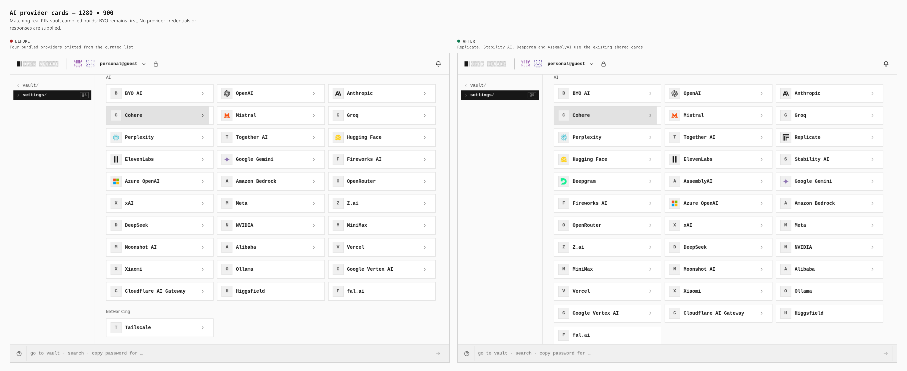
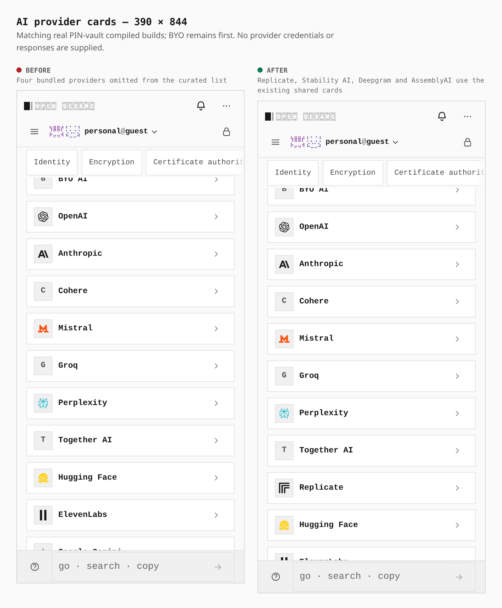
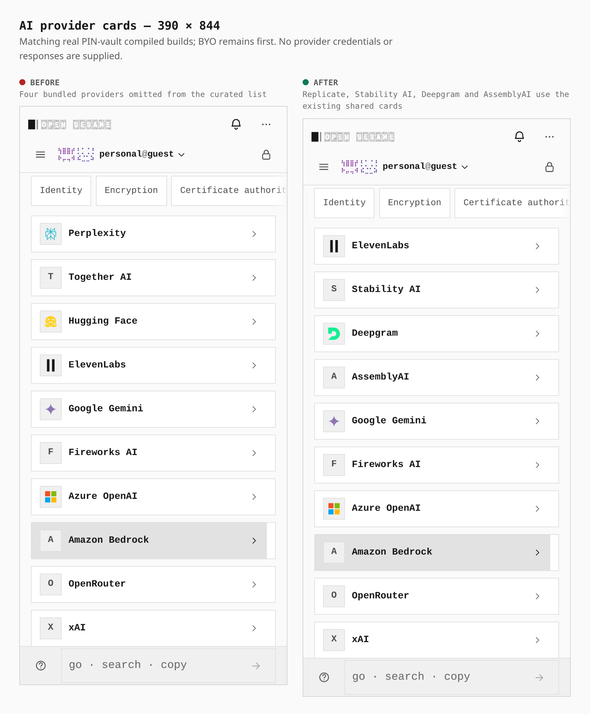

# AI provider cards

Actual production PWA builds with the same real PIN-vault journey at 1280×900 and 390×844. Enable External connectors, open Settings → Integrations → AI, and inspect the overview and the common Google Gemini scroll anchor.

Replicate, Stability AI, Deepgram and AssemblyAI return to the existing shared card list. The measured count changes from 30 to 34. BYO AI stays first. Both widths retain one main region and have no horizontal overflow.

The desktop grid changes from 960×630px to 960×758px; the phone grid changes from 358×1910px to 358×2166px. Shared card controls and configuration placement are unchanged.

Before: signed `22aee90866b2ff636798cd74cb94be59c5b77649`, tree `91f6601bebd1a99beaf788552d1d71ac3432812d`. After: signed `0b089e69a3bb1eef9f95eb02a15ca57eba03d61f`, tree `713afd07478361761762204cd1ae8ec3575671fe` (PR #1854). Both builds pass the unchanged bundle budgets and strict capability graph. Exact compiled identities and capture measurements are recorded in [the build proof](paired-build-proof.json).

Reproduce with `capture-evidence.mjs capture before/after` and [the journey](ai-provider-cards.journey.json), setting `EVIDENCE_DIST` to the matching compiled artifact and `PLAYWRIGHT_CHROMIUM` to the installed browser. Then run `capture-evidence.mjs compose`.

These screenshots verify list layout and configuration visibility. Provider authentication and useful inference are separate functional checks; Stability image-family activation is a later checkpoint.
