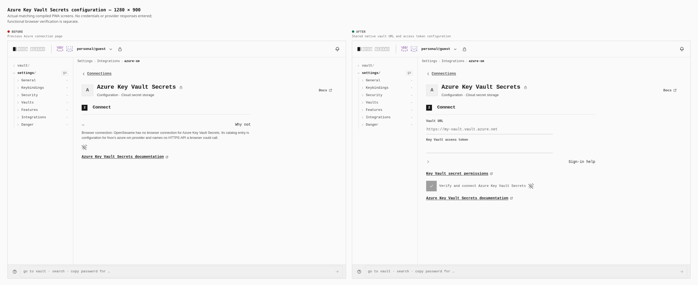
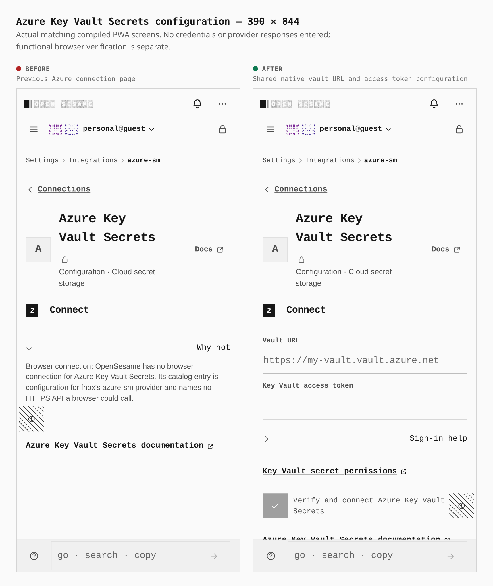

# Azure Key Vault Secrets native configuration

Paired actual production PWA builds, with the same PIN-vault journey at 1280×900 and 390×844: enable External connectors, then open Settings → Integrations → Azure Key Vault Secrets. No credentials or provider responses are entered in these configuration screenshots.

Before: signed `f1cd43f7100289a83e9d0a1b56a663dfcaf05c89`, tree `b047594929d5dec10c85683b62cc344249ce24d7`. After: signed `26d69ba7cf33b4cc481d69e29bd29d41571db745`, tree `93aae8381866635d96dd49332b293151cff6e539`. The before tree is recorded from its build receipt; the exact source identity is checked during publication.

The previous explanation is replaced with the shared Vault URL, masked access token and Verify and connect controls. Both widths contain one main region and have no horizontal overflow. The password-input count changes from zero to one. The visible configuration form grows from 171px to 328px on desktop and from 232px to 397px on phone. Provider instructions and controls compose the existing native connection design.

## Reproduction

Use `capture-evidence.mjs capture before/after` with [the journey](azure-configuration-20261020.journey.json) and each matching compiled artifact, followed by `capture-evidence.mjs compose`. Set `EVIDENCE_DIST` to the matching artifact and `PLAYWRIGHT_CHROMIUM` to the installed browser. Both actual builds pass the unchanged bundle budget and strict capability graph; the after build has 288 files and its index SHA256 is `15cb15c540231cf7bb3f24311341e88be8afd087b024ec3379ff73426f4b0617`.

These images show configuration layout. Successful authentication, resource reads, cold custody, encrypted backup and restore are separate functional requirements. The dedicated browser journey uses synthetic documented Azure protocol responses; it does not establish a live Azure account, token issuance or public Azure CORS behavior. Native CRUD and backup activation are reviewed in PR #1844, with browser coverage in PR #1845 and its disclosure correction.
