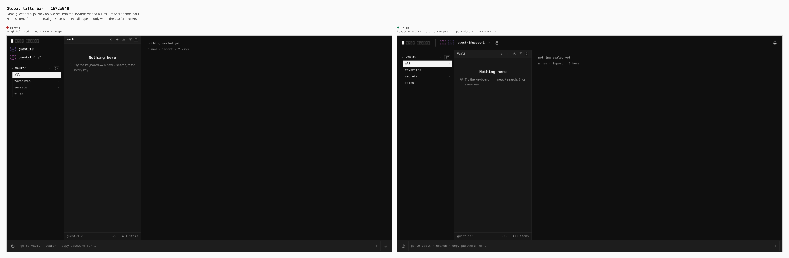
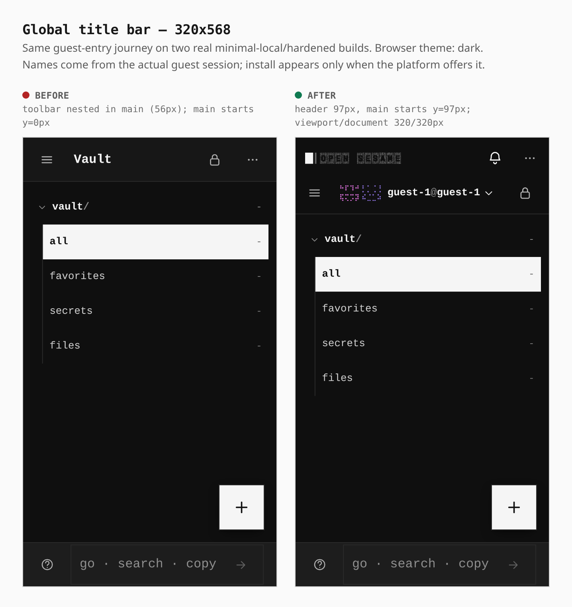
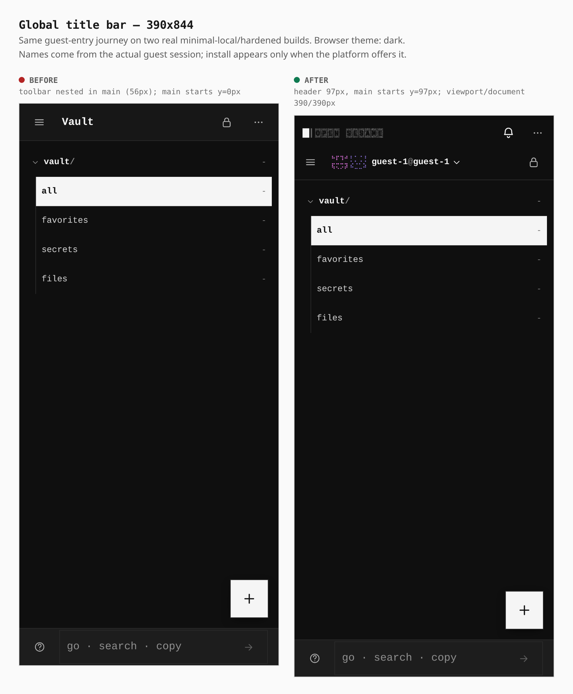
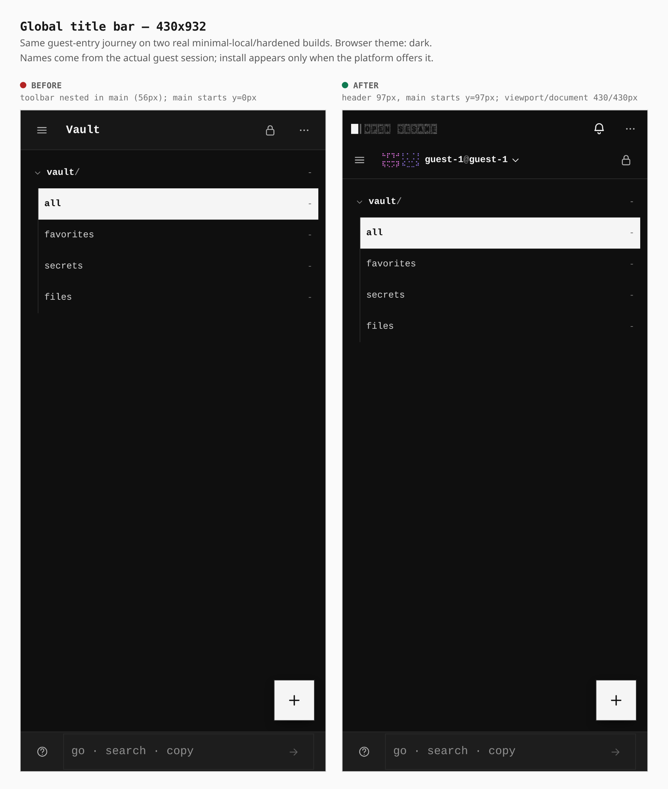
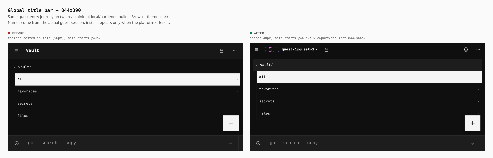
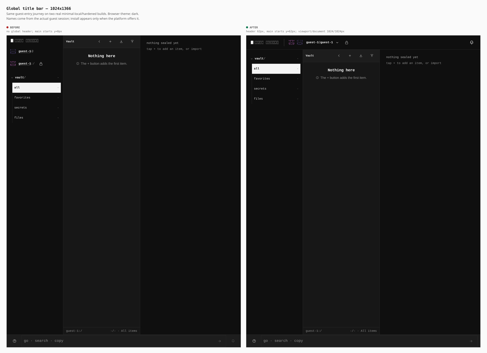

# Global title bar

The approved screenshot is the layout reference: one full-width header above
the sidebar and content, logo and adjacent identity glyphs on the left, vault
name before `@account`, lock beside the identity, and install/notifications on
the right. Phones use two rows; short landscape uses one compact row.

These six pairs come from **two real minimal-local/hardened builds**, using
base `75687a6c` and the changed source, the same guest-entry journey, and the
browser's dark theme. The vault/account names are actual generated guest
names. No controls were hand-placed or screenshots cropped. Install remains
conditional on browser eligibility; its geometry is separately exercised by
`verify:header-layout` through the real install store's browser event listener.

Browser measurements are in [measurements.json](measurements.json).
Full default-build checks and known baseline blockers are recorded in
[validation.md](validation.md). The
header and main share an exact boundary at every measured viewport, and
document width equals viewport width throughout. All header action targets
are at least 44px on narrow windows and touch devices.

| Viewport | Before | After |
| --- | --- | --- |
| 1672x940 | no global header; main starts y=0px | header 62px, main starts y=62px; viewport/document 1672/1672px |
| 320x568 | toolbar nested in main (56px); main starts y=0px | header 97px, main starts y=97px; viewport/document 320/320px |
| 390x844 | toolbar nested in main (56px); main starts y=0px | header 97px, main starts y=97px; viewport/document 390/390px |
| 430x932 | toolbar nested in main (56px); main starts y=0px | header 97px, main starts y=97px; viewport/document 430/430px |
| 844x390 | toolbar nested in main (56px); main starts y=0px | header 48px, main starts y=48px; viewport/document 844/844px |
| 1024x1366 | no global header; main starts y=0px | header 62px, main starts y=62px; viewport/document 1024/1024px |

## 1672x940



## 320x568



## 390x844



## 430x932



## 844x390



## 1024x1366



## Reproduce

Build the base in a separate worktree and this branch with the same profile:

```sh
# From apps/pages in each worktree:
node scripts/build-profile.mjs --profile minimal-local --mode hardened --out /absolute/build-output

# From the repository root, using separate absolute build paths:
PLAYWRIGHT_CHROMIUM=/path/to/chromium node docs/evidence/2026-10-20-global-title-bar/capture.mjs before /absolute/base-build /absolute/raw-captures
PLAYWRIGHT_CHROMIUM=/path/to/chromium node docs/evidence/2026-10-20-global-title-bar/capture.mjs after /absolute/branch-build /absolute/raw-captures
```

The full default build is also verified separately. Header geometry checks
cover both themes, live breakpoint resizing, long names, keyboard opening and
closing of switchers/notifications, browser install eligibility, and the
offline status indicator beside install at 320px.
