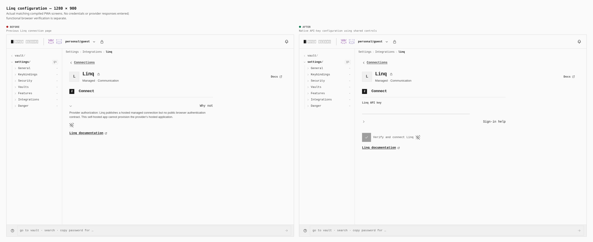
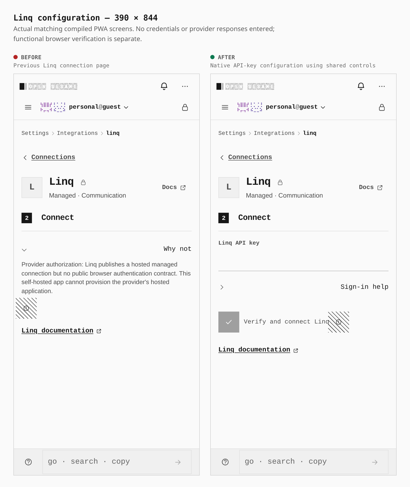

# Linq native configuration

Paired screenshots from matching production PWA builds, using the same saved PIN-vault journey at1280×900 and390×844. The journey enables External connectors and opens Settings → Integrations → Linq. No credentials or provider response are entered in these screenshots.

These screenshots retain the original signed capture commits from before the stack was rebased onto main `2576d1aacf064a9a72c13faee95bcd558b5c2bb4`. They are historical before/after evidence; the current PR heads are different.

Before: signed `5e1142d0da9a6cb5b6e9d5da093e4aa0fa1be72e` (PR #1828), tree `fae10fcfbd78c974c7b858f71900fef11373268a`.
After: signed `8351db0023e802119c3703114ebb377acfbc5a43` (PR #1829), tree `9ea1e9b21ff265ad3bd428d07590a0a49a74d3ec`.

The old hosted-only explanation is replaced with the shared native API-key form and Verify and connect control. Each captured page contains one main region and has no sideways overflow. The password-input count changes from zero to one at both widths. The header and existing control styles come from the current shared design.

## Reproduction

Use `capture-evidence.mjs capture before/after` with [the journey](linq-configuration-20261020.journey.json) and each matching compiled artifact, followed by `capture-evidence.mjs compose`. Set `EVIDENCE_ORIGIN=https://provider-auth.opensesame.test:46749`, `EVIDENCE_DIST` to the matching build, and `PLAYWRIGHT_CHROMIUM` to the installed browser.

These are visual configuration measurements. They do not establish successful provider authentication, a useful resource read, live-account CORS behavior, or emitted WASM execution. Positive browser requirements are a separate three-file change in PR #1830. Both normal builds pass the strict capability graph and retain the existing CSS budget failure (183/181KiB); these screenshots do not imply green bundle CI.
