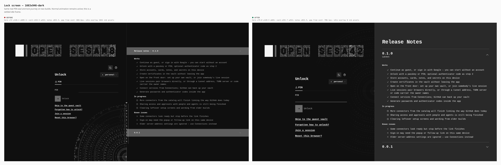
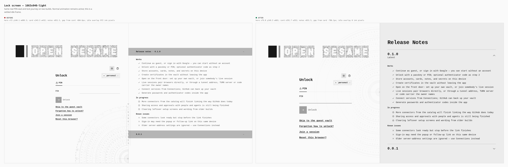
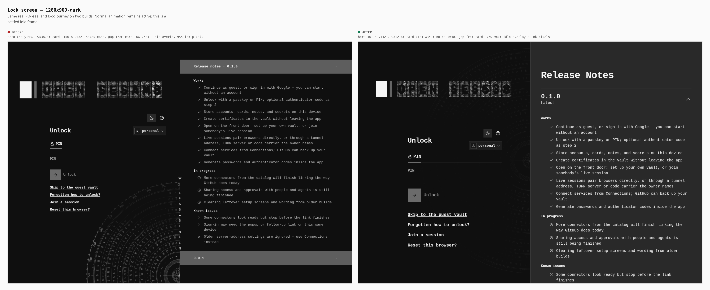
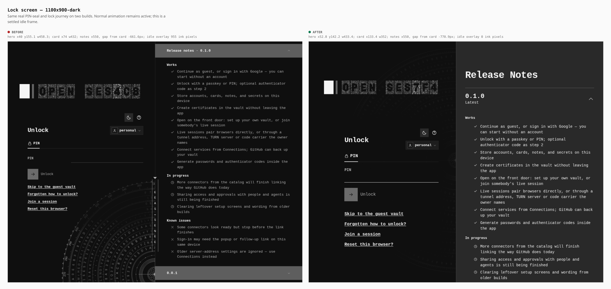
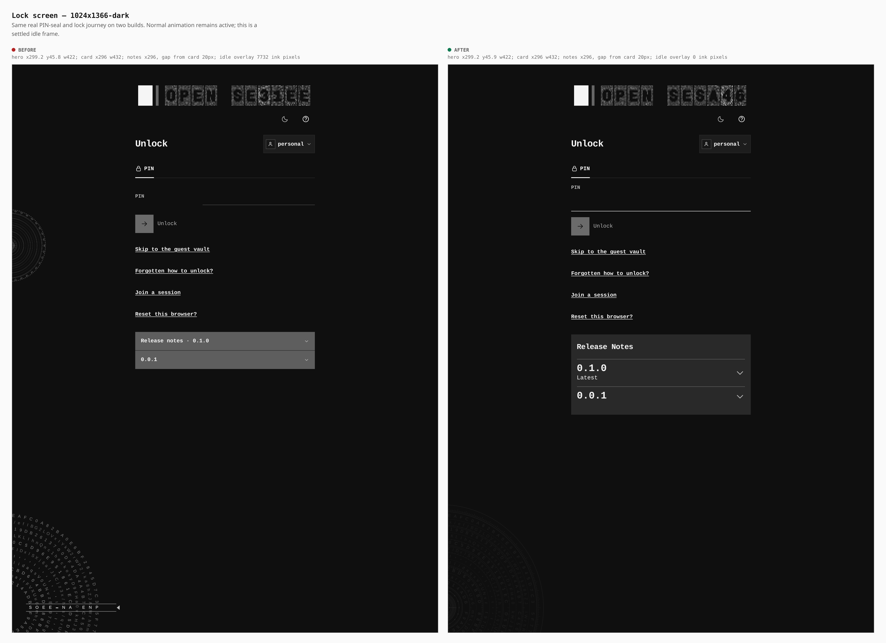
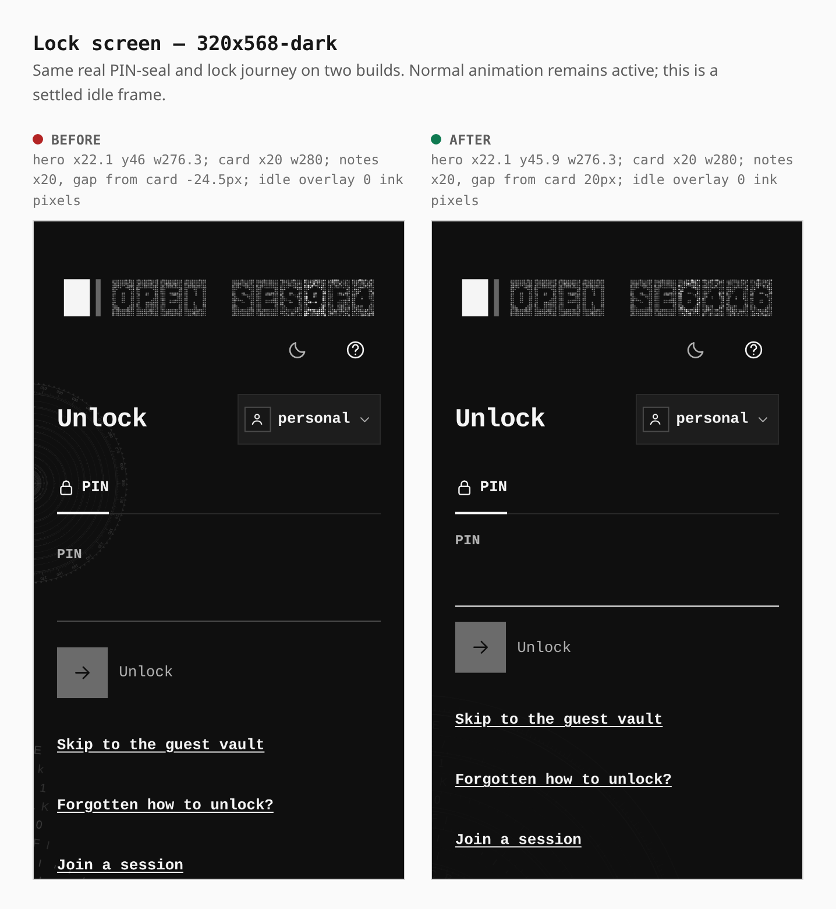
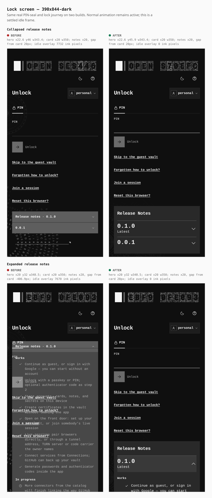
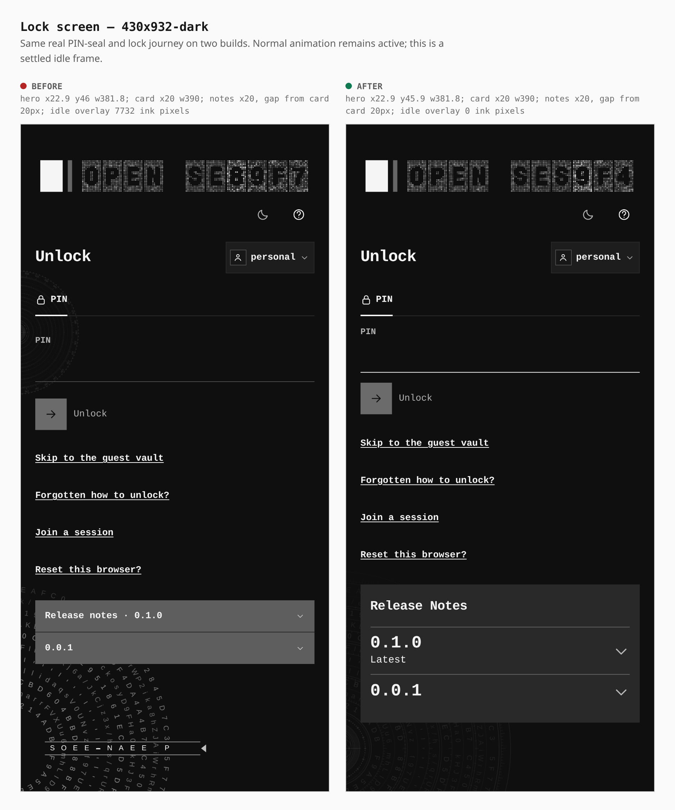
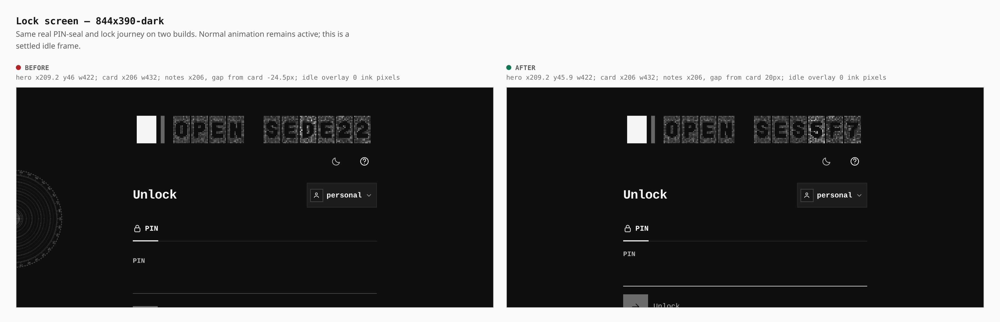
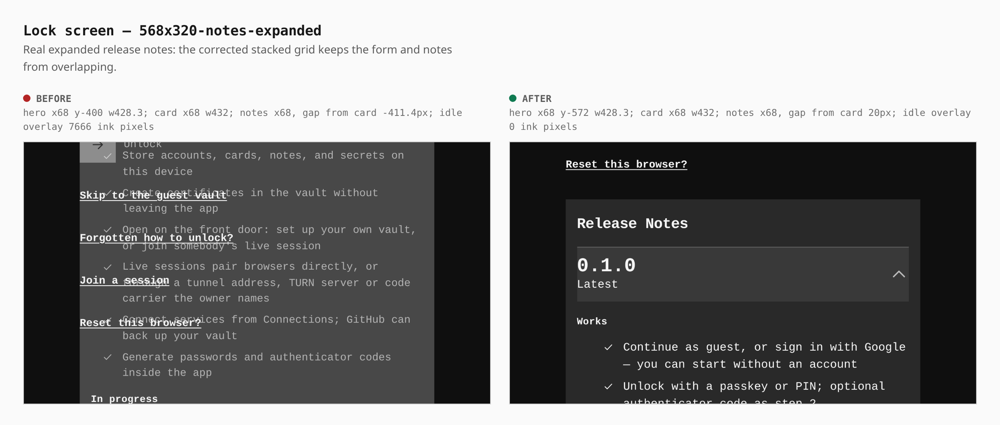

# Lock screen parity

Two real default builds: base `a03b3c50` and this change. Each capture follows the same local PIN seal → lock journey, uses the gate’s own theme control, and leaves normal animation running. Screens are complete viewport captures; no elements were hand-placed or hidden for a shot.

The supplied 1663 × 946 reference sets the desktop geometry. Smaller screens retain the form, release-note accordion and cipher animation with a stacked layout. The reduced-motion and successful-unlock checks use the same production gate.

## Measurements

Across every narrow after capture, including expanded notes and live resizes, the minimum clearance below the complete card is 20.0 px. At 568 × 320 with notes expanded, the baseline gap was −411.4 px (overlap); the after gap is 20.0 px.

| Screen | Before | After |
|---|---|---|
| 1663x946-dark | hero x72 y146.1 w689.3; card x343.5 w432; notes x831.5, gap from card -684.6px; idle overlay 1041 ink pixels | hero x79.8 y149.5 w681; card x291.7 w352; notes x831.5, gap from card -786.1px; idle overlay 0 ink pixels |
| 1663x946-light | hero x72 y146.1 w689.3; card x343.5 w432; notes x831.5, gap from card -684.6px; idle overlay 972 ink pixels | hero x79.8 y149.5 w681; card x291.7 w352; notes x831.5, gap from card -786.1px; idle overlay 0 ink pixels |
| 1280x900-dark | hero x40 y143.9 w538.8; card x156.8 w432; notes x640, gap from card -661.6px; idle overlay 955 ink pixels | hero x61.4 y142.2 w512.6; card x184 w352; notes x640, gap from card -770.9px; idle overlay 0 ink pixels |
| 1100x900-dark | hero x40 y155.1 w458.3; card x74 w432; notes x550, gap from card -661.6px; idle overlay 955 ink pixels | hero x52.8 y142.2 w433.4; card x133.4 w352; notes x550, gap from card -770.9px; idle overlay 0 ink pixels |
| 1024x1366-dark | hero x299.2 y45.8 w422; card x296 w432; notes x296, gap from card 20px; idle overlay 7732 ink pixels | hero x299.2 y45.9 w422; card x296 w432; notes x296, gap from card 20px; idle overlay 0 ink pixels |
| 320x568-dark | hero x22.1 y46 w276.3; card x20 w280; notes x20, gap from card -24.5px; idle overlay 0 ink pixels | hero x22.1 y45.9 w276.3; card x20 w280; notes x20, gap from card 20px; idle overlay 0 ink pixels |
| 390x844-dark | hero x22.6 y46 w343.4; card x20 w350; notes x20, gap from card 20px; idle overlay 7732 ink pixels | hero x22.6 y45.9 w343.4; card x20 w350; notes x20, gap from card 20px; idle overlay 0 ink pixels |
| 430x932-dark | hero x22.9 y46 w381.8; card x20 w390; notes x20, gap from card 20px; idle overlay 7732 ink pixels | hero x22.9 y45.9 w381.8; card x20 w390; notes x20, gap from card 20px; idle overlay 0 ink pixels |
| 844x390-dark | hero x209.2 y46 w422; card x206 w432; notes x206, gap from card -24.5px; idle overlay 0 ink pixels | hero x209.2 y45.9 w422; card x206 w432; notes x206, gap from card 20px; idle overlay 0 ink pixels |
| 568x320-notes-expanded | hero x68 y-400 w428.3; card x68 w432; notes x68, gap from card -411.4px; idle overlay 7666 ink pixels | hero x68 y-572 w428.3; card x68 w432; notes x68, gap from card 20px; idle overlay 0 ink pixels |

## Animation and readability proof

The browser reads real ring-canvas and hero-canvas pixel hashes over time. Normal idle frames must change. Freshly mounted reduced-motion gates must keep all eleven desktop ring canvases painted and static, with a static hero, including after a live resize. Narrow corner dials use aggregate visible glyph ink because some rings fall outside the visible pane. A real PIN submission must advance several door positions and finish at the unlocked vault.

Canvas alpha measurements require no idle foreground readout/index ink. For desktop, a decoded screenshot also measures the composite contrast of the empty upper cipher arc against its pane background. The fixed bezel must paint at the actual device pixel ratio, including touch contexts at DPR 3.

The baseline reduced-motion canvases were blank at seven viewport sizes; the two landscape sizes retained only a small clipped fragment. Baseline 1024 px and 320 px release-note summaries had confirmed pointer obstruction from the form/footer. Baseline captures use real Tab navigation and Enter to continue that journey when pointer access is blocked; the after contract requires pointer access after scrolling the summary into view.

All measurements are recorded in [before-measurements.json](before-measurements.json) and [after-measurements.json](after-measurements.json). The after contract result is [after-result.json](after-result.json). See [validation](validation.md) for gate results and baseline defects.

## Gallery

### 1663x946-dark



### 1663x946-light



### 1280x900-dark



### 1100x900-dark



### 1024x1366-dark



### 320x568-dark



### 390x844-dark



### 430x932-dark



### 844x390-dark



### 568x320-notes-expanded



## Reproduce

Build the base and current source separately with the default Pages build, then run:

```sh
PLAYWRIGHT_CHROMIUM=/path/to/chromium PAGES_VERIFY_DIST=/absolute/before/dist \
  node apps/pages/scripts/capture-lockscreen-parity.mjs before /tmp/lockscreen-parity
PLAYWRIGHT_CHROMIUM=/path/to/chromium PAGES_VERIFY_DIST=/absolute/after/dist \
  node apps/pages/scripts/capture-lockscreen-parity.mjs after /tmp/lockscreen-parity
PLAYWRIGHT_CHROMIUM=/path/to/chromium \
  node apps/pages/scripts/capture-lockscreen-parity-gallery.mjs /tmp/lockscreen-parity docs/evidence/2026-10-20-lockscreen-parity
```
