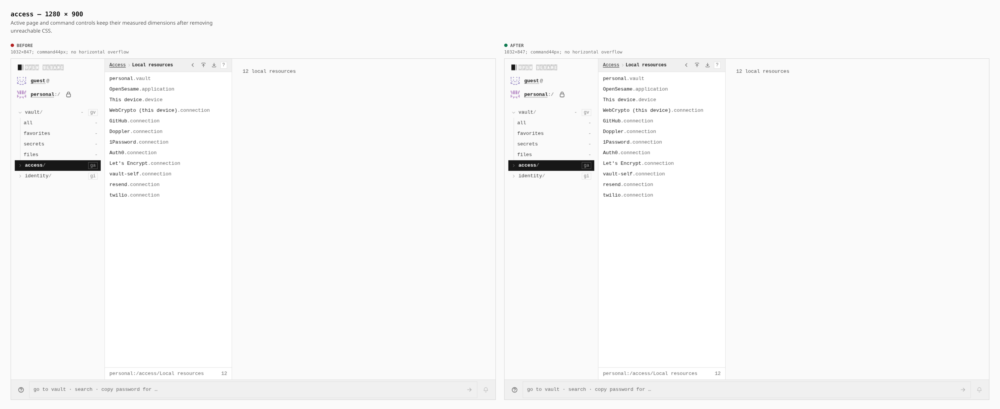
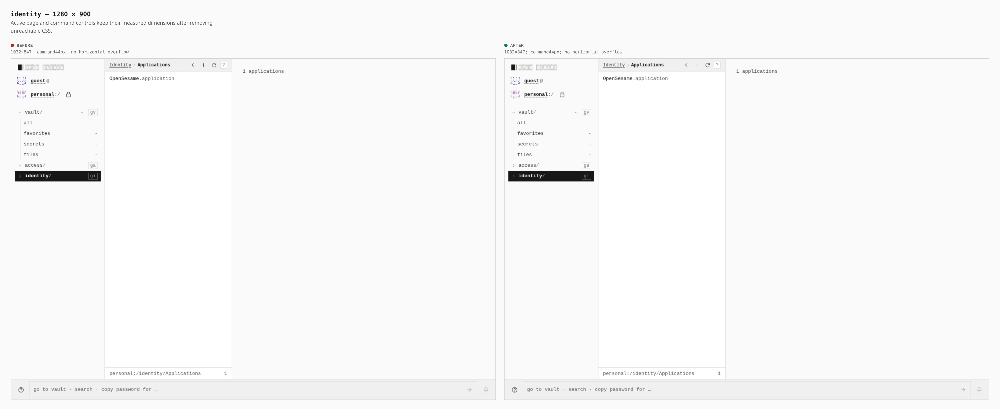
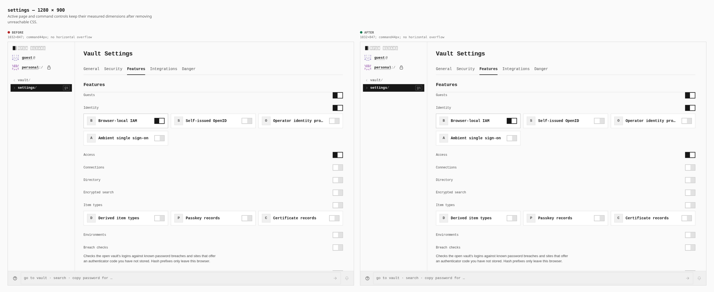
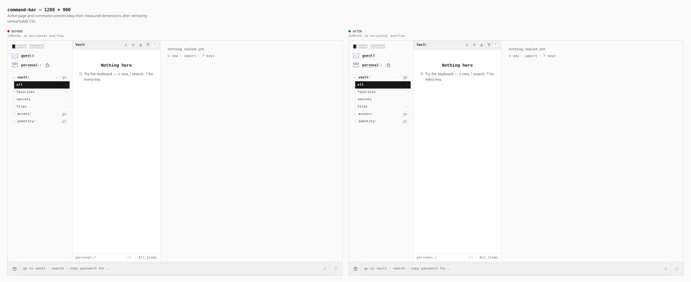
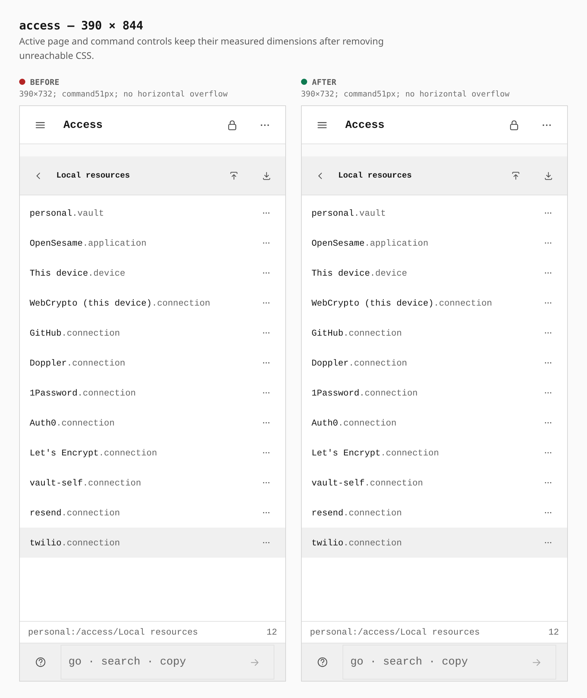
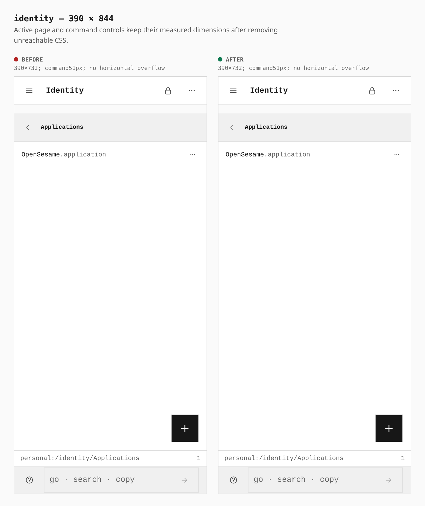
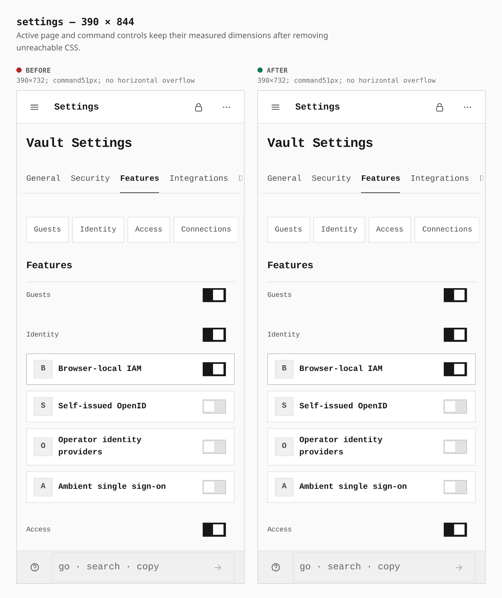
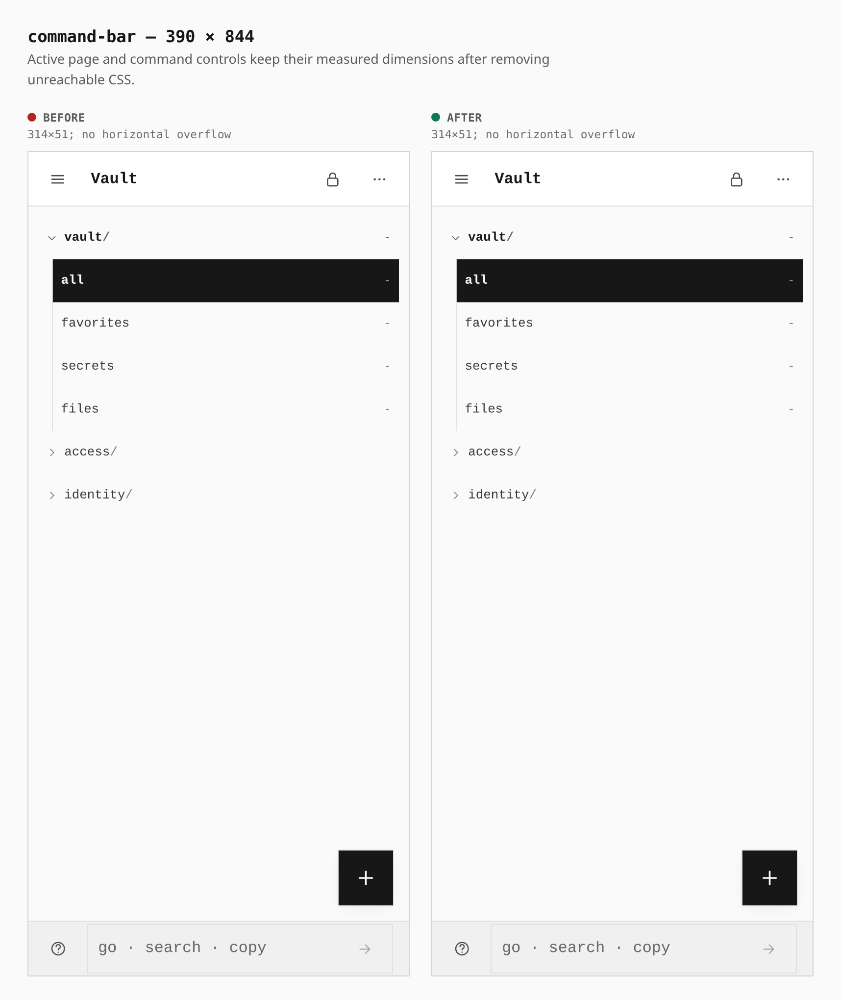

# Unreachable CSS cleanup

Two real production builds of the signed stack: base `fbe2d2a73cccc3db1d5b034967f87e90c414d36d` and cleaned `699cb090b0592ae127c5246a23ecc755519ec273`. Both use the dedicated-origin static PWA profile. The same PIN-vault journey opens Local resources, Applications, Features and Vault at 1280×900 and 390×844. No provider account, app backend, browser extension, host process or staged DOM is involved.

The normal production bundle drops from **188,510 to 185,220 CSS bytes**, below the unchanged 185,344-byte cap by 124 bytes. JavaScript, compressed JavaScript, total size and the strict capability graph also pass. Separate hardened profile entry-bundle failures remain open; this is not an all-CI-green claim.

Every paired browser measurement is identical; no horizontal overflow occurs. Desktop main panels measure 1032×847 and command controls 1184×44. Phone panels measure 390×732 and command controls 314×51. The Vault uses its own split view; its footer measurement is the command control. The dormant tab components are not rendered: this change removes their unreachable rules and other globally unused selectors without modifying active styles.

Only composed sheets are committed. The journey and machine-readable measurements live beside them. The routes are actual supported views, including Identity's `?view=service-accounts` selection.

## Local resources — 1280px

1032×847 panel; 1184×44 command, unchanged before→after; no horizontal overflow.

## Applications — 1280px

1032×847 panel; 1184×44 command, unchanged before→after; no horizontal overflow.

## Features — 1280px

1032×847 panel; 1184×44 command, unchanged before→after; no horizontal overflow.

## Vault command control — 1280px

1184×44 command, unchanged before→after; no horizontal overflow.

## Local resources — 390px

390×732 panel; 314×51 command, unchanged before→after; no horizontal overflow.

## Applications — 390px

390×732 panel; 314×51 command, unchanged before→after; no horizontal overflow.

## Features — 390px

390×732 panel; 314×51 command, unchanged before→after; no horizontal overflow.

## Vault command control — 390px

314×51 command, unchanged before→after; no horizontal overflow.

