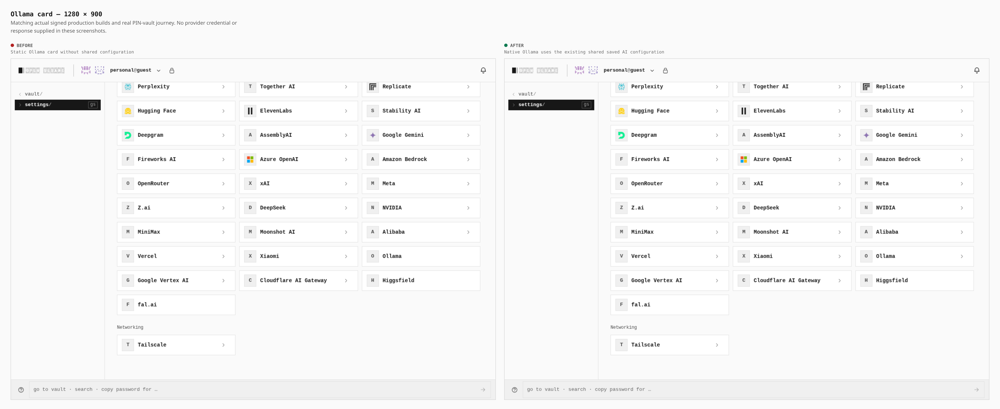
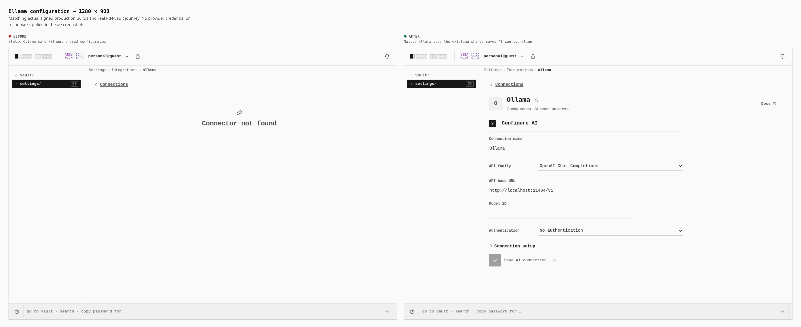
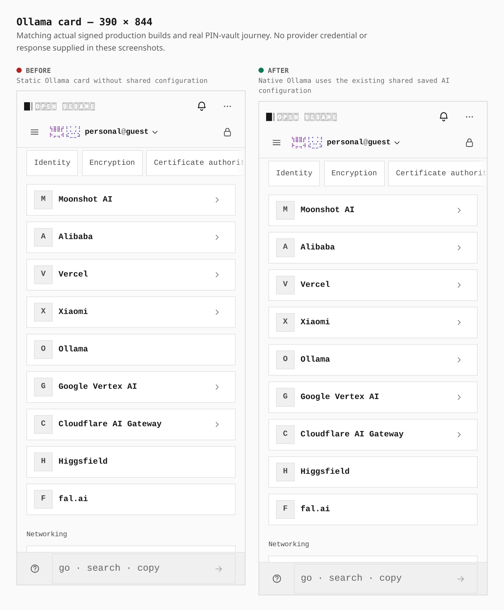
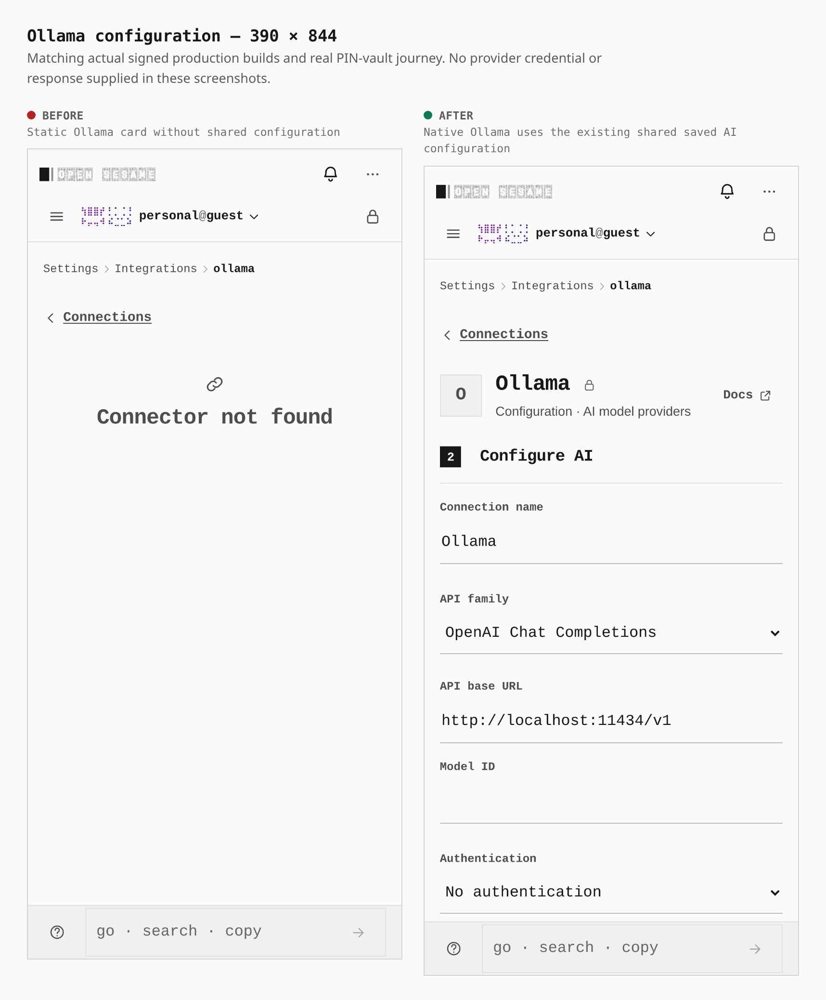

# Ollama shared configuration

The existing Ollama card now opens the same saved AI configuration used by native and BYO providers. Defaults use OpenAI Chat Completions at `http://localhost:11434/v1` without authentication. Operators supply their model and can configure another endpoint and API-key authentication.

Matching actual signed production builds and the same real PIN-vault journey at 1280×900 and 390×844 show the configuration link count changing from zero to one and the shared form count from zero to one. BYO AI remains first. Each screen has one main region and no horizontal overflow. The form measures 640×445 CSS pixels on desktop and 358×580 on phone.

Before: signed `35da37457f447ca2d3aabe4a7a6a22d0cfcb7c66`. After: signed `979caf304c4b13fca55ad699798a61298a79b3ca` (PR #1857). Both pass unchanged bundle budgets and the strict capability graph. Exact tree, compiled HTML, receipt and capture identities are in [the build proof](paired-build-proof.json).

Reproduce the screenshots with `capture-evidence.mjs capture before/after` and [the journey](ollama-shared-config.journey.json), using each matching `EVIDENCE_DIST` and the installed `PLAYWRIGHT_CHROMIUM`. Then run `capture-evidence.mjs compose`.

Screenshots supply no provider responses or credentials. The 166 canonical owning/regression cases and 32 producer/completion cases passed separately. The actual desktop browser run completed ten UI checks but failed the final audit of two ordinary SSE request aborts and a verification-only ledger mismatch. The phone functional run remains pending. The shared credential-edit-during-verification defect is fixed separately in PR #1858; these screenshots describe PR #1857 and do not establish that fix.
