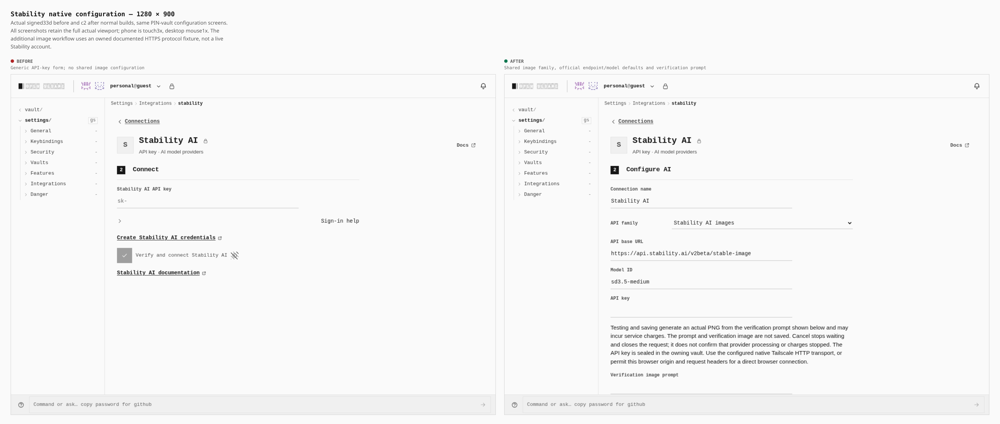
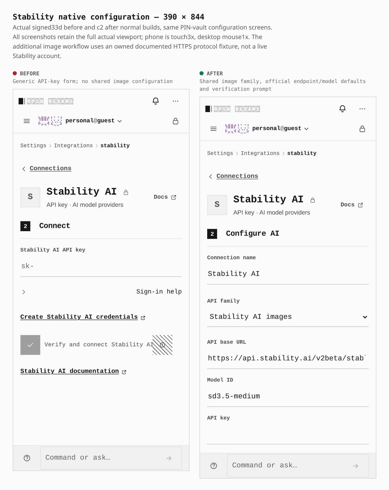
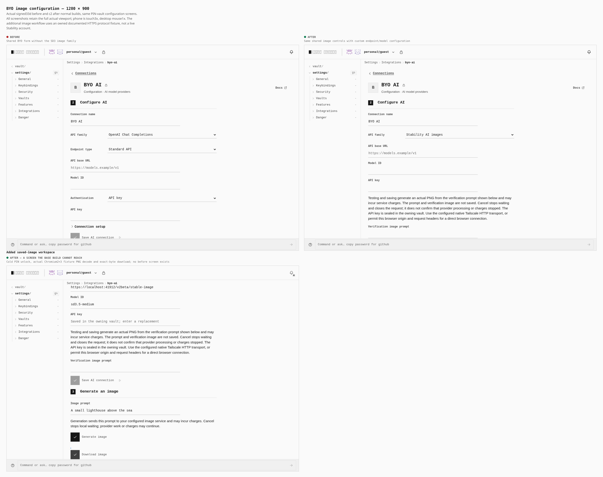
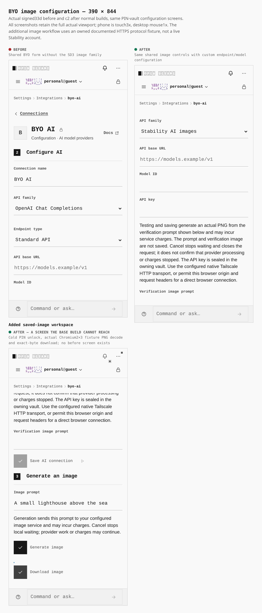

# Stability native and BYO image configuration

Stability now uses the same saved AI form as BYO, with the official SD3 endpoint and model defaults. BYO exposes the same image protocol for custom endpoints. Saved connections generate a PNG, preview it locally and download its original bytes.

Two actual signed normal builds show the same configuration screens at 1280×900 desktop and 390×844 phone. The native page changes from zero shared forms to one; BYO keeps one shared form and gains the image family and verification prompt. Every measured form control fits its viewport, with no horizontal overflow. Phone controls retain 44px targets. BYO remains the first AI option.

The phone BYO after form is naturally scrolled after API-family selection; its before capture retains the header. Both are complete viewports, so this is a configuration comparison rather than a same-scroll pixel comparison. No crop, DOM staging or recapture was used.

The workspace rows are explicitly added screens; no corresponding before screen exists. These are complete actual viewport captures, composed with the unchanged canonical evidence tool. No screenshot is a mockup or cropped to hide controls. The tiny generated image is the owned fixture's actual 2×3 PNG, not a live hosted artwork result.

Before: signed `33d8513793cbf2a6d647363230e15b67d0733917`. After: signed `c2b820991b5877cdf4bea298c928d81a7f41b074`, including shared UI activation in #1864 and completed-response cleanup fixes in #1866/#1867. Normal builds passed in 105.24s and 101.62s. Unchanged bundle and strict-graph gates passed; gzip is 2233/2235KiB before and 2235/2235KiB after.

All four final native/BYO × desktop/phone browser runs passed 33 checks each. They used the ordinary PIN vault, Test and Save, cold unlock with encrypted credential custody, real Chromium Image.decode and exact-byte PNG downloads. Each run completed five ordinary HTTP exchanges and proved five 250ms-held bodies physically closed in under2s on caller cancellation, route change, credential/row replacement, vault lock and connection removal. No unarmed browser/console/HTTP errors or forced cleanup occurred. Credential replacement also changes the row revision; it is not an isolated token-only test.

Native checks preserved the exact `https://api.stability.ai` URL, TLS SNI and Host while Chromium mapped the host to an owned TLS stand-in. BYO used its configured owned HTTPS endpoint. This proves the documented browser protocol and PWA consumer with an independent fixture; it does not claim a live Stability account, provider CORS deployment, hosted billing or stopping provider-side work. There was no application backend, extension or host CLI.

Exact build/tree/HTML identities, measurements, raw capture/composition hashes, ordinary request/body joins, cancellation times and retained failed attempts are in [the paired build proof](paired-build-proof.json). Earlier CSP-proof, obsolete-observer, failed-response-wait and real mobile response failures remain recorded as failures. A root mistyped-hash preflight is recorded separately because no browser launched.

[The configuration journey](stability-shared-image.journey.json) uses existing PIN, Features, route and field-selection helpers for the matching forms. Reproduce those configuration captures with `capture-evidence.mjs capture before/after`, the matching `EVIDENCE_DIST`, and the installed Chromium, then compose. The added workspace images come from the separate bounded functional journey described in that file and proved above; configuration-only capture does not recreate its owned provider fixture or establish inference.

This gallery covers Stability image roads. The separately retained ordinary Ollama SSE acceptance failure remains open; these image results do not close it.
